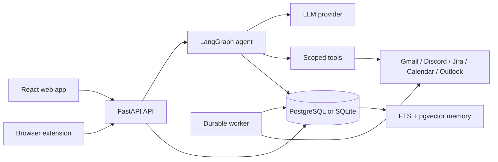

# Mondaiy — AI work navigator

Mondaiy is a personal work assistant that brings together messages, email,
calendar events, tasks and long-term memory. It uses a scoped LangGraph agent
to answer questions, retrieve evidence from connected sources, extract
actionable work and prepare user-approved actions.

The repository contains the FastAPI backend, LangGraph agent, connector
pipeline, PostgreSQL/SQLite data layer, React web app, browser extension and
test suites.

> Status: active MVP / pilot project. Some integrations are opt-in and require
> provider OAuth credentials.

## Highlights

- Ask questions across Gmail, Discord, Jira, Outlook and Calendar.
- Generate daily briefs and identify actionable work from source messages.
- Preserve source evidence, links, timestamps and provenance.
- Resolve deadlines and assignees before creating task proposals.
- Use long-term memory with PostgreSQL FTS and optional pgvector retrieval.
- Require approval before task/calendar side effects.
- Stream agent progress and responses over Server-Sent Events (SSE).
- Run locally with SQLite or as a Docker stack with PostgreSQL, Redis and MinIO.

## Architecture



Detailed diagrams and Gate 2 evaluation evidence:

All diagrams below are the Gate 2 snapshot. Open an image from its link.

### Gate 2 diagrams

- [Components overview](docs/projects/gates/gate-2/diagram/components/overview.png)
- [Components flow](docs/projects/gates/gate-2/diagram/components/flow.png)
- [Agent flow](docs/projects/gates/gate-2/diagram/agent_flow/agent_flow.png)
- [Data flow overview](docs/projects/gates/gate-2/diagram/data_flow/overview.png)
- [Full data flow](docs/projects/gates/gate-2/diagram/data_flow/full.png)
- [Sync data flow](docs/projects/gates/gate-2/diagram/data_flow/sync.png)
- [Task data flow](docs/projects/gates/gate-2/diagram/data_flow/task.png)
- [Agent data flow](docs/projects/gates/gate-2/diagram/data_flow/agent.png)
- [Brief data flow](docs/projects/gates/gate-2/diagram/data_flow/brief.png)
- [Action data flow](docs/projects/gates/gate-2/diagram/data_flow/action.png)
- [API contact](docs/projects/gates/gate-2/diagram/contact/api_contact.png)
- [Intent registry](docs/projects/gates/gate-2/diagram/contact/intent_reg.png)
- [Agent schema](docs/projects/gates/gate-2/diagram/schema/agent_schema.png)
- [Tool schema](docs/projects/gates/gate-2/diagram/schema/tool_schema.png)
- [Database ERD](docs/projects/gates/gate-2/diagram/schema/ERD.png)

### Gate 2 eval evidence

- [Gate 2 smoke, node, graph flow and coverage report](docs/projects/gates/gate-2/eval_evidence/GATE-2-SMOKE-TEST-REPORT.md)
- [Filter golden dataset report](docs/projects/gates/gate-2/eval_evidence/FILTER-GOLDEN-DATASET-REPORT.md)
- [Output versus expected response review](docs/projects/gates/gate-2/eval_evidence/output_vs_expect%20response.md)
- [Recent 10 question traces (JSON)](docs/projects/gates/gate-2/eval_evidence/recent_10_question_traces.json)
- [Gate 2 manifest](docs/projects/gates/gate-2/README.md)

### Gate 3 evidence

- [Test cases (MondAIy)](docs/projects/gates/gate-3/%5BMondAIy%5D_TestCases%20.xlsx)
- [SDD](docs/projects/gates/gate-3/mondaiy-sdd.pdf)
- [SRS](docs/projects/gates/gate-3/mondaiy-srs.pdf)
- [STD](docs/projects/gates/gate-3/mondaiy-std.pdf)
- [Weekly logs](docs/projects/gates/gate-3/weekly_log_mondaiy.pdf)
- [Docs](docs/projects/gates/gate-3/mondaiy_docs.pdf)

## Repository layout

```text
src/
  agents/       LangGraph agent, pipeline and tools
  api/          FastAPI routes and authentication
  connectors/   Gmail, Google Calendar, Discord, Jira and Outlook adapters
  models/       SQLAlchemy models and Pydantic API schemas
  services/     LLM, memory, retrieval, OAuth and domain services
  main.py       FastAPI application entry point
  worker.py     Durable run worker and scheduled background loops
client/
  web-app/      React + Vite web application
  extension/    WXT browser extension
tests/          Backend, API, agent, connector and service tests
docs/           Architecture, ADRs, product and operational documentation
scripts/        Setup, migration, import and quality scripts
```

## Requirements

- Python 3.11+
- Git
- PostgreSQL 16 with pgvector for production-like retrieval, or SQLite for a
  lightweight local setup
- Redis and MinIO when using the full Docker stack
- Node.js 20+ and npm for the web app

## Quick start — local backend

### 1. Clone and create a virtual environment

```bash
git clone <your-repository-url>
cd P-004

python3.11 -m venv .venv
# Linux/macOS/Git Bash
source .venv/bin/activate
# Windows PowerShell
# .venv\Scripts\Activate.ps1
```

### 2. Install dependencies and configure environment

```bash
python -m pip install --upgrade pip
pip install -r requirements.txt
cp .env.example .env                 # PowerShell: Copy-Item .env.example .env
```

For the fastest local start, keep the default SQLite URL and set at least one
LLM key in `.env`:

```dotenv
DATABASE_URL=sqlite:///./data/app.db
OPENROUTER_API_KEY=your-openrouter-key
MODEL_NAME=inclusionai/ling-3.0-tiny:free
APP_SECRET_KEY=generate-a-long-random-secret
```

Generate secrets with:

```bash
python -c "import secrets; print(secrets.token_urlsafe(48))"
python -c "from cryptography.fernet import Fernet; print(Fernet.generate_key().decode())"
```

### 3. Start the API

```bash
python -m uvicorn src.main:app --reload --host 0.0.0.0 --port 8000
```

Useful endpoints:

- Swagger UI: <http://localhost:8000/docs>
- OpenAPI JSON: <http://localhost:8000/openapi.json>
- Health: <http://localhost:8000/health>
- Agent status: <http://localhost:8000/api/v1/status>

### 4. Start the web app

In a second terminal:

```bash
cd client/web-app
npm install
cp .env.example .env.local       # PowerShell: Copy-Item .env.example .env.local
npm run dev
```

Open <http://localhost:5173>. Set `VITE_API_URL=http://localhost:8000` in
`client/web-app/.env.local` if it is not already present.

### 5. Start the worker for sync runs

The API can enqueue a run, but the worker performs the durable pipeline:

```bash
python -m src.worker
```

With the default `EMBED_WORKER=true`, the API process also runs an embedded
worker. Do not start duplicate workers unless you intentionally want multiple
consumers.

## Quick start — Docker Compose

Docker Compose starts PostgreSQL with pgvector, Redis, MinIO, backend and a
separate worker:

```bash
cp .env.example .env                 # PowerShell: Copy-Item .env.example .env
# Edit .env: add APP_SECRET_KEY and an LLM key at minimum.
docker compose up -d --build
docker compose ps
docker compose logs -f backend worker
```

| Service | Local address | Purpose |
| --- | --- | --- |
| Backend | <http://localhost:8000> | API and agent |
| PostgreSQL | `localhost:5433` | Relational data, FTS, pgvector |
| Redis | <redis://localhost:6379/0> | Rate-limit/coordination support |
| MinIO API | <http://localhost:9000> | Object storage |
| MinIO console | <http://localhost:9001> | Local storage administration |

Stop the stack with `docker compose down`. Add `-v` only when you intentionally
want to remove local database/storage volumes.

## Environment variables

`.env.example` is the complete reference. The table below lists variables
normally needed to run the application.

### Application and database

| Variable | Required | Example | Description |
| --- | --- | --- | --- |
| `APP_ENV` | No | `development` | `development`, `test` or `production` |
| `APP_PORT` | No | `8000` | API port |
| `APP_TIMEZONE` | No | `Asia/Ho_Chi_Minh` | Display and relative-time timezone |
| `CORS_ORIGINS` | Browser | `http://localhost:5173` | Comma-separated frontend origins |
| `DATABASE_URL` | Yes | `sqlite:///./data/app.db` | SQLAlchemy database URL |
| `REDIS_URL` | Docker/optional | `redis://localhost:6379/0` | Coordination store |
| `APP_SECRET_KEY` | Production | random secret | JWT and OAuth state signing |
| `TOKEN_ENCRYPTION_KEY` | Production | Fernet key | Encrypts provider tokens at rest |

For Docker, use `DATABASE_URL=postgresql://app:app@db:5432/ai20k` and
`REDIS_URL=redis://redis:6379/0`.

### LLM and retrieval

| Variable | Required | Description |
| --- | --- | --- |
| `OPENROUTER_API_KEY` | Recommended | Primary LLM and embedding provider key |
| `OPENROUTER_BASE_URL` | No | Defaults to `https://openrouter.ai/api/v1` |
| `GROQ_API_KEY` | Optional | Provider fallback |
| `LLM_PROVIDER` | No | `openrouter`, `groq` or `openai` |
| `LLM_PROVIDERS` | No | Provider priority, e.g. `openrouter,groq` |
| `MODEL_NAME` | No | Chat model identifier |
| `LLM_ROUTING_ENABLED` | No | Capability-aware candidate routing |
| `WORK_TOOL_CANDIDATES` | No | Tool-capable provider/model candidates |
| `WORK_RESPONSE_CANDIDATES` | No | Response-generation candidates |
| `EMBEDDING_MODEL` | Optional | Embedding model for chunks and memory |
| `MEMORY_SEMANTIC_RECALL_ENABLED` | No | Enable pgvector memory recall |
| `WEB_SEARCH_ENABLED` | No | Enable web search tool |
| `TAVILY_API_KEY` | Optional | Required when web search is enabled |

If no LLM key is configured, the API can start but model-backed agent requests
will not produce a real answer. `MOCK_LLM=true` is intended for tests and
pipeline development.

### Provider connections

| Provider | Variables |
| --- | --- |
| Google/Gmail | `GOOGLE_CLIENT_ID`, `GOOGLE_CLIENT_SECRET`, `GOOGLE_REDIRECT_URI`, `GOOGLE_SCOPES` |
| Discord | `DISCORD_CLIENT_ID`, `DISCORD_CLIENT_SECRET`, `DISCORD_BOT_TOKEN` |
| Jira | `JIRA_CLIENT_ID`, `JIRA_CLIENT_SECRET`, `JIRA_SCOPES` |
| Outlook | `MICROSOFT_CLIENT_ID`, `MICROSOFT_CLIENT_SECRET`, `MICROSOFT_TENANT`, `MICROSOFT_SCOPES` |
| Telegram | `TELEGRAM_BOT_TOKEN`, `TELEGRAM_BOT_USERNAME`, `TELEGRAM_WEBHOOK_SECRET` |
| Program calendar | `PHOENIX_ICS_FEED_URL`, `PROGRAM_COHORT_SLUG`, `PROGRAM_CALENDAR_AUTO_IMPORT_ENABLED` |

Never commit OAuth secrets, provider tokens, Fernet keys, JWT secrets or real
user data. Keep them in `.env`, a secret manager or your deployment platform.

### Object storage and notifications

| Variable | Description |
| --- | --- |
| `MINIO_ENDPOINT` | Backend endpoint, e.g. `localhost:9000` or `minio:9000` |
| `MINIO_PRESIGN_ENDPOINT` | Endpoint reachable by the browser |
| `MINIO_ACCESS_KEY`, `MINIO_SECRET_KEY` | MinIO credentials |
| `MINIO_BUCKET` | Object bucket name |
| `WEB_PUSH_ENABLED` | Enable Web Push delivery |
| `VAPID_PUBLIC_KEY`, `VAPID_PRIVATE_KEY`, `VAPID_SUBJECT` | Web Push credentials |
| `TELEGRAM_DELIVERY_ENABLED` | Enable outbound Telegram reminders |

## Sample queries

After signing in and connecting at least one source, try these in the web app:

```text
Tóm tắt ngày hôm nay của tôi.
```

```text
Tóm tắt tuần này, ưu tiên các việc sắp đến hạn và các cuộc họp quan trọng.
```

```text
Tìm các email hoặc tin nhắn cần tôi phản hồi trong hôm nay.
```

```text
Các công việc nào của tôi đang bị trễ hoặc chưa hoàn thành?
```

```text
Thêm công việc vào lịch cho tôi: gửi báo cáo cho mentor lúc 17:00 hôm nay.
```

```text
Tạo một task: kiểm tra lại proposal trước thứ Sáu, hạn chót 16:00.
```

For write requests, the agent creates a draft, asks for missing/ambiguous
fields and waits for explicit approval before writing a task or calendar event.
It must not invent a deadline or silently perform an external side effect.

## API examples

Register a local user:

```bash
curl -X POST http://localhost:8000/api/v1/auth/register \
  -H 'Content-Type: application/json' \
  -d '{"email":"you@example.com","password":"change-me-now","display_name":"Your Name"}'
```

Ask the agent after obtaining a bearer token:

```bash
curl -X POST http://localhost:8000/api/v1/chat \
  -H "Authorization: Bearer $ACCESS_TOKEN" \
  -H 'Content-Type: application/json' \
  -d '{"message":"Tóm tắt ngày hôm nay của tôi"}'
```

Stream a response:

```bash
curl -N -X POST http://localhost:8000/api/v1/chat/stream \
  -H "Authorization: Bearer $ACCESS_TOKEN" \
  -H 'Content-Type: application/json' \
  -d '{"message":"Tóm tắt tuần này của tôi"}'
```

The stream emits `progress`, `token`, `done` and `error` events. Conversation
endpoints persist turns; `/chat` and `/chat/stream` are stateless entry points.

## Testing and quality checks

Backend:

```bash
pytest tests/ -v
ruff check src/ tests/
mypy src/
```

Frontend:

```bash
cd client/web-app
npm test
npm run build
npm run lint
```

Browser extension:

```bash
cd client/extension
npm install
npm test
npm run compile
npm run build
```

Code changes require tests. Frontend changes should also pass typecheck/build/
lint. PostgreSQL-specific memory/pgvector tests run when a test PostgreSQL
instance is available; SQLite is the default lightweight test backend.

## Common troubleshooting

### API starts but agent requests fail

Check the provider key, model name, provider base URL and `LLM_PROVIDER`. Use
`MOCK_LLM=true` only to isolate application wiring from provider configuration.

### Sync stays `queued`

The API enqueues runs; a worker executes them. Run `python -m src.worker`, or
use `docker compose up -d worker`. Check `docker compose logs -f worker`.

### OAuth returns `redirect_uri_mismatch`

`APP_PUBLIC_URL`, provider redirect URI settings and the callback URL must match
exactly, including scheme, host, port and path.

### Vector retrieval is unavailable

Use PostgreSQL with `pgvector/pgvector:pg16` and enable the extension. The
application can fall back to non-vector retrieval when semantic recall is
disabled or unavailable.

### MinIO upload URL does not work in the browser

Use `MINIO_ENDPOINT=minio:9000` for backend-to-container traffic and
`MINIO_PRESIGN_ENDPOINT=localhost:9000` for a local browser.

## Documentation map

- [Architecture](docs/projects/engineering/architecture.md)
- [Gate 2 diagrams and evaluation evidence](docs/projects/gates/gate-2/README.md)
- [Testing guide](docs/guide/testing/_index.md)
- [Setup guide](docs/guide/setup/_index.md)
- [Deployment](DEPLOY.md)
- [Security policy](SECURITY.md)
- [Project documentation index](docs/projects/README.md)

## Contributing

1. Create a focused branch.
2. Make the smallest change that solves the problem.
3. Add or update tests for behavior changes.
4. Run relevant test, lint, typecheck and build commands.
5. Update documentation when setup, API, configuration or user behavior changes.
6. Open a pull request with context, validation commands and known limitations.

Please do not include secrets, raw email/message content, private transcripts or
production database files in commits, issues or pull requests.

## License

See [SECURITY.md](SECURITY.md) and the repository license/distribution terms.
