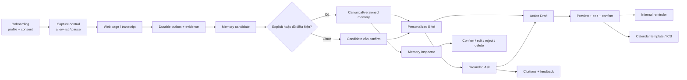
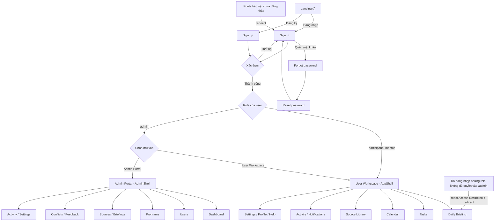

# UI flow — mondaiy

| Thuộc tính | Giá trị |
| --- | --- |
| Status | Superseded (một phần) |
| Owner | Lê Thị Yến Nhi (UI/UX Lead) |
| Reviewers | PM, Technical Lead, PO/QC |
| Last updated | 2026-08-04 |
| Source of truth | Không — nguồn chuẩn cho UI flow P0 là [Wireframe & UI flow](wireframe-ui-flow.md) |
| Superseded by | [Wireframe & UI flow](wireframe-ui-flow.md) cho phần product surface và P0 flow |
| Related | [1-page brief](../product/one-page-brief.md) · [PRD](../product/prd.md) · [ADR-002](../engineering/adr/adr-002-connector-first-p0-scope.md) · [Memory lifecycle](../engineering/memory-lifecycle.md) · [Mermaid source](ui-flow.mmd) · [Web app flow](web-app-ui-flow.mmd) |

> **Đọc file này như ghi chép lịch sử, không phải nguồn chuẩn.** Mục 1–2 mô tả
> Chrome side panel là P0 surface — điều này đã bị
> [ADR-002](../engineering/adr/adr-002-connector-first-p0-scope.md) (Approved)
> thay thế: P0 là web app, dữ liệu chỉ vào qua connector người dùng chủ động kết
> nối, extension không thu thập nội dung trang đang mở.
>
> Nguồn chuẩn hiện tại cho UI flow, wireframe và screen state là
> [`wireframe-ui-flow.md`](wireframe-ui-flow.md).
>
> Phần vẫn còn giá trị tham chiếu: memory state (explicit/confirmed/candidate/
> disputed), UX guardrail và mục 13 về `client/web-app`. Việc có mở lại web
> capture cho extension hay không là **OD-07** trong
> [PRD](../product/prd.md), chưa chốt.

## 1. Information architecture

Chrome side panel là product surface P0:

1. **Brief** — điều cần chú ý và source receipt.
2. **Ask** — global/contextual Q&A.
3. **Memory** — explicit, confirmed, candidate, disputed.
4. **Actions** — drafts, reminders và Calendar handoffs.
5. **Sources & Settings** — capture status, consent, allow-list, sync và retention.

Program Navigator xuất hiện như workspace/vertical đang active, không phải một ứng dụng tách khỏi mondaiy.

## 2. End-to-end flow



## 3. Onboarding và consent

```text
┌──────────────────────────────────────────────────────┐
│ Contextual                                           │
│ Trợ lý hiểu context bạn cho phép                     │
├──────────────────────────────────────────────────────┤
│ Bạn muốn được hỗ trợ điều gì?                        │
│ Vai trò   [AI Engineer________________________]       │
│ Mục tiêu  [Hoàn thành cohort đúng hạn_________]       │
│ Timezone  [Asia/Ho_Chi_Minh ▾]                       │
│                                                      │
│ Nguồn context                                        │
│ ● Domain cho phép      Khuyên dùng cho pilot         │
│ ○ Toàn bộ web          Chỉ internal dogfood          │
│                                                      │
│ [Xem dữ liệu được thu thập]                          │
│ [Chọn domain]                         [Tiếp tục]      │
└──────────────────────────────────────────────────────┘
```

Rules:

- Permission browser chỉ được yêu cầu sau user gesture.
- Copy phải nói rõ hệ thống không đọc password/cookie/system pages.
- Nếu từ chối permission, user vẫn dùng `Lưu trang này` và `Import transcript`.
- Input/draft capture không bật mặc định.

## 4. Capture status

```text
┌──────────────────────────────────────────────────────┐
│ ● Đang ghi nhớ · 3 domain                  [Tạm dừng]│
├──────────────────────────────────────────────────────┤
│ Trang hiện tại: docs.example.com                     │
│ Đã lưu phiên bản mới · 10:42                         │
│                                                      │
│ Hôm nay                                              │
│ 24 trang quan sát · 7 phiên bản mới · 1 transcript   │
│ Đồng bộ lần cuối: 10:43                              │
│                                                      │
│ ⚠ 1 nguồn chưa đồng bộ · sẽ thử lại                  │
│ [Xem biên lai] [Lưu trang này] [Import transcript]   │
└──────────────────────────────────────────────────────┘
```

States bắt buộc:

- Active, paused, permission denied.
- Offline/queued, syncing, synced, retrying, failed.
- Duplicate observation và new document version.
- Partial/unknown coverage.

## 5. Daily Brief

```text
┌──────────────────────────────────────────────────────┐
│ Chào An · Program Navigator · Tuần 3/6               │
│ Brief 02/08 · Context cập nhật 07:30                 │
├──────────────────────────────────────────────────────┤
│ ⚠ CẦN XỬ LÝ                                          │
│ Proposal Gate 1 · còn 16 giờ · liên quan role của bạn│
│ Nguồn cam kết · chắc chắn                            │
│ [Mở nguồn] [Hỏi] [Nhắc tôi] [Thêm vào lịch]         │
├──────────────────────────────────────────────────────┤
│ 📌 THAY ĐỔI                                          │
│ Meeting nói deadline 03/08; tài liệu vẫn ghi 02/08   │
│ [Meeting · 18:42] [Tài liệu · phiên bản 4]           │
├──────────────────────────────────────────────────────┤
│ ✅ VIỆC CỦA BẠN                                      │
│ □ Review PRD                 Hôm nay                  │
│ □ Chốt API contract          Đang chờ Tech Lead      │
├──────────────────────────────────────────────────────┤
│ 🧠 CONTEXT LIÊN QUAN                                 │
│ Bạn đọc lại 3 nguồn về agent memory trong hai ngày   │
│ Nhãn: suy ra từ hoạt động · [Xem vì sao]             │
├──────────────────────────────────────────────────────┤
│ 📄 BIÊN LAI                                          │
│ 4 domain + 1 transcript · 18:00–07:30                │
│ Coverage: PARTIAL · Calendar chưa kết nối            │
└──────────────────────────────────────────────────────┘
```

Rules:

- Fact/candidate phải có nhãn khác nhau.
- “Không có gì mới” vẫn hiển thị pending action, upcoming deadline và receipt.
- Coverage partial/unknown nằm trước recommendation có thể bị ảnh hưởng.
- Không dùng chỉ màu để phân biệt status.

## 6. Grounded Ask

```text
┌──────────────────────────────────────────────────────┐
│ ← Brief                  Hỏi Contextual              │
│ Context: Proposal Gate 1                             │
├──────────────────────────────────────────────────────┤
│ Bạn: Deadline hiện tại là ngày nào?                  │
│                                                      │
│ AI: Có hai phiên bản chưa được đồng bộ:              │
│ • Meeting ngày 01/08 nói 03/08, 23:59 ICT. [1]      │
│ • Tài liệu chương trình vẫn ghi 02/08. [2]           │
│ Nguồn cam kết hiện chưa được admin xác nhận lại.     │
│                                                      │
│ [1 Meeting · 18:42] [2 Tài liệu · v4]               │
│ [Nhắc tôi] [Thêm vào lịch]                           │
│ [Hữu ích] [Sai] [Thiếu nguồn]                        │
└──────────────────────────────────────────────────────┘
```

Abstention:

```text
Mình chưa tìm thấy câu trả lời trong context đã lưu.
Đã tìm: 3 domain, 1 transcript, 0 Calendar.
Bạn có thể import nguồn liên quan hoặc hỏi mentor.
```

Mỗi factual block có citation riêng. Citation mở source mà user có quyền tại thời điểm mở.

## 7. Source detail

```text
┌──────────────────────────────────────────────────────┐
│ ← Quay lại                       Evidence             │
├──────────────────────────────────────────────────────┤
│ Meeting: Sprint planning · 01/08                     │
│ Speaker: Mentor Hạnh · 18:42–18:55                   │
│                                                      │
│ “Deadline được chuyển sang 03/08 lúc 23:59...”       │
│                                                      │
│ Captured: 01/08 19:04 · Transcript revision 3        │
│ Source level: Context · Trạng thái: final             │
│ [Mở transcript] [Xem memory được tạo]                │
└──────────────────────────────────────────────────────┘
```

Web evidence hiển thị canonical URL, observed time, document version, excerpt và link mở trang. Source version cũ vẫn xem được khi dùng để giải thích conflict.

## 8. Memory Inspector

```text
┌──────────────────────────────────────────────────────┐
│ Memory                                               │
│ [Explicit] [Confirmed] [Candidates] [Disputed]       │
├──────────────────────────────────────────────────────┤
│ CANDIDATE                                            │
│ “Bạn đang quan tâm đến agent memory”                 │
│ Suy ra từ 5 trang trong 3 ngày · confidence 0.78     │
│ [Xem evidence] [Xác nhận] [Sửa] [Không đúng]         │
├──────────────────────────────────────────────────────┤
│ DISPUTED                                             │
│ Deadline Proposal Gate 1                             │
│ 02/08 — tài liệu v4                                  │
│ 03/08 — meeting 18:42                                │
│ [So sánh] [Để nguyên]                                │
└──────────────────────────────────────────────────────┘
```

Rules:

- Candidate không được copy như confirmed fact.
- Edit tạo memory version mới và giữ audit.
- Delete/revoke phải giải thích ảnh hưởng retrieval/retention.
- Không cho user “confirm” fact thuộc source authority của admin theo cách âm thầm thay source-of-truth; confirmation chỉ ảnh hưởng personal memory.

## 9. Action Draft

```text
┌──────────────────────────────────────────────────────┐
│ ← Quay lại                   Thêm vào lịch            │
├──────────────────────────────────────────────────────┤
│ Tiêu đề  [Nộp Proposal Gate 1________________]       │
│ Bắt đầu  [03/08/2026] [22:30]                        │
│ Kết thúc [03/08/2026] [23:00]                        │
│ Timezone [Asia/Ho_Chi_Minh ▾]                        │
│ Ghi chú  [Nguồn meeting + tài liệu conflict___]       │
│                                                      │
│ ⚠ Deadline đang có hai phiên bản. Bạn đang chọn 03/08│
│ [Meeting · 18:42] [Tài liệu · v4]                    │
│                                                      │
│ [Hủy] [Lưu reminder] [Tải ICS] [Mở Calendar draft]  │
└──────────────────────────────────────────────────────┘
```

Rules:

- Field mơ hồ để trống và focus vào field bắt buộc.
- Không tạo reminder/handoff trước confirm.
- Copy P0 là `Đã mở bản nháp lịch`, không phải `Đã thêm vào lịch`.
- Double click/retry dùng idempotency key.
- Source update sau confirm chỉ tạo warning.

## 10. Actions

```text
┌──────────────────────────────────────────────────────┐
│ Actions                                              │
├──────────────────────────────────────────────────────┤
│ ⚠ Nộp Proposal Gate 1 · 03/08 23:59                 │
│ Source đã thay đổi sau khi bạn tạo action            │
│ [Xem thay đổi] [Sửa action] [Giữ nguyên]             │
│                                                      │
│ □ Review PRD · Hôm nay 17:00                         │
│ [Hoàn thành] [Dời giờ] [Hủy]                         │
└──────────────────────────────────────────────────────┘
```

## 11. Settings và data control

Phải có:

- Capture mode và allow-list.
- Pause/resume và ignore domains.
- Meeting imports/connections.
- Retention cho pages/transcripts/conversations.
- Cloud AI toggle/model status.
- Export/delete memory.
- Revoke consent.
- Biên lai nguồn và lỗi sync.

## 12. Accessibility và copy checklist

- Keyboard navigation cho tabs, citations, forms và dialogs.
- Focus không bị mất sau async update.
- Status có icon/text, không chỉ màu.
- Screen-reader label cho capture indicator và confidence.
- Time luôn có timezone khi dùng cho action.
- Text nguyên văn source được giữ trong conflict/detail.
- Không dùng “AI biết bạn thích…” khi memory chỉ là inferred candidate.

## 13. Web app — user & admin surface (Draft, nhánh `ui/ux`)

> **Trạng thái: Draft, chưa merge vào canonical flow ở mục 1–2.** Section này mô
> tả UI đã dựng tại `client/web-app` (React + Vite, route bằng
> `react-router-dom`) trên nhánh `ui/ux`. Nội dung cần PM + Technical Lead
> review trước khi coi là source of truth, vì đây là **material change**
> (thêm một product surface mới ngoài Chrome side panel ở mục 1). Bản UX
> deliverable đầy đủ (design system, screen inventory, usability test plan,
> Figma) cho cùng surface này nằm ở Gate 1 submission,
> `docs/projects/gates/gate-1/03-wireframe-ui-flow.md`.

### 13.1 Vì sao cần chốt trước khi Approved

| Điểm cần chốt | `client/web-app` (nhánh `ui/ux`) | Canonical hiện tại / yêu cầu review |
| --- | --- | --- |
| Product surface | Web app độc lập (marketing site + auth + user workspace + admin portal) | Chrome side panel là P0 (mục 1); Program Navigator là workspace bên trong, không phải app riêng |
| Admin dashboard | Có `/admin` đầy đủ: Users, Programs, Sources, Briefings, Conflicts, Feedback, Activity, Settings | PRD liệt kê "Admin dashboard giám sát hành vi chi tiết" là **non-goal** |
| Quyền xem dữ liệu cá nhân | Chưa định nghĩa rõ admin thấy gì của user trong UI hiện tại | PRD: admin/mentor **không** được xem browsing/Ask history/reminder cá nhân mặc định |
| Data | Toàn bộ trang dùng mock data (`src/data`, `src/stores` — zustand, chưa gọi `src/api`) | — |
| Kiến trúc thư mục | `client/web-app` (Vite root riêng) | `engineering/repository-setup.md` đề xuất `apps/extension`, `services/api`; chưa liệt kê `client/web-app` |

Khuyến nghị: nếu PM/Tech Lead xác nhận `client/web-app` là surface chính thức
(song song hoặc thay thế extension), cần mở ADR mới tại
`../engineering/adr/` đối chiếu với
[ADR-001](../engineering/adr/adr-001-platform-core-program-navigator-vertical.md)
và cập nhật PRD §non-goals + `repository-setup.md`. Nếu chỉ là prototype nội
bộ/demo UI, giữ nguyên Status Draft, không promote phần này thành canonical.

### 13.2 Information architecture đã dựng

- **Marketing** (`/`) — Landing page công khai.
- **Auth** (`/sign-in`, `/sign-up`, `/forgot-password`, `/reset-password`) — công khai.
- **User workspace** (cần đăng nhập, role `participant` / `mentor` / `admin`) —
  Daily Briefing, Tasks, Calendar, Source Library, Activity, Notifications,
  Settings, Profile, Help, Onboarding.
- **Admin portal** (`/admin/*`, cần role `admin`) — Dashboard, Users, Programs
  (+ chi tiết theo id), Sources, Briefings, Conflicts, Feedback, Activity,
  Settings.

### 13.3 Flow điều hướng & role guard



Rules đã implement trong `ProtectedRoute`:

- Chưa đăng nhập truy cập route bảo vệ → redirect `/sign-in`, giữ lại
  location gốc để quay lại sau khi đăng nhập.
- Đã đăng nhập nhưng role không nằm trong `allowedRoles` của route → hiện
  toast "Access Restricted" và redirect về `/briefing`.
- Route không khớp (`*`) → redirect về `/`.

### 13.4 Việc còn thiếu trước khi hết Draft

- Nối `src/stores` sang `src/api` (FastAPI) thay vì mock, đặc biệt
  `useAuthStore` (đang giả lập role/login).
- Bổ sung state rỗng/lỗi/permission-denied cho từng trang admin, theo cùng
  chuẩn empty/partial/conflict/abstain đã áp dụng ở mục 3–11.
- Quyết định phạm vi dữ liệu admin được xem (đối chiếu PRD §5 personas).
- Đồng bộ lại `ui-flow.mmd` (mục 2) nếu quyết định giữ web app làm surface
  chính thức — hiện `ui-flow.mmd` vẫn mô tả flow Program Navigator kiểu cũ
  (Admin tạo Program Frame → ingestion → rule/AI), khác với flow ở mục 2.
