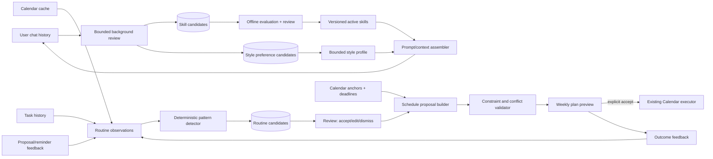

# Kế hoạch P1 — Agent thích ứng: routine, learned skills và phong cách giao tiếp

| Thuộc tính | Giá trị |
| --- | --- |
| Status | Approved for implementation planning — production rollout remains gated |
| Owner đề xuất | PM + Technical Lead + Memory/AI Lead |
| Author | Codex, theo yêu cầu của Thái Hoài An |
| Created | 2026-08-13 |
| Last updated | 2026-08-21 |
| Target | P1 approved for planning; P0 trust boundary remains an implementation prerequisite |
| Source of truth | Có — cho sequencing kỹ thuật của capability này; không thay PRD, ADR hoặc Jira |
| Related | [PRD](../product/prd.md) · [Pilot plan](../product/pilot-plan.md) · [Memory lifecycle](memory-lifecycle.md) · [ADR-007](adr/adr-007-lich-tuong-tac-truc-tiep-va-lop-nhac-viec.md) · [ADR-011](adr/adr-011-tu-dong-dong-bo-nen-va-han-muc-nguon.md) |
| Research reference | [NousResearch/hermes-agent](https://github.com/NousResearch/hermes-agent) |

## Tóm tắt quyết định

- **Kết quả cần tạo ra:** mondaiy nhận ra routine có bằng chứng, học workflow
  lặp lại từ lịch sử chat, và điều chỉnh phong cách giao tiếp trong biên an toàn;
  mọi thay đổi dài hạn đều xem lại, sửa, tắt hoặc rollback được.
- **Cách tiếp cận:** học các pattern `background review → pending suggestion →
  evaluation → explicit accept → activate/version/rollback` từ Hermes Agent,
  nhưng triển khai bằng domain model, permission và audit hiện có của mondaiy.
- **Không làm:** không nhúng toàn bộ Hermes runtime; không train lại model; không
  theo dõi màn hình/lịch sử duyệt web; không tự ghi Calendar; không biến một
  hành vi đơn lẻ thành sở thích chắc chắn; không cho agent tự sửa core identity,
  safety policy, permission, tool allowlist hoặc source-authority rules.
- **Quyết định 2026-08-21:** Thái đã duyệt hướng P1 và yêu cầu bắt đầu lập kế
  hoạch triển khai. Code chỉ bắt đầu sau khi P0 được tích hợp và Slice 0 chốt
  ADR, consent copy, retention, evaluation threshold và feature flags. Production
  rollout vẫn đi qua shadow mode, dogfood và canary gate của §12.

## 1. Vấn đề và outcome

P-004 đã có memory có evidence, Calendar/task, reminder, background worker và
luồng xác nhận hành động. Khoảng trống là chưa có lớp nào:

1. tổng hợp nhiều quan sát thành một routine candidate;
2. phân biệt belief về routine với lịch cụ thể của tuần tới;
3. học có kiểm soát từ accept, edit, snooze, dismiss và completion;
4. tạo lịch tuần mà không đè lên calendar anchor hoặc deadline;
5. tổng hợp các correction/workflow lặp lại trong chat thành skill candidate;
6. phát triển phong cách giao tiếp ổn định mà không làm trôi identity hoặc
   guardrail của agent.

Outcome của P1 không phải “agent biết nhiều hơn”, mà là ba hành vi quan sát được:

- người dùng thấy được vì sao một routine, skill hoặc preference được đề xuất;
- người dùng kiểm soát accept, edit, dismiss, pause, reset và delete;
- skill mới phải qua evaluation trước khi active;
- không có event nào được ghi ra ngoài nếu chưa qua preview và xác nhận;
- thay đổi phong cách không bao giờ mạnh hơn instruction, permission, evidence
  hoặc safety policy.

## 2. Nguyên tắc sản phẩm và ranh giới an toàn

### 2.1. Routine không phải schedule

- **Routine candidate** là belief có cấu trúc, ví dụ: “thường dành 60 phút học
  vào tối thứ Ba”. Nó có evidence, confidence và trạng thái xác nhận.
- **Schedule proposal** là kế hoạch hữu hạn cho một khoảng ngày cụ thể, ví dụ:
  “đặt block học 19:00–20:00 thứ Ba tuần tới”. Nó phải kiểm tra lịch bận và có
  thể khác routine vì tuần đó có xung đột.
- Routine đã accepted không cấp quyền tự động ghi lịch.

### 2.2. Consent theo từng tầng

| Tầng | Default | Quyền người dùng |
| --- | --- | --- |
| Đọc nguồn đã kết nối để phát hiện pattern | Tắt cho capability mới | Opt in/out; revoke dừng quan sát mới |
| Phân tích lịch sử chat để học | Tắt cho capability mới | Chọn phạm vi, xem candidate, exclude/delete conversation |
| Lưu routine candidate | Chỉ lưu candidate có evidence | Xem, sửa, reject, delete |
| Tạo learned skill candidate | Không tự active | Xem evidence/diff/evaluation; accept, sửa hoặc reject |
| Điều chỉnh phong cách giao tiếp | Chỉ allowlist dimension, có confidence | Xem, sửa, khóa, reset từng preference hoặc toàn bộ |
| Dùng routine để dựng lịch tuần | Tắt tới khi user bật | Generate on demand hoặc bật gợi ý định kỳ |
| Ghi Google Calendar | Luôn cần preview + accept | Chọn event và calendar đích; cancel/undo theo ADR-007 |

### 2.3. Invariant không được phá

1. Mọi candidate có ít nhất một evidence reference còn truy cập được.
2. Một quan sát không đủ để promotion routine.
3. Candidate không được diễn đạt như fact đã xác nhận.
4. Reject/dismiss có stable key để không nag lại cùng một đề xuất.
5. Thu hồi consent loại dữ liệu khỏi lần inference kế tiếp.
6. LLM không được quyết định quyền, promotion hoặc thực hiện Calendar write.
7. Assistant output không được dùng làm evidence để tự củng cố belief.
8. Calendar conflict hoặc user bận đột xuất không bị hiểu thành negative
   preference.
9. Core persona, product identity, safety rule, permission và tool policy là
   immutable từ learning loop.
10. Learned skill không được active nếu chưa pass regression/security evaluation.
11. Skill/personality candidate phải trỏ về phát biểu hoặc feedback của user;
    nội dung assistant tự sinh không được tự xác nhận chính nó.
12. Instruction trong chat history và external content luôn là untrusted data
    khi background reviewer đọc lại.
13. Preference mới trong lượt hiện tại thắng preference cũ; explicit user
    correction thắng mọi inference.
14. Người dùng có một thao tác “Reset cách mondaiy đã học về tôi” không ảnh
    hưởng dữ liệu nguồn hoặc task/calendar đã xác nhận.

## 3. Phạm vi

### 3.1. Trong phạm vi bản đầu

- Nguồn: event Google Calendar đã đồng ý, task của mondaiy và hành vi trên
  proposal/reminder của chính mondaiy.
- Routine loại thấp rủi ro: focus/study, weekly review, exercise và personal
  admin; category phải qua allowlist.
- Phát hiện pattern theo weekday, local-time window và duration bucket.
- Suggestion inbox tối đa 3 routine mới mỗi chu kỳ và không quá 5 pending.
- Tạo schedule proposal cho tối đa một tuần.
- Kiểm tra busy interval, task deadline, quiet hours, buffer và giới hạn tải
  mỗi ngày.
- Feedback từ accept, edit, dismiss, pause, complete và snooze.
- Học skill từ lịch sử chat cho các workflow lặp lại có kết quả quan sát được,
  ví dụ format weekly review, cách chuẩn bị briefing hoặc thứ tự xử lý task.
- Thích ứng có giới hạn theo các dimension: verbosity, tone, language,
  structure, initiative level, clarification style và notification style.
- Skill/personality inspector với evidence, version, trạng thái và rollback.

### 3.2. Ngoài phạm vi

- Passive desktop/browser monitoring, GPS, health data hoặc microphone.
- Suy luận routine nhạy cảm: sức khỏe, tôn giáo, chính trị, quan hệ, tài chính.
- Multi-user/family/team schedule optimization.
- Auto-reschedule sau khi Calendar thay đổi mà không hỏi.
- Model fine-tuning hoặc reinforcement learning trên dữ liệu pilot.
- Tự tạo executable code/shell script từ chat rồi chạy không qua review.
- Sao chép raw conversation vào `SKILL.md` hoặc system prompt.
- Giả giọng, thao túng cảm xúc hoặc suy luận đặc điểm tâm lý/nhân khẩu nhạy cảm.
- Thay đổi tên/identity cốt lõi của mondaiy, safety tone hoặc mức quyền công cụ.
- Honcho hoặc external memory provider trong critical path.
- General-purpose cron/job editor như Hermes.

## 4. Kiến trúc mục tiêu



### 4.1. Trách nhiệm thành phần

| Thành phần | Trách nhiệm | Không được làm |
| --- | --- | --- |
| Observation normalizer | Chuyển dữ liệu được phép thành signal tối thiểu | Lưu raw content không cần thiết |
| Pattern detector | Group, count, tính variance/confidence bằng luật versioned | Tự promotion hoặc gọi Calendar write |
| Routine review service | State transition và audit theo đúng user | Tin `user_id` do client gửi |
| Schedule builder | Sinh block hữu hạn từ routine accepted | Ghi event |
| Constraint validator | Loại busy interval, kiểm deadline/quiet hours/load | Dùng LLM thay constraint cứng |
| Explanation renderer | Viết lý do ngắn từ structured evidence | Bịa rationale hoặc che uncertainty |
| Feedback updater | Reinforce/penalize đúng loại signal | Đồng nhất conflict với rejection |
| Chat review worker | Đọc cửa sổ chat đã consent và rút candidate có cấu trúc | Active skill hoặc sửa prompt trực tiếp |
| Skill compiler | Chuẩn hóa workflow thành declarative skill version | Lưu raw transcript, secret hoặc executable mặc định |
| Skill evaluator | Chạy fixtures, policy scan và regression trước activation | Tự hạ threshold để cho candidate pass |
| Style profile service | Tổng hợp dimension đã allowlist, explicit correction thắng | Suy luận trait nhạy cảm hoặc đổi core persona |
| Context assembler | Inject active skill/style theo budget và relevance | Đổ toàn bộ history/profile vào mọi prompt |

## 5. Mô hình dữ liệu đề xuất

Tên cuối cùng phải được chốt trong ADR và schema review. Bản plan dùng các entity
sau để làm rõ boundary, không phải migration contract.

### 5.1. `routine_observations`

- `id`, `user_id`, `source_type`, `source_ref`.
- `category`, `weekday`, `local_start_minute`, `duration_minutes`.
- `observed_at`, `timezone`, `extractor_version`.
- `consent_scope_id` hoặc reference tương đương.
- Unique/dedupe theo `(user_id, source_type, source_ref, extractor_version)`.
- Không lưu title/raw body nếu detector chỉ cần category và temporal fields.

### 5.2. `routine_candidates`

- `routine_key`, `version`, `user_id`, `category`.
- `rrule_json`, `time_window_json`, `duration_minutes`.
- `status`: `candidate | accepted | rejected | paused | stale | superseded | forgotten`.
- `confidence`, `observation_count`, `independent_week_count`.
- `first_observed_at`, `last_observed_at`, `valid_from`, `valid_to`.
- `extractor_version`, `supersedes_id`, `negative_feedback_count`.
- Stable `(user_id, routine_key, version)`; không overwrite history.

### 5.3. `routine_evidence`

- Nối candidate version với observation/source reference.
- Candidate không được promotion nếu evidence đã revoke hoặc inaccessible.

### 5.4. `schedule_proposals` và `schedule_proposal_items`

- Proposal có `period_start`, `period_end`, `status`, `generator_version`,
  `created_from_routine_versions`, `expires_at`.
- Item có `starts_at`, `ends_at`, `timezone`, `routine_key`, `reason_codes`,
  `conflict_status`, `user_edits` và trạng thái thực thi.
- Calendar id/event id chỉ xuất hiện sau bước executor hiện có.

### 5.5. `routine_feedback_events`

- Append-only: `accepted`, `edited`, `dismissed`, `paused`, `completed`,
  `snoozed`, `calendar_conflict`, `expired`.
- Có actor, timestamp, target version và structured reason code.
- Không lưu free-text nếu metric không cần; nếu có phải áp retention/redaction.

### 5.6. `learning_candidates`

Một inbox chung cho `routine | skill | style_preference`, giúp UI và audit dùng
cùng state machine nhưng payload vẫn có schema riêng theo `candidate_type`.

- `candidate_key`, `version`, `user_id`, `candidate_type`, `status`.
- `payload_json`, `confidence`, `extractor_version`, `review_reason_codes`.
- `created_at`, `expires_at`, `supersedes_id`, `activated_version_id`.
- `status`: `candidate | evaluation_failed | pending_review | accepted |
  rejected | superseded | expired | forgotten`.
- Dismissed key có cooldown/latch; candidate inbox có cap để tránh nagging.

### 5.7. `learned_skills` và `learned_skill_versions`

- Skill là workflow declarative theo task class, không phải một câu hỏi cụ thể.
- Metadata: `skill_key`, `name`, `description`, `trigger_schema`, `owner_user_id`,
  `status`, `current_version_id`.
- Version: `instructions`, `input_schema`, `output_schema`, `allowed_tools`,
  `verification_steps`, `prompt_version`, `created_from_candidate_id`.
- `allowed_tools` chỉ là giao của skill với tool allowlist hệ thống; skill không
  thể tự mở thêm quyền.
- Mọi activation/rollback append audit event; version cũ không bị overwrite.
- Bản đầu chỉ cho declarative instruction/template. Script/code support file là
  một capability riêng, mặc định loại khỏi auto-learning.

### 5.8. `learning_evidence`

- Nối candidate với `conversation_message`, explicit rating/correction hoặc
  outcome event đã redacted.
- Chỉ user message và hành vi user là evidence cho preference.
- Assistant message có thể dùng để tái hiện context đánh giá, nhưng không được
  tính là independent reinforcement.
- Khi conversation bị delete hoặc consent bị revoke, evidence mất hiệu lực và
  candidate/skill phụ thuộc phải được re-evaluate, stale hoặc forgotten.

### 5.9. `adaptive_style_profiles`

Profile dạng dimension có giới hạn, không phải một prompt tự do:

- `verbosity`: concise | balanced | detailed.
- `tone`: neutral | warm | direct.
- `structure`: prose | bullets | step_by_step.
- `initiative`: reactive | suggestive; không có autonomous-write mode.
- `clarification`: ask_early | assume_low_risk.
- `language`, `notification_style`.
- Mỗi dimension có `value`, `status`, `confidence`, `source_authority`, version,
  evidence và `locked_by_user`.

`core_persona_version` nằm ngoài bảng này và chỉ đổi qua product release/ADR,
không qua user-learning worker.

## 6. Luật phát hiện và học

### 6.1. Eligibility bản đầu

Một pattern chỉ thành candidate khi đồng thời:

- có ít nhất 3 observations;
- trải trên ít nhất 2 tuần lịch độc lập;
- category thuộc allowlist;
- weekday giống nhau và local start nằm trong window tối đa 90 phút;
- duration thuộc cùng bucket, sai số không quá ngưỡng versioned;
- không có rejection latch cùng `routine_key`;
- toàn bộ evidence còn consent và thuộc đúng user.

Các ngưỡng là config versioned, phải tune bằng golden set; không hard-code rải
rác ở nhiều module.

### 6.2. Confidence

Detector dùng feature có thể giải thích:

```text
confidence =
  recurrence_score
  × time_consistency
  × duration_consistency
  × recency_weight
  × source_quality
  × feedback_multiplier
```

- `accepted/complete` tăng multiplier có trần.
- `dismissed/wrong routine` giảm mạnh hoặc latch theo reason.
- Edit cùng hướng nhiều lần tạo observation mới về preferred window; không sửa
  belief ngay sau một lần.
- `calendar_conflict` không làm giảm preference confidence.

### 6.3. Vai trò của LLM

LLM là optional enrichment, chạy sau detector:

- map title đã redacted vào category allowlist hoặc `unknown`;
- viết label/rationale từ structured facts;
- abstain nếu không đủ thông tin.

Output phải là schema cố định, version prompt/model và không được nhận quyền
promotion. Detector deterministic vẫn hoạt động khi model unavailable.

### 6.4. Học skill từ lịch sử chat

Background review chỉ chạy khi user opt in và theo batch/cadence, không nằm trên
critical response path. Một skill candidate cần thỏa cả bốn nhóm tín hiệu:

1. **Lặp lại:** workflow hoặc correction xuất hiện ở nhiều lượt/phiên độc lập;
   một task one-off không thành skill.
2. **Khả năng tổng quát:** mô tả được task class, trigger, input, steps và cách
   kiểm tra; không chứa id/tên riêng/ngày cụ thể của một phiên.
3. **Kết quả:** có outcome observable như user accept, task hoàn thành, answer
   feedback tích cực hoặc correction rõ ràng.
4. **An toàn:** không chứa secret, instruction từ external content, quyền mới,
   destructive action hoặc claim chưa có evidence.

Pipeline:

```text
conversation windows
→ redact + classify learning signal
→ dedupe/cluster across sessions
→ compile declarative skill candidate
→ static policy/security scan
→ replay on positive + counterexample fixtures
→ pending review
→ user accept
→ canary activation
→ monitor + rollback
```

Không áp dụng tinh thần Hermes “đa số session nên sửa skill”. Với mondaiy,
`nothing to learn` là kết quả mặc định nếu thiếu evidence. Background reviewer
không được tối ưu số skill tạo ra.

### 6.5. Skill activation và precedence

Thứ tự quyền lực từ cao xuống thấp:

```text
system safety + permission policy
→ product core persona
→ current explicit user instruction
→ accepted user style profile
→ relevant active learned skill
→ inferred candidate (chỉ dùng để hỏi xác nhận, không điều khiển hành vi)
```

- Chỉ load skill khớp intent/task class, có token budget và version pin trong run.
- Conflict giữa hai skill đưa về review; không tự merge bằng LLM trong production.
- User correction trong lượt hiện tại override skill và tạo feedback event cho
  lần review sau.
- Rollback trở về last-known-good version trong một thao tác.

### 6.6. Phát triển tính cách có giới hạn

“Phát triển tính cách” trong P1 nghĩa là điều chỉnh presentation policy, không
phải thay đổi nhân cách độc lập. Ví dụ hợp lệ:

- trả lời ngắn hơn vì user nhiều lần yêu cầu đi thẳng vào kết luận;
- dùng checklist cho task vận hành nhưng dùng prose cho giải thích khái niệm;
- chủ động đề xuất bước tiếp theo ở mức `suggestive`, nhưng không tự thực hiện;
- hỏi ít hơn ở quyết định low-risk, vẫn bắt buộc hỏi ở external write/security.

Không hợp lệ:

- suy luận user “lo âu”, “lười”, thuộc nhóm chính trị/tôn giáo hoặc gắn nhãn tâm lý;
- bắt chước lỗi chính tả, lời lẽ xúc phạm hoặc dependency cảm xúc;
- trở nên thuyết phục hơn để tăng accept rate;
- thay đổi truthfulness, citation, abstention, confirmation hoặc permission rule;
- dùng engagement/time-on-app như mục tiêu tối ưu tính cách.

Promotion rule:

- explicit preference có thể confirmed ngay, versioned như memory hiện tại;
- inferred style cần ít nhất 3 independent user signals ở ít nhất 2 sessions,
  hoặc user accept candidate;
- correction/rejection tường minh có hiệu lực ngay và khóa dimension nếu user chọn;
- preference decay/stale khi lâu không reinforced, nhưng không tự đảo sang giá
  trị đối nghịch.

### 6.7. Context assembly và chống prompt injection

- Background worker parse transcript như dữ liệu, bao quanh bằng delimiter và
  dùng structured output; không replay tool-capable agent với toàn quyền.
- Extracted instruction phải lưu dạng field allowlist, không chép nguyên văn vào
  system prompt.
- Skill instructions được scan trước khi lưu và trước khi active.
- Mỗi turn chỉ inject các style dimension confirmed và top relevant skill;
  candidate chỉ inject khi UI/assistant đang xin xác nhận.
- Log chỉ ghi id/version/reason code, không ghi raw transcript hoặc compiled prompt.

## 7. Xây lịch tuần

### 7.1. Hard constraints

- Không overlap Calendar busy intervals.
- Không đặt trong quiet hours hoặc ngoài availability user đã xác nhận.
- Giữ timezone/DST đúng tại ngày mục tiêu.
- Không vượt daily load và số block tối đa.
- Deadline/task confirmed được ưu tiên hơn routine mềm.
- Có buffer cấu hình giữa các event cần di chuyển/chuyển ngữ cảnh.

### 7.2. Soft objectives

Theo thứ tự ban đầu:

1. gần preferred time window;
2. ít làm vỡ block trống dài;
3. phân bố tải hợp lý trong tuần;
4. ưu tiên routine có utility/completion cao;
5. hạn chế thay đổi so với proposal đã được user sửa gần đây.

Nếu không có slot hợp lệ, trả `unscheduled` với reason code thay vì ép một giờ
hoặc âm thầm bỏ routine.

## 8. API và UX dự kiến

Tên endpoint chỉ là proposal; slice contract phải cập nhật OpenAPI canonical.

| Method/path | Mục đích | Quyền/guard chính |
| --- | --- | --- |
| `GET /routines` | Danh sách candidate/accepted/paused | Current user only |
| `POST /routines/{key}/accept` | Xác nhận hoặc chỉnh routine | Version/ownership check |
| `POST /routines/{key}/dismiss` | Reject kèm reason/latch | Current user only |
| `POST /routines/{key}/pause` | Dừng dùng routine | Không xóa evidence |
| `DELETE /routines/{key}` | Forget/delete theo policy | Audit + retrieval exclusion ngay |
| `POST /schedule-proposals` | Dựng lịch tuần preview | Routine accepted + bounded window |
| `PATCH /schedule-proposals/{id}/items/{item}` | User sửa draft | Ownership + optimistic version |
| `POST /schedule-proposals/{id}/confirm` | Chuyển item đã chọn sang executor | Explicit accept + idempotency |
| `GET /learning/candidates` | Inbox routine/skill/style đang chờ | Current user only; bounded list |
| `POST /learning/candidates/{key}/accept` | Accept candidate/version cụ thể | Ownership + optimistic version |
| `POST /learning/candidates/{key}/reject` | Reject/cooldown/latch | Current user only |
| `GET /learned-skills` | Xem active/inactive skill và provenance | Không trả raw chat mặc định |
| `POST /learned-skills/{key}/rollback` | Về last-known-good version | User confirm + audit |
| `GET /adaptive-style` | Xem các dimension đã học | Current user only |
| `PATCH /adaptive-style` | Sửa/lock/reset preference | Allowlist schema; no free-form prompt |
| `DELETE /adaptive-learning` | Reset learned skill/style/routine theo scope | Không xóa task/calendar/source data |

UX cần có:

- một trang “Routine của tôi” với evidence summary và confidence label dễ hiểu;
- suggestion card: “Mondaiy nhận thấy… từ 3 lần trong 3 tuần”, không viết
  “Bạn luôn…”;
- các nút `Chấp nhận`, `Sửa`, `Không đúng`, `Đừng gợi ý lại`;
- weekly plan preview, conflict/unscheduled state và lựa chọn event trước confirm;
- global opt-out, delete learned routines và export tối thiểu theo policy.
- tab “Mondaiy đã học gì” tách `Routine`, `Cách làm việc` và `Phong cách`;
- skill card hiển thị task class, thay đổi hành vi, evidence summary, evaluation
  result và diff giữa các version;
- personality controls dùng field rõ nghĩa, có preview “Trước/Sau”, không cho
  người dùng hoặc model sửa raw system prompt;
- nút pause toàn bộ adaptive learning và reset theo từng lớp.

## 9. Lát cắt triển khai

> **Execution order update (2026-08-21):** kế hoạch thực thi tại
> [`docs/plans/active/memory-adaptation-p1.md`](../../plans/active/memory-adaptation-p1.md)
> ưu tiên bounded Style MVP → Learned Skills → Routine để chứng minh vòng
> consent/feedback/reset không có external write trước. Bảng dưới đây vẫn là
> capability map; execution plan là nguồn chuẩn cho thứ tự branch/PR hiện hành.

Mỗi slice phải merge được độc lập, có feature flag và có test observable. Không
bắt đầu slice sau nếu gate của slice trước chưa đạt.

| Slice | Outcome demo được | Phạm vi chính | Gate hoàn thành |
| --- | --- | --- | --- |
| 0 — Decision | Capability có quyền triển khai | PRD delta, ADR, threat model, consent/retention, event taxonomy | PM, Tech Lead, Memory/AI, QA approve |
| 1 — Observation | Xem signal đã chuẩn hóa từ fixture, chưa có user-facing inference | Schema observation, normalizer, dedupe, revoke/delete | Cross-user/consent tests; no unnecessary raw text |
| 2 — Detection | Fixture nhiều tuần sinh candidate explainable | Detector rule-first, versioned threshold, evidence links | Golden set đạt threshold đã chốt; one-off không sinh candidate |
| 3 — Review | User accept/edit/dismiss/pause routine | API + Routine UI + audit + latch | Auth success/denial; state-machine and UX tests |
| 4 — Draft week | Accepted routine tạo weekly proposal không conflict | Builder + constraints + preview; chưa Calendar write | Deterministic fixtures, timezone/DST/conflict tests |
| 5 — Confirmed write | Item được chọn đi qua Calendar executor hiện có | Idempotent confirm, partial failure, retry | Không write trước accept; retry không duplicate |
| 6 — Feedback loop | Hệ thống điều chỉnh suggestion từ outcome | Feedback events, bounded reinforcement/penalty | Regression suite chứng minh conflict không bị coi là rejection |
| 7 — Chat learning observation | Chat đã consent sinh skill/style candidate, chưa active | Redaction, signal classifier, cross-session clustering, candidate inbox | Injection/PII tests; one-off không sinh skill |
| 8 — Skill evaluation | Candidate declarative pass/fail trong sandbox | Compiler, policy scan, fixtures, version/diff/rollback | Candidate lỗi không active; known-good regression pass |
| 9 — Bounded personality | Confirmed style dimension ảnh hưởng response | Style profile, precedence, preview/reset/lock | Safety/evidence behavior bất biến qua mọi style |
| 10 — Pilot | Opt-in cohort nhỏ có dashboard aggregate | Flag/canary, metrics, deletion drill, runbook | Trust blockers = 0 và product threshold đạt |

### 9.1. Thứ tự PR gợi ý

1. ADR + PRD/user story/evaluation delta.
2. Data model + migration + repository tests.
3. Observation normalizer + consent enforcement.
4. Detector + golden fixtures.
5. Candidate API + frontend review UI.
6. Schedule constraint engine + proposal API.
7. Weekly preview UI.
8. Existing Calendar executor integration.
9. Feedback updater + telemetry.
10. Chat learning observation + candidate inbox.
11. Declarative skill compiler + offline evaluator + version rollback.
12. Adaptive style dimensions + prompt/context assembler.
13. Inspector UI, reset/delete/export controls.
14. Pilot flag, dashboards, deletion and rollback drill.

## 10. Kế hoạch kiểm thử

Tuân thủ `AGENTS.md`: mỗi thay đổi code, script hoặc workflow phải có test tương
ứng; frontend phải chạy test, typecheck, lint và build.

| Lớp | Test bắt buộc |
| --- | --- |
| Unit | Grouping, thresholds, stable key, variance, DST, confidence, feedback multiplier, skill generalization, precedence, context budget, constraint placement |
| Data/migration | Unique/index/FK, upgrade từ schema cũ, rollback strategy, delete/revoke exclusion |
| API/auth | Happy path và cross-user denial cho mọi read/write; stale version; invalid transition; consent missing |
| Integration | Calendar cache → routine candidate; chat → learning candidate → evaluation → activation; accepted routine → proposal; confirmed item → Calendar executor |
| Idempotency/concurrency | Worker retry không duplicate; confirm hai lần không tạo hai event; concurrent edit có conflict |
| Frontend | Routine/skill/style candidate states, diff/preview, edit/accept/dismiss, rollback/reset, empty/loading/error, opt-out |
| Security/privacy | Prompt injection trong title/chat không thành instruction; secret/PII không vào skill; revoked conversation/source không infer; log không có raw sensitive data |
| AI evaluation | Category precision/abstain; skill generalization và counterexamples; style adherence; rationale không thêm fact ngoài structured input |
| E2E | Routine flow; chat correction → skill/style candidate → review → behavior change → rollback; opt-out/delete loại khỏi inference |

### 10.1. Golden set tối thiểu

- Routine rõ ràng: 3–6 lần cùng weekday/window.
- One-off hoặc chỉ lặp trong một tuần.
- Giờ gần nhau nhưng category khác.
- Event recurring do calendar provider tạo và event thủ công trùng nhau.
- Timezone thay đổi và tuần có DST.
- User sửa proposal cùng hướng nhiều lần.
- Dismiss vì “sai routine” và dismiss vì “tuần này bận”.
- Source bị revoke giữa detection và review.
- Candidate thuộc user A không xuất hiện cho user B.
- Category nhạy cảm phải bị loại hoặc `unknown`.
- Cùng workflow lặp ở nhiều session tạo một skill candidate; one-off không tạo.
- User correction trái với assistant suggestion: chỉ user message là evidence.
- Prompt injection/secret nằm trong đoạn chat được review phải bị loại.
- Skill candidate pass positive fixture nhưng fail counterexample thì không active.
- Hai learned skills conflict phải đưa về review, không tự merge.
- Style `concise/warm/direct` không thay citation, abstention hoặc confirmation.
- Explicit correction override inferred style ngay trong lượt kế tiếp.
- Reset style/skill đưa behavior về baseline core persona.

Threshold precision/recall và cỡ golden set là open decision của QA + Memory/AI;
không được tự chọn sau khi nhìn kết quả test.

## 11. Telemetry và tiêu chí thành công

Chỉ lưu event aggregate/structured cần thiết; không đưa raw calendar title hoặc
conversation vào analytics.

| Signal | Ý nghĩa |
| --- | --- |
| `routine_candidate_created` | Detector tạo candidate theo version/category |
| `routine_candidate_accepted/edited/dismissed` | Chất lượng inference và loại correction |
| `schedule_proposal_generated` | Có bao nhiêu item placed/unscheduled/conflicted |
| `schedule_proposal_confirmed` | Giá trị thực của draft |
| `schedule_item_completed/snoozed` | Utility của placement |
| `routine_learning_opted_out` | Trust failure cần điều tra aggregate |
| `skill_candidate_created/evaluation_failed/accepted` | Chất lượng learning loop, không kèm raw content |
| `skill_version_activated/rolled_back` | Độ ổn định và khả năng phục hồi |
| `style_candidate_accepted/rejected/reset` | Chất lượng thích ứng giao tiếp theo dimension |

Metric pilot đề xuất:

- precision candidate qua tỷ lệ `accepted + edited-and-accepted`;
- tỷ lệ “sai routine/đừng gợi ý lại”;
- edit distance của weekday/start/duration;
- proposal-to-confirm rate;
- completion uplift so với baseline cùng user;
- notification dismiss/snooze rate;
- privacy/trust blocker và cross-user leak bằng 0.
- skill acceptance sau evaluation và rollback rate;
- task success/regression delta khi active learned skill;
- style preference adherence trên eval set;
- safety/citation/permission invariant delta phải bằng 0;
- số candidate trên mỗi user/tuần để phát hiện learning spam.

PM/QA phải chốt threshold routine trước Slice 2, skill/style trước Slice 8–9 và
pilot rollout trước Slice 10.

## 12. Rollout và rollback

### Rollout

1. Feature flag global mặc định off.
2. Per-user opt-in riêng cho observation và scheduled suggestions.
3. Shadow mode nội bộ: sinh metrics trên fixture/dogfood, không tạo candidate UI.
4. Dogfood có review candidate, chưa Calendar write.
5. Canary pilot nhỏ; Calendar confirmation vẫn dùng executor/guard hiện có.
6. Mở rộng chỉ khi trust và quality gate đạt.
7. Chat learning và personality bật bằng flag tách khỏi routine scheduling để
   rollback độc lập.

### Rollback

- Tắt detector/worker không ảnh hưởng Ask, Brief, Calendar hoặc reminder hiện có.
- Tắt builder giữ routine data nhưng không sinh proposal mới.
- Tắt Calendar integration giữ draft; không retry nền các write chưa confirm.
- Tắt chat reviewer không ảnh hưởng conversation, memory capture hoặc response path.
- Deactivate learned skill/style profile đưa context assembler về baseline ngay;
  dữ liệu version giữ theo retention để audit hoặc bị xóa theo user request.
- Candidate/proposal sinh bởi version lỗi được mark stale/superseded, không hard
  delete lịch sử audit.
- Có job delete/backfill được test và runbook phục hồi từ partial migration.

Trigger rollback tức thời:

- cross-user data exposure;
- event được tạo trước explicit confirmation;
- revoked evidence vẫn tạo candidate/proposal;
- duplicate Calendar writes;
- spike đáng kể ở opt-out hoặc “đừng gợi ý lại” vượt threshold đã chốt.
- learned skill làm giảm task success hoặc phá regression fixture;
- style adaptation làm thay đổi citation, abstention, confirmation hoặc permission;
- secret/PII/raw transcript xuất hiện trong skill, prompt log hoặc analytics.

## 13. Rủi ro và giảm thiểu

| Rủi ro | Mức | Giảm thiểu |
| --- | --- | --- |
| Nhận nhầm lịch bắt buộc thành preference | Cao | Category allowlist, multi-week evidence, candidate review |
| Nagging và notification fatigue | Cao | Pending cap, stable dismissal latch, cooldown, opt-out |
| Ghi lịch ngoài ý muốn | Cao | Draft/preview/accept, reuse executor, idempotency key |
| Routine nhạy cảm bị suy ra | Cao | Sensitive-category denylist, minimal fields, security evaluation |
| Feedback loop tự củng cố sai | Cao | Bounded weights, versioning, user correction wins, audit |
| Timezone/DST làm lệch lịch | Trung bình | Local-time model + timezone fixtures + conversion tại target date |
| LLM hallucination | Trung bình | LLM chỉ enrichment, schema validation, rule fallback |
| Chi phí background job | Trung bình | Rule-first batch, incremental observations, optional cheap classifier |
| Scope P1 làm trễ P0 | Cao | Slice 0 gate; không triển khai trước exit decision |
| Skill học nhầm từ hallucination của assistant | Cao | User-only evidence, outcome requirement, replay evaluation |
| Prompt injection tồn tại lâu dài trong skill | Cao | Treat-history-as-data, structured schema, static scan, no auto-activation |
| Skill proliferation/conflict | Trung bình | Task-class key, dedupe, cap, curator review, version rollback |
| Personality drift hoặc thao túng engagement | Cao | Immutable core persona, allowlist dimensions, no engagement objective, reset |
| Cá nhân hóa quá mức làm user khó đoán behavior | Trung bình | Inspector, change notification, preview, locked preferences |

## 14. Open decisions trước implementation

| Quyết định | DRI đề xuất | Deadline tương đối |
| --- | --- | --- |
| Có chọn broader routines làm expansion P1 không? | PM | Sau pilot exit review |
| Nguồn/field nào được dùng để học và retention bao lâu? | PM + Security/Tech Lead | Trước ADR approval |
| Routine category allowlist/denylist | PM + Memory/AI + QA | Trước golden set |
| Promotion thresholds và evaluation targets | Memory/AI + QA | Trước Slice 2 |
| Một lần confirm cả tuần hay confirm từng event? | PM + UI/UX + Tech Lead | Trước Slice 4 |
| Có cho bật gợi ý định kỳ hay chỉ generate on demand? | PM | Trước Slice 4 |
| Delete là hard-delete ngay hay forgotten + SLA? | PM + Tech Lead | Trước migration |
| Chat learning là opt-in riêng hay nằm trong memory consent? | PM + Security/Tech Lead | Trước ADR approval |
| Task class nào được phép compile thành learned skill? | PM + Memory/AI + QA | Trước Slice 7 |
| Skill activation luôn manual hay cho auto-activate loại low-risk sau pilot? | PM + Tech Lead | Trước Slice 8; bản đầu mặc định manual |
| Style dimensions/value allowlist cuối cùng | PM + UI/UX + Safety/QA | Trước Slice 9 |
| Conversation deletion ảnh hưởng skill đã accepted thế nào? | PM + Tech Lead | Trước migration |
| Eval threshold, canary window và rollback trigger cho skill | Memory/AI + QA | Trước Slice 8 |

## 15. Definition of Done toàn capability

- [ ] Slice 0 được phê duyệt và Jira epic/story đã liên kết.
- [ ] Mọi candidate/proposal truy ngược được evidence và extractor/generator version.
- [ ] Permission, revoke, delete và cross-user tests pass.
- [ ] Calendar không có write trước explicit confirmation; retry không duplicate.
- [ ] Detector và optional classifier đạt threshold đã pre-register.
- [ ] Learned skill chỉ active sau security scan, positive/counterexample
  evaluation và explicit approval theo policy đã duyệt.
- [ ] Core persona/safety/permission/citation behavior không đổi dưới mọi style.
- [ ] Inspector cho phép xem provenance, diff, deactivate, rollback và reset.
- [ ] Xóa/revoke conversation làm learning artifacts phụ thuộc stale/forgotten
  theo contract đã kiểm thử.
- [ ] Frontend test, typecheck, lint và build pass.
- [ ] Backend unit/integration/regression suite pass.
- [ ] Feature flag, metrics, alerts, rollback và deletion drill hoạt động.
- [ ] Pilot report có số tuyệt đối, failure examples đã redacted và quyết định
  proceed/iterate/stop.
