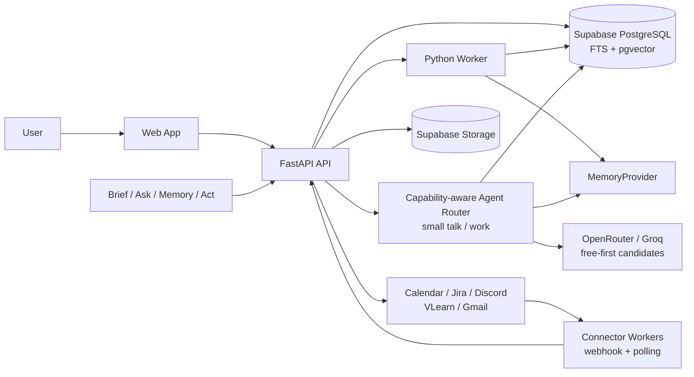

# Architecture — mondaiy MVP

| Thuộc tính | Giá trị |
| --- | --- |
| Status | In review |
| Owner | Nguyễn Văn Phong (Technical Lead) |
| Author | Thái Hoài An (PM) |
| Reviewers | UI/UX Lead, Backend Lead, AI/Memory Lead, QA Lead |
| Last updated | 2026-08-10 |
| Related | [ADR-001](adr/adr-001-platform-core-program-navigator-vertical.md) · [ADR-002](adr/adr-002-connector-first-p0-scope.md) · [ADR-005](adr/adr-005-capability-aware-llm-routing.md) · [PRD](../product/prd.md) · [Memory lifecycle](memory-lifecycle.md) · [LLM routing](llm-routing.md) |

## 1. Architecture goals

- Connector đồng bộ tăng dần, không mất item và gửi lại không tạo bản trùng.
- Evidence/provenance là canonical trước mọi extraction/memory.
- Memory có version, status và evidence.
- Web app và client không giữ secret backend/provider.
- Một backend/worker/Postgres stack đủ cho 5–10 pilot và load test 50 users.
- Provider/model có thể thay mà không đổi product/data contracts; model chỉ
  được chọn sau khi thỏa capability của execution lane.
- Program Navigator dùng engine APIs, không nhúng cohort logic vào connector.

## 2. System context



## 3. Deployable units

### `client/web-app`

- Onboarding, quản lý nguồn, Daily Brief, Ask, Memory và Action Draft.
- Hiển thị quyền, lần đồng bộ cuối, độ phủ và trạng thái nguồn.
- API client dùng Supabase user JWT.

Không gọi OpenRouter trực tiếp và không giữ canonical memory. Extension nếu có
chỉ là bề mặt phụ; không đọc nội dung trang đang mở.

### `services/connectors`

- Adapter chỉ đọc cho Calendar, Jira, Discord, VLearn và Gmail.
- Webhook hoặc polling, checkpoint, retry và idempotency.
- Chuẩn hóa item nhưng giữ raw source ID, deep link và thời điểm cập nhật.

### `services/api`

- FastAPI.
- Auth/JWT validation.
- Source sync ACK và connection management.
- Brief/Ask/Memory/Action APIs.
- Citation permission checks.
- Provider adapters.

### `services/worker`

- Normalize/chunk/embed.
- Structured extraction.
- Memory candidate/promotion/consolidation.
- Change/conflict detection.
- Daily Brief generation.
- Retention/deletion jobs.

### Data services

- Supabase PostgreSQL: canonical relational data, FTS, pgvector và audit.
- Supabase Storage: raw source artifact lớn khi cần và đã được cấp quyền.
- Postgres job queue: P0 dùng `jobs` + `FOR UPDATE SKIP LOCKED` hoặc managed PGMQ; không thêm Redis/Celery nếu chưa cần.

## 4. Module boundaries

| Module | Owns | Không sở hữu |
| --- | --- | --- |
| Connector | Source connections, checkpoints, sync state | Memory truth, generation |
| Evidence | Source items, versions, citations | User inference |
| Memory | Candidates, promotion, versions, feedback | Raw artifact mutation |
| Vertical | Program Frame, information items, Brief policy | Connector implementation |
| Retrieval | Permission filter, FTS/vector merge, evidence pack | Final action execution |
| Agent | Tool orchestration, structured answer/draft | Direct external write |
| Action | Draft/state/idempotency/provider handoff | Autonomous decision |

## 5. Core data flow

### Đồng bộ nguồn

```text
Webhook / scheduled poll
→ connector checkpoint
→ normalize + content hash
→ durable ingestion job
→ source_items/source_item_versions
→ ACK + source receipt
→ async jobs
```

### Ask

```text
Question
→ auth + scope
→ deterministic query router
  ├─ small_talk → small/free model, no tool binding → short playful response
  └─ work/ambiguous
       → authenticated tool guards
       → tool-capable candidate registry (free-first)
       → structured facts / bounded tools
       → FTS/vector candidates khi cần retrieval
       → RRF/rerank + token-budget evidence pack
       → grounded response + citation validator
→ provider/model failover trong cùng capability lane
→ response
```

Chat client có thể dùng `POST /api/v1/chat/stream` để nhận SSE với các event
`token`, `done` và `error`; request vẫn giữ Bearer auth và quota như endpoint
`/chat`. Conversation có endpoint tương ứng
`POST /api/v1/conversations/{id}/messages/stream`, trong đó event `done` chỉ
được phát sau khi assistant message đã commit vào database.

Chi tiết decision table, error taxonomy và rollout tại
[LLM routing](llm-routing.md). Tài liệu đó là target architecture; cho tới khi
ADR-005 được accepted và feature flag được bật, production vẫn có thể chạy
đường model/provider chung hiện tại.

### Action

```text
Evidence-backed proposal
→ persisted ActionDraft
→ preview/edit
→ explicit confirm + idempotency key
→ reminder or Calendar handoff
→ audit event
```

## 6. Provider interfaces

```text
SourceConnector
  ingest(payload) -> EvidenceRef[]

MemoryProvider
  retain(candidate)
  recall(query, filters) -> MemoryHit[]
  reflect(scope) -> Candidate[]

ModelProvider
  candidates(lane, required_capabilities) -> ModelCandidate[]
  generate(messages, candidate)
  generate_with_tools(messages, tools, candidate)
  embed(texts)

CalendarProvider
  build_handoff(draft)
  create_event(confirmed_draft)   # P1/feature flag
```

Required P0 implementations:

- Ít nhất hai connector nguồn đạt gate; ưu tiên Jira/Calendar và Discord/VLearn.
- Postgres memory provider.
- OpenRouter model provider.
- Ít nhất một work candidate đã smoke-test function calling; provider kế tiếp
  giữ cùng tool contract để failover.
- Calendar template/ICS provider.

Optional:

- Gmail và các connector chưa đạt gate.
- Hindsight memory provider.
- Google Calendar OAuth provider.

## 7. Security boundary

- Supabase Auth authenticates user; backend verifies JWT.
- RLS là defense-in-depth, không thay app-level authorization.
- Client chỉ có public project config/user token; service role, OAuth secret và OpenRouter key ở backend.
- Raw data không vào product analytics.
- Citation open luôn kiểm tra current permission.
- Connector webhook có signature/replay protection; OAuth token được mã hóa.
- Every batch/action có idempotency key.

## 8. Scale target

P0 capacity:

- 50 registered/active pilot users.
- Connector batch và checkpoint thay full resync.
- Worker concurrency giới hạn theo provider.
- Precompute Daily Brief.
- HNSW/FTS indexes chỉ thêm sau khi dataset đủ lớn; explain/query metrics quyết định tuning.

Không dùng Kubernetes, Kafka, Neo4j hoặc microservice split cho P0. Tách deployable mới chỉ khi load/ownership evidence yêu cầu.

## 9. Observability

- Structured logs với request/job IDs, không raw content.
- Metrics: source freshness, queue lag, ingest latency, duplicate rate, extraction failure, model latency/cost, citation validator failure và Brief generation status.
- Trace IDs đi từ connector sync tới evidence/job/answer/action.
- Model trace ghi `route_lane`, provider, model, cost tier, candidate index và
  fallback reason; không ghi key, raw source hoặc tool arguments nhạy cảm.
- Alert riêng cho `tool_use_failed`, candidate exhaustion, paid fallback và work
  request bỏ qua tool bắt buộc.
- Pilot blockers tạo alert: permission leak, data loss, unsupported fact, unsafe action và false complete coverage.

## 10. Failure and fallback

| Failure | Fallback |
| --- | --- |
| Connector timeout/429 | Retry/backoff và giữ checkpoint gần nhất |
| Worker restart | Durable job queue và idempotency |
| Model/provider timeout/429/5xx | Retry bounded, xoay key rồi failover sang candidate cùng capability |
| HTTP 400 `tool_use_failed` | Không lặp cùng model; chuyển tool-capable candidate tiếp theo, giữ nguyên tool binding/scope |
| HTTP 400 request/schema khác | Không retry mù; alert engineering và trả lỗi sanitized |
| Small-talk candidate unavailable | Free candidate tiếp theo; không chuyển work request sang small-talk model |
| Work candidates exhausted | Explicit error/abstain; không trả lời từ model thiếu tool capability |
| Một connector unavailable | Coverage partial/unknown; các nguồn khác vẫn chạy |
| Calendar OAuth unavailable | Template URL/ICS |
| Hindsight unavailable | Postgres memory provider |
| Source inaccessible | Coverage partial/unknown; abstain |
