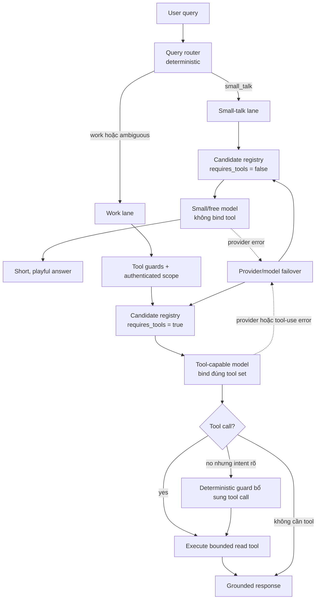

# LLM routing — phân luồng hội thoại, năng lực model và provider failover

| Thuộc tính | Giá trị |
| --- | --- |
| Status | In review |
| Owner | Nguyễn Văn Phong (Technical Lead) |
| Author | Thái Hoài An (PM) |
| Reviewers | Backend Lead, AI/Memory Lead, QA Lead, PO/QC |
| Last updated | 2026-08-10 |
| Source of truth | Có — implementation contract cho model routing |
| Related | [ADR-005](adr/adr-005-capability-aware-llm-routing.md) · [Architecture](architecture.md) · [PRD](../product/prd.md) · [AI usage log](ai-usage-log.md) |

> Tài liệu này mô tả **target architecture chưa được implement đầy đủ**. Hệ
> thống hiện tại vẫn dùng một chuỗi provider/model chung cho cả phân tích có
> tool và sinh câu trả lời. Không dùng tài liệu này để khẳng định production đã
> có capability-aware routing trước khi acceptance checklist ở cuối được ký.

## 1. Mục tiêu

Routing phải đạt đồng thời bốn mục tiêu:

1. Chào hỏi và trò chuyện xã giao có phản hồi nhanh, ngắn, tự nhiên và hóm hỉnh.
2. Câu hỏi về dữ liệu hoặc luồng thực tế chỉ dùng model có năng lực gọi tool,
   giữ đúng scope người dùng và trả lời dựa trên bằng chứng.
3. Provider/model lỗi không làm hỏng cả lượt nếu còn candidate tương thích.
4. Ưu tiên model miễn phí, nhưng **capability và độ chính xác đứng trước giá**.

Không thuộc phạm vi quyết định này:

- thay đổi quyền truy cập Gmail, Calendar, Discord hoặc Jira;
- cho agent tự thực hiện hành động ghi ra hệ thống ngoài;
- dùng model để quyết định scope dữ liệu người dùng;
- bảo đảm một model miễn phí cụ thể tồn tại vĩnh viễn.

## 2. Ba lớp routing độc lập

Không gộp “câu này nói về gì”, “model nào làm được” và “provider nào còn sống”
vào một hàm duy nhất.



### 2.1. Query router

Query router chọn **lane**, không chọn provider và không được đọc dữ liệu nguồn.
Nó ưu tiên luật deterministic để không tốn thêm một lượt LLM chỉ để chọn LLM.

Hai lane canonical:

| Lane | Ý nghĩa | Tool binding | Default khi mơ hồ |
| --- | --- | --- | --- |
| `small_talk` | Chào hỏi, cảm ơn, tạm biệt, đùa vui hoặc trò chuyện xã giao không đòi fact | Không | Không |
| `work` | Cần dữ liệu, fact, tính toán, trạng thái thực tế, lịch, email, task, nguồn nội bộ hoặc Internet | Có khi tool được phép | Có |

Nguyên tắc fail-safe: chỉ route sang `small_talk` khi tín hiệu đủ rõ. Nếu một
câu vừa có lời chào vừa hỏi việc, route sang `work`.

Decision table tối thiểu:

| Câu hỏi | Lane | Lý do |
| --- | --- | --- |
| “hi”, “chào buổi sáng” | `small_talk` | Xã giao thuần túy |
| “cảm ơn nha” | `small_talk` | Không cần fact hay dữ liệu |
| “kể một câu đùa ngắn đi” | `small_talk` | Nội dung sáng tạo, không cần nguồn |
| “hi, hôm nay tôi cần làm gì?” | `work` | Có task và thời gian thực |
| “mail của tôi có gì?” | `work` | Cần Gmail tool và user scope |
| “tuần này tôi có lịch gì?” | `work` | Cần Calendar tool, cửa sổ thời gian hữu hạn |
| “Discord nói gì về Gate 3?” | `work` | Cần retrieval trên evidence đã cấp quyền |
| “Phạm Nhật Vượng là ai?” | `work` | Fact công khai; cần web search khi feature được bật |
| “2 + 3 * 4 bằng bao nhiêu?” | `work` | Cần calculator để kết quả deterministic |
| “cái kia thì sao?” | `work` | Mơ hồ, cần lịch sử hội thoại và có thể cần nguồn |

Router phải normalize Unicode, chữ hoa/thường và khoảng trắng trước khi so luật.
Không dùng một regex bao phủ mọi tiếng Việt; dùng tập intent fixtures có thể
review và mở rộng bằng regression test.

### 2.2. Model capability router

Sau khi có lane, hệ thống chỉ xét các candidate thỏa capability bắt buộc.

Mỗi candidate có contract:

| Trường | Mục đích |
| --- | --- |
| `provider` | `openrouter`, `groq` hoặc provider được hỗ trợ |
| `model` | Model slug gửi cho provider |
| `supports_tools` | Model/provider combination đã được smoke-test function calling |
| `cost_tier` | `free` hoặc `paid` |
| `enabled` | Cho phép tắt candidate mà không sửa routing code |
| `priority` | Thứ tự trong nhóm cùng capability và cost tier |
| `max_attempts` | Giới hạn lần thử candidate |

Quy tắc chọn:

1. Lọc theo `enabled` và capability của lane.
2. Ưu tiên `free` trước `paid`.
3. Trong cùng cost tier, dùng `priority` rồi provider health gần nhất.
4. Paid candidate chỉ được xét khi feature flag/budget cho phép.

Trong env, mỗi candidate có dạng `provider:model` và có thể ghi rõ cost tier
bằng hậu tố `|free` hoặc `|paid` (ví dụ `openrouter:some-model|paid`). Candidate
không có hậu tố được xem là `free` để tương thích với các model free hiện tại;
team phải xác minh lại tier trước khi bật production.

“Free-first” không có nghĩa là small model được bind tool dù chưa chứng minh
function calling. Candidate không đủ capability bị loại trước khi xếp giá.

### 2.3. Provider failover

Failover chạy **bên trong lane hiện tại**. Nó không được đổi một work request
thành small talk chỉ vì provider tool-capable đang lỗi.

Thứ tự:

```text
candidate hiện tại
→ key tiếp theo của cùng provider/model
→ free candidate tiếp theo cùng capability
→ provider tiếp theo cùng capability
→ paid candidate nếu được phép
→ explicit error/abstain
```

Khi đổi provider, phải giữ nguyên:

- messages và lịch sử hội thoại đã giới hạn;
- tool schemas/tool binding;
- authenticated user scope;
- time bounds và deterministic tool guards;
- trace ID và routing metadata.

## 3. Luồng `small_talk`

Small-talk lane không chạy analyze node có tool và không tự động gọi
`discord_search_program` (kho vector chỉ chứa dữ liệu Discord đã cào riêng),
`discord_search_my_messages` và `discord_get_my_activity` (khóa author theo Discord OAuth).

Contract phản hồi:

- tiếng Việt tự nhiên, tối đa vài câu trừ khi người dùng yêu cầu khác;
- vui vừa đủ, không mỉa mai người dùng hoặc nhóm nhạy cảm;
- không bịa fact, lịch, email, task hoặc trạng thái hệ thống;
- không nói về cơ chế nội bộ, model lane hoặc provider;
- câu hỏi chuyển sang nhu cầu thực tế ở lượt sau phải được route lại từ đầu.

Prompt định hướng:

```text
Bạn là mondaiy, một đồng nghiệp nhanh trí và thân thiện. Với lời chào hoặc trò
chuyện xã giao, trả lời ngắn, tự nhiên và hóm hỉnh vừa đủ. Không bịa thông tin
thực tế, không tuyên bố đã đọc email/lịch/task và không nhắc tới hệ thống nội bộ.
```

## 4. Luồng `work`

Work lane giữ nguyên security boundary hiện tại: scope do backend đặt từ session,
không nhận `user_id` do model sinh và không mở rộng quyền khi failover.

### 4.1. Tool groups

| Intent | Tool/nguồn ưu tiên | Guard bắt buộc |
| --- | --- | --- |
| Việc, deadline, quá hạn | `list_tasks` | User scope; time window khi có yếu tố thời gian |
| Nội dung chương trình trên Discord | `discord_search_program` | Scope Discord đã xác thực; không đại diện cho nguồn khác |
| Chính người dùng đã nhắn gì | `discord_search_my_messages` | Scope + author ID lấy từ OAuth, không nhận ID từ model |
| Hoạt động Discord của người dùng | `discord_get_my_activity` | Đếm chính xác theo author và kênh trong scope |
| Gmail | `gmail_search_emails`, sau đó mới `gmail_read_email` | Chỉ đọc; window hữu hạn; chỉ đọc ID vừa search |
| Calendar | `calendar_search_events` | Chỉ đọc; `time_from < time_to` |
| Fact công khai | `web_search` | Feature flag + key; nguồn Internet phải được gắn nhãn và link |
| Tính toán | `calculate` | Parser/operator allowlist; không `eval` |
| Thời gian tương đối | `current_datetime`, `relative_time` | Múi giờ ứng dụng; không tự đoán ngày hiện tại |

Các deterministic guard hiện có cho Gmail, Calendar và web search tiếp tục là
lớp bảo vệ khi model không gọi tool. Guard không thay quyền; nó chỉ bổ sung một
tool call đã được backend cho phép.

### 4.2. Grounded response

Model viết câu trả lời cuối có thể là candidate khác với model analyze, nhưng
phải nhận cùng context pack đã tối thiểu hóa. Khi không có bằng chứng:

- nói rõ chưa tìm thấy hoặc nguồn chưa sẵn sàng;
- không dùng kiến thức model để lấp phần dữ liệu cá nhân bị thiếu;
- không biến lỗi tool/provider thành khẳng định “không có dữ liệu”.

## 5. Error taxonomy và chính sách retry

Không failover mọi HTTP 400. Làm vậy vừa che bug request/schema vừa nhân chi phí.

| Failure | Retry cùng candidate | Candidate/provider tiếp theo | Kết quả cuối nếu hết candidate |
| --- | --- | --- | --- |
| Timeout/408 | Có, bounded | Có | 502 sanitized |
| Rate limit/429 | Key tiếp theo | Có | 503/429 rõ ràng |
| Provider 5xx | Có, bounded | Có | 502 sanitized |
| Auth/quota 401/402/403 | Không lặp cùng key lỗi | Có | Config/quota error sanitized |
| `400 tool_use_failed` | Không lặp cùng model | Có, chỉ candidate `supports_tools` | 502 tool-capability exhausted |
| 400 schema/request khác | Không | Không mặc định | 500/502 và alert engineering |
| Tool timeout | Tool policy riêng | Có thể trả partial evidence | Trả partial/abstain, không bịa |
| Tất cả nguồn rỗng | Không | Không | Grounded empty state |

Regression bắt buộc từ incident hội thoại 8:

```text
OpenRouter model sinh malformed web_search function call
→ provider trả 400 code=tool_use_failed
→ giữ web_search binding và query
→ chuyển sang tool-capable candidate tiếp theo
→ API conversation trả 200 hoặc explicit exhausted error, không 502 mơ hồ
```

## 6. Cấu hình target

Tên biến dưới đây là contract đề xuất, chưa tồn tại trong `Settings` cho tới khi
implementation PR được merge:

```env
LLM_ROUTING_ENABLED=false
SMALL_TALK_CANDIDATES=openrouter:<small-free-model>,groq:<small-model>
WORK_TOOL_CANDIDATES=openrouter:<tool-free-model>,groq:<tool-model>
WORK_RESPONSE_CANDIDATES=openrouter:<response-free-model>,groq:<response-model>
PAID_FALLBACK_ENABLED=false
LLM_CANDIDATE_MAX_ATTEMPTS=1
```

Không commit model slug chỉ vì tên có hậu tố `:free`. Trước khi đưa vào danh
sách production phải chạy capability smoke test: bind tối thiểu một synthetic
tool, yêu cầu model gọi tool và kiểm tra payload parse được.

## 7. Observability

Mỗi lượt phải có một trace xuyên suốt query router, model candidates và tools.
Metadata được phép ghi:

| Trường | Ví dụ |
| --- | --- |
| `route_lane` | `small_talk`, `work` |
| `route_reason` | `greeting`, `gmail`, `public_web`, `ambiguous_default` |
| `provider` | `openrouter` |
| `model` | model slug, không có key |
| `cost_tier` | `free`, `paid` |
| `candidate_index` | `0`, `1` |
| `fallback_reason` | `rate_limit`, `tool_use_failed`, `provider_5xx` |
| `tool_names` | Tên tool đã dùng, không ghi arguments nhạy cảm |
| `latency_ms` | Thời gian candidate/lượt |
| `token_in`, `token_out`, `cost_usd` | Khi provider trả usage |

Không ghi API key, OAuth token, raw email, raw Discord message, tool arguments
nhạy cảm hoặc prompt chứa evidence vào application log. LangSmith phải tuân
theo consent/retention của dữ liệu nguồn; bật tracing không tự động hợp thức hóa
việc gửi dữ liệu cá nhân ra ngoài.

Dashboard/alert tối thiểu:

- request theo lane/provider/model;
- tỷ lệ fallback và lý do;
- `tool_use_failed` theo model;
- p50/p95 latency từng lane;
- free/paid request và estimated cost;
- tỷ lệ exhausted candidates;
- tỷ lệ work request không có tool khi deterministic intent yêu cầu tool.

## 8. Test contract

### Unit tests

- Unicode/case/whitespace normalization.
- Small-talk fixtures route đúng và không bind tool.
- Câu vừa chào vừa hỏi việc route `work`.
- Câu mơ hồ route `work`.
- Candidate thiếu `supports_tools` không được xét cho work lane.
- Free candidate đứng trước paid candidate trong cùng capability.
- `tool_use_failed` chuyển candidate; 400 schema khác không chuyển mù.
- Tool binding và scope không đổi sau failover.

### Agent/API tests

- Small talk trả câu ngắn, không gọi retrieval/tool.
- Gmail/Calendar/web/task intent dùng đúng deterministic guard.
- Hội thoại giữ tối đa số lượt lịch sử đã quy định sau khi đổi lane.
- Provider đầu trả 429/5xx hoặc `tool_use_failed`, provider hai thành công và API
  trả 200.
- Hết toàn bộ work candidates trả lỗi sanitized, không ghi assistant answer giả.
- Cross-user scope test vẫn pass khi provider/model thay đổi.

Mọi test CI mock provider; live smoke test chỉ chạy staging/nightly để không phụ
thuộc quota và độ ổn định của free tier.

## 9. Rollout và rollback

1. Merge docs/ADR và test fixtures trước implementation.
2. Thêm registry + router sau feature flag `LLM_ROUTING_ENABLED=false`.
3. Chạy shadow classification: ghi lane dự kiến nhưng vẫn dùng đường cũ; không
   gọi thêm model.
4. Review tỷ lệ work request bị route nhầm sang `small_talk`; mọi trường hợp
   này phải được sửa trước rollout.
5. Bật small-talk lane ở staging, sau đó production theo tỷ lệ nhỏ nếu hạ tầng
   hỗ trợ.
6. Bật work candidate registry và theo dõi `tool_use_failed`, latency, fallback.
7. Chỉ bật paid fallback sau khi có budget owner và alert chi phí.

Rollback nhanh: tắt `LLM_ROUTING_ENABLED`, đưa mọi query về work lane cũ. Không
rollback bằng cách đưa mọi query sang small model vì có thể làm mất tool/scope.

## 10. Runbook vận hành

Khi một model/provider lỗi:

1. Tìm trace theo request/conversation ID.
2. Xác nhận `route_lane`, model, provider và tool binding.
3. Phân loại error theo bảng ở mục 5.
4. Nếu `tool_use_failed` tăng theo một model, disable candidate đó; không tắt
   toàn bộ work lane.
5. Smoke-test candidate kế tiếp bằng synthetic tool, không dùng dữ liệu thật.
6. Cập nhật candidate registry/config và recreate đúng service backend.
7. Xác minh health, một small-talk request, một bounded work request và trace.
8. Ghi incident/model/version vào [AI usage log](ai-usage-log.md).

## 11. Acceptance checklist

- [ ] ADR-005 được Technical Lead và AI/Memory Lead chấp thuận.
- [ ] `small_talk` và `work` có fixture/decision table được QA review.
- [ ] Candidate registry kiểm capability trước cost tier.
- [ ] Small-talk lane không bind hoặc gọi tool.
- [ ] Work lane không dùng candidate thiếu function calling.
- [ ] Free-first và paid fallback có cấu hình/feature flag rõ ràng.
- [ ] `400 tool_use_failed` có regression test và failover thành công.
- [ ] Trace có lane/provider/model/fallback, không có secret/raw source.
- [ ] Docs, env templates và implementation dùng cùng tên lane/config.
- [ ] Rollback về đường cũ đã được smoke-test.
