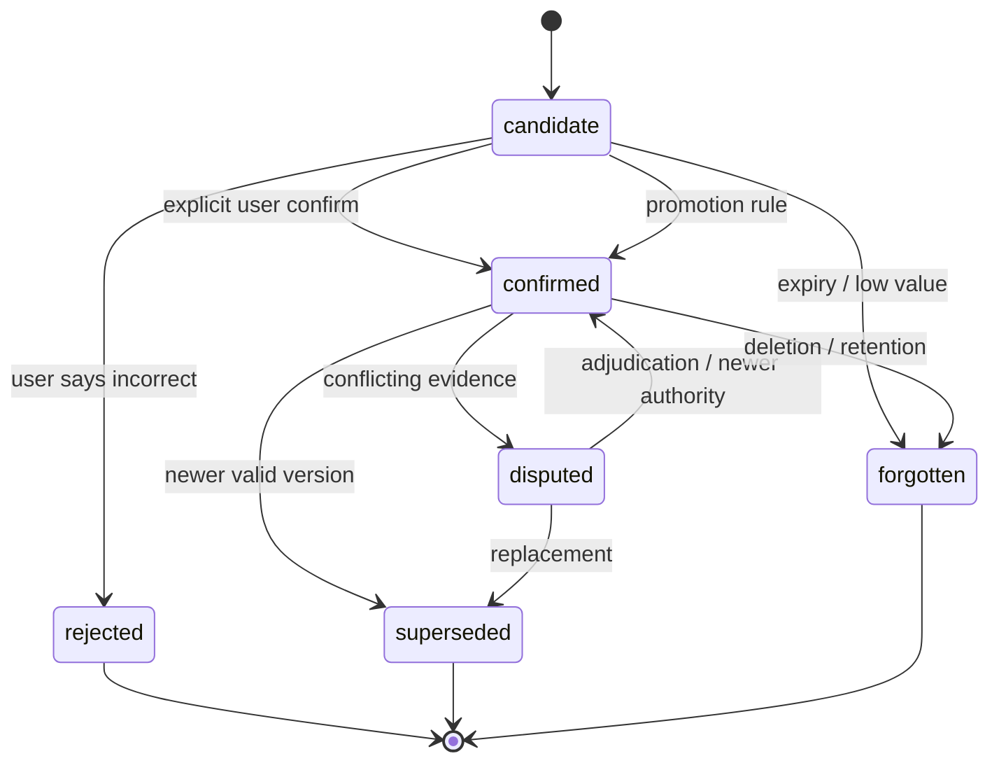
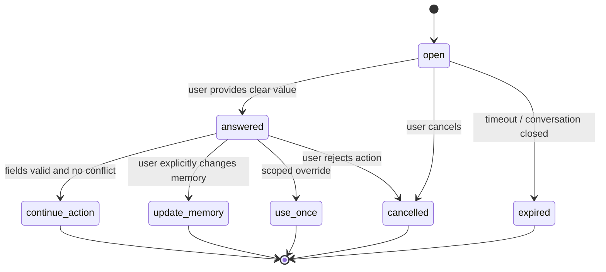

# Memory lifecycle — Evidence-backed personalization

| Thuộc tính | Giá trị |
| --- | --- |
| Status | In review |
| Owner | Nguyễn Văn Phong (Technical Lead; acting owner) |
| Author | Thái Hoài An (PM) |
| Reviewers | Tech Lead, QA Lead, PM |
| Last updated | 2026-08-01 |
| Related | [PRD](../product/prd.md) · [Architecture](architecture.md) · [Evaluation](../qa/evaluation-plan.md) |

## 1. Mục tiêu

Memory phải giúp agent hiểu user tốt hơn theo thời gian mà không:

- Biến activity quan sát được thành identity/preference chắc chắn.
- Overwrite history khi fact thay đổi.
- Tách memory khỏi evidence.
- Nhồi toàn bộ history vào prompt.
- Giữ dữ liệu đã revoke/delete trong retrieval.

## 2. Các lớp memory

| Lớp | Nội dung | Persistence | Authority |
| --- | --- | --- | --- |
| Explicit profile | User tự khai role, goal, timezone, preference | Versioned | Cao nhất cho personal preference |
| Episodic evidence | Page observation, meeting segment, event | Theo retention | Evidence, không phải belief |
| Semantic candidate | Fact/preference/project/relationship suy ra | Versioned | Chưa canonical |
| Canonical memory | Candidate đã promotion | Versioned/temporal | Phụ thuộc source/evidence |
| Action/prospective | Draft, reminder, commitment | Versioned/audited | Theo confirmed state |
| Working context | Evidence pack của request hiện tại | Tạm thời | Chỉ dùng cho request |

## 3. State machine



## 4. Memory schema

```text
memory_id
version_id
user_id
kind
subject
predicate
object_json
status
confidence
importance
source_authority
valid_from
valid_to
first_observed_at
last_reinforced_at
supersedes_memory_id
extractor_version
created_by: user | rule | model | import
evidence_ids[]
```

Kinds P0:

- `profile`
- `preference`
- `goal`
- `project`
- `topic_interest`
- `decision`
- `commitment`
- `deadline`
- `task`
- `episode`

## 5. Promotion rules

### Explicit

User-created/edited profile có thể promotion ngay nhưng vẫn version/audit.

### Official structured source

Calendar, Program Frame hoặc declared source-of-truth có thể tạo canonical fact nếu parser đủ điều kiện và source/version hợp lệ.

### Inferred preference/interest

Mặc định ở `candidate`. Promotion chỉ khi:

- User xác nhận; hoặc
- Rule được QA phê duyệt dựa trên nhiều independent evidence và không có negative feedback.

Ngay cả khi promotion tự động, UI phải ghi `Suy ra từ hoạt động`, không giả là user đã tự khai.

### Meeting decision/commitment

Meeting discussion tạo candidate. Decision/commitment chỉ promotion nếu language/role/source rule đủ rõ hoặc user confirms. Assignee/deadline thiếu phải `unknown`.

## 6. Conflict và temporal behavior

- Không update record tại chỗ để xóa fact cũ.
- Fact mới tạo version, set `valid_from` và link `supersedes`.
- Khi authority chưa rõ, cả hai version ở `disputed`.
- Retrieval ưu tiên fact valid tại query time nhưng vẫn trả conflict khi câu hỏi cần current truth.
- Source authority không được âm thầm loại evidence thấp hơn.

### 6.1. Khi user nhập khác với memory đã có

Phát biểu mới của user là evidence mới, không phải lệnh âm thầm ghi đè memory
cũ. Khi phát hiện khác biệt với một memory đang hiệu lực:

1. Giữ memory cũ và tạo version/candidate mới kèm evidence của lượt hiện tại.
2. Nếu chưa xác định được user muốn sửa memory hay chỉ đang nói về một trường
   hợp tạm thời, đặt record ở `disputed`/`candidate` theo authority.
3. Tạo một `clarification_request` trong conversation; không tự chọn giá trị để
   gọi tool hoặc tạo action.
4. Hỏi user ngắn gọn, hiển thị hai giá trị và phạm vi ảnh hưởng.
5. Chỉ sau câu trả lời rõ ràng mới adjudicate memory hoặc dùng giá trị một lần.

Ví dụ:

```text
Memory hiện tại: múi giờ Asia/Ho_Chi_Minh
User vừa nhập: “Tôi đang ở Berlin tuần này.”

Hỏi lại: “Bạn muốn đổi múi giờ mặc định sang Europe/Berlin, hay chỉ dùng
Europe/Berlin cho việc này?”
```

Các lựa chọn cần biểu diễn được:

- `update_memory`: tạo version mới và supersede version cũ;
- `use_once`: dùng giá trị mới cho request hiện tại, không đổi memory;
- `keep_memory`: giữ giá trị cũ và đánh dấu phát biểu mới là context-specific;
- `cancel`: không tiếp tục action đang phụ thuộc vào giá trị mâu thuẫn.

Không được coi câu trả lời mơ hồ như confirmation. Khi user không trả lời,
clarification hết hạn hoặc conversation bị đóng, action phụ thuộc phải giữ ở
`needs_clarification` và memory không được promotion.

### 6.2. Khi thiếu thông tin để gọi tool hoặc thực hiện yêu cầu

Tool planner phải kiểm tra required fields trước khi tạo tool call. Nếu thiếu
field hoặc giá trị còn mơ hồ:

1. Không gọi tool với giá trị đoán, giá trị mặc định không được phê duyệt hoặc
   `unknown`.
2. Tạo `clarification_request` gắn với `action_request_id` và draft hiện tại.
3. Trả lời đúng các field còn thiếu, mỗi câu hỏi ưu tiên số lượng nhỏ nhưng đủ
   để tiếp tục.
4. Lưu câu trả lời của user vào pending draft, không coi toàn bộ câu trả lời là
   memory dài hạn.
5. Validate lại toàn bộ draft sau khi có câu trả lời; nếu vẫn thiếu thì hỏi
   tiếp, nếu đủ mới tạo tool call.
6. Với thao tác ghi ra hệ thống bên ngoài, vẫn phải có bước preview và
   confirmation riêng theo PRD; clarification không thay thế confirmation.

Required fields tối thiểu:

| Tool/action | Bắt buộc |
| --- | --- |
| Event | title, start, end hoặc duration, timezone khi chưa xác định |
| Task/todo | title, deadline khi user yêu cầu deadline hoặc workflow bắt buộc |
| Search có time range | khoảng thời gian nếu câu hỏi không xác định được |
| Handoff ngoài | target/source và ownership đã kiểm tra |

## 6.3. Contract của clarification request

Đây là state tạm thời của request, không phải memory belief:

```text
clarification_id
user_id
conversation_id
action_request_id
kind: memory_conflict | missing_tool_fields | ambiguous_value
status: open | answered | cancelled | expired
question
conflicting_memory_ids[]
missing_fields[]
known_values{}
pending_draft{}
expires_at
created_at
resolved_at
resolution: update_memory | use_once | keep_memory | continue_action | cancel
evidence_ids[]
```

State flow:



`clarification_request` phải được scope theo authenticated `user_id` và
`conversation_id`. Không để model tự chọn `clarification_id`, memory owner,
hoặc action draft từ nội dung user gửi.

## 7. Retrieval

1. Filter user/consent/source/project/time.
2. Fetch exact structured facts bằng SQL.
3. Search chunks/memories bằng Postgres FTS + pgvector.
4. Hợp nhất bằng reciprocal rank fusion.
5. Rerank:

```text
score =
  relevance
  × authority_weight
  × status_weight
  × recency_weight
  × reinforcement_weight
  × negative_feedback_penalty
```

6. Build evidence pack theo token budget.
7. Model trả claim blocks + citation IDs.
8. Validator kiểm tra evidence/permission/status.

Inferred personalization chỉ rerank; không thay source authority.

Cách hiện thực bước 3 cho lớp memory nằm tại
[ADR-006](adr/adr-006-pgvector-cho-lop-memory-dai-han.md): pgvector trên chính
bảng `user_memories`, còn nhánh từ khoá chấm điểm trong tiến trình thay vì dựng
Postgres FTS — số memory của một người quá nhỏ để cần index.

## 8. Consolidation

Chạy background sau meeting hoặc theo lịch:

- Dedupe equivalent candidates.
- Link evidence mới tới memory cũ.
- Phát hiện contradiction.
- Đề xuất summary/insight candidate.
- Cập nhật importance/reinforcement.

Consolidation không chạy trong critical Ask request và không tự xóa evidence.

Clarification chưa được resolve không được đưa vào consolidation. Chỉ event đã
được user xác nhận, source chính thức xác nhận hoặc rule promotion hợp lệ mới
được gửi sang lớp consolidation.

## 9. Forgetting, retention và delete

- Raw evidence theo source-specific retention.
- Working context xóa sau request/session.
- Candidate yếu có thể decay khỏi default retrieval.
- `forgotten` khác hard delete: status phục vụ audit trong giới hạn policy.
- User delete/revoke phải loại data khỏi retrieval ngay; hard deletion job hoàn thành theo SLA được PRD/policy chốt.
- Backup/derived vector phải được xử lý trong deletion contract.

## 10. Hindsight integration

Hindsight chỉ là optional `MemoryProvider`:

- Có thể dùng cho retain/recall/reflect A/B test.
- Mỗi user có bank/scope do backend map.
- Không nhận quyền quyết định canonical fact/source authority.
- Raw evidence, canonical memory status và audit vẫn ở Postgres.
- Provider failure fallback về Postgres retrieval.

Nếu dùng Zep thay cho hoặc cùng với provider này, áp dụng cùng ranh giới:

- Zep chỉ nhận memory/event đã qua consent, scope và resolution kiểm tra ở
  PostgreSQL;
- không ghi `clarification_request` chưa resolve thành fact hoặc episode đã
  xác nhận;
- khi `update_memory`/`use_once` được resolve, PostgreSQL commit trước rồi mới
  enqueue write sang Zep;
- Zep failure không làm mất clarification state hoặc pending action;
- delete/revoke phải chặn retrieval ở PostgreSQL trước khi provider deletion
  hoàn tất.

## 11. Evaluation invariants

- 100% canonical memory có ≥1 accessible evidence.
- Explicit correction thắng inferred memory.
- Candidate không xuất hiện như confirmed fact.
- Contradiction không overwrite history.
- Revoked evidence không được retrieve.
- Temporal question trả đúng version theo time.
- Unsupported deadline/assignee = 0.
- Conflict cần hỏi lại không được tự chọn giá trị để gọi tool.
- Thiếu required field không tạo tool call hoặc external action.
- User trả lời clarification rõ ràng phải tiếp tục đúng draft và scope ban đầu.
- Clarification hết hạn không tự thực thi action và không promotion memory.
