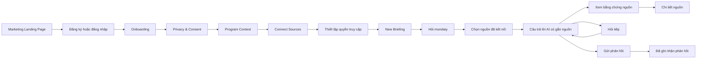
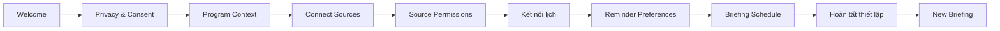
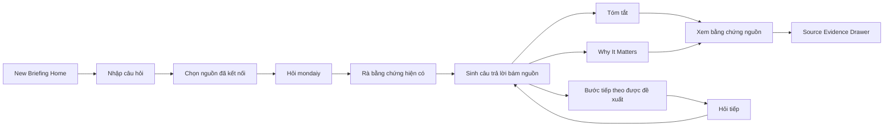
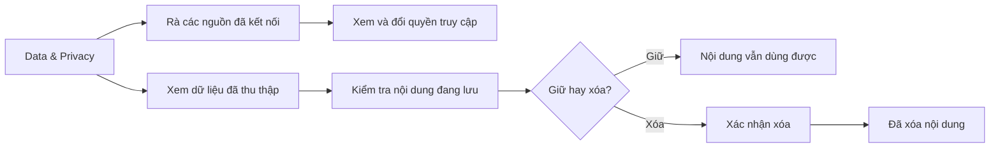
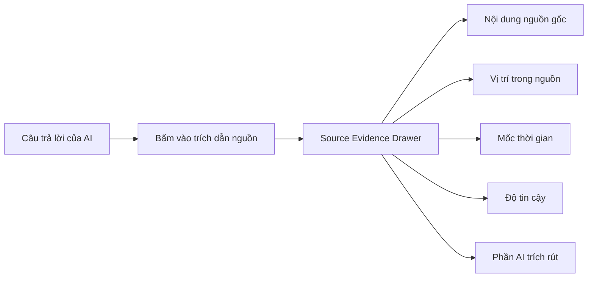
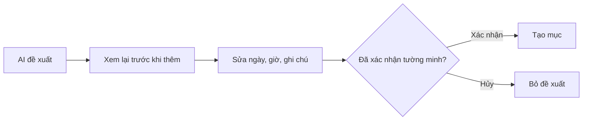

# Luồng giao diện và wireframe: mondaiy

| Thuộc tính | Giá trị |
| --- | --- |
| Trạng thái | Đang lấy ý kiến để hoàn thiện |
| Người chịu trách nhiệm | Lê Thị Yến Nhi, UI/UX Lead |
| Tác giả | Lê Thị Yến Nhi, UI/UX Lead |
| Người phản biện | Quản lý dự án, Trưởng nhóm kỹ thuật, Chủ sản phẩm và kiểm soát chất lượng |
| Cập nhật lần cuối | 2026-08-04 |
| Nguồn chuẩn | Có, gồm luồng giao diện, wireframe, danh sách màn hình, hệ thống thiết kế và các trạng thái giao diện cho web app P0 |
| Tài liệu liên quan | [Bảng kê Gate 1](README.md) · [Quyết định kiến trúc số 2](../../engineering/adr/adr-002-connector-first-p0-scope.md) · [Đặc tả yêu cầu sản phẩm](../../product/prd.md) · [Luồng giao diện bản side panel, đã thu hẹp](../../design/ui-flow.md) · [Sơ đồ Mermaid luồng web app](../../design/web-app-ui-flow.mmd) · [Bộ wireframe bản PDF](assets/mondaiy-ui-ux-wireframe-gate-1.pdf) |
| Hạng mục bàn giao | Gate 1: Wireframe và luồng giao diện |

> **Bản đóng băng Gate 1.** Bản sống được cập nhật tại
> [`design/wireframe-ui-flow.md`](../../design/wireframe-ui-flow.md). Không sửa file này.

Tài liệu này mô tả web app P0 theo
[Quyết định kiến trúc số 2](../../engineering/adr/adr-002-connector-first-p0-scope.md). Extension,
nếu được giữ, chỉ là bề mặt phụ và không theo dõi màn hình hoặc thu thập nội
dung trang đang mở.

> **Phạm vi nguồn chuẩn.** File này là nguồn chuẩn cho luồng giao diện và
> wireframe của web app P0. [`ui-flow.md`](../../design/ui-flow.md) đã được thu hẹp còn ghi chép
> lịch sử cho bề mặt Chrome side panel, không còn là nguồn chuẩn. Câu hỏi
> extension có được thu thập nội dung trang web hay không là **OD-07** trong
> [Đặc tả yêu cầu sản phẩm](../../product/prd.md), chưa chốt và không thuộc phạm vi P0.

> **Quy ước ngôn ngữ.** Toàn bộ nội dung viết bằng tiếng Việt. Tên màn hình,
> tên thành phần giao diện và tên design token giữ nguyên tiếng Anh vì trùng với
> tên khung trong Figma và tên file export; đổi đi sẽ mất khả năng đối chiếu.

---

## 1. Tổng quan hạng mục bàn giao

Tài liệu ghi lại các quyết định đã thể hiện trong wireframe web app P0: cấu trúc
màn hình, luồng thao tác, trạng thái giao diện, thành phần dùng chung, yêu cầu
khả năng tiếp cận và các nội dung cần kiểm thử trước Gate 2.

## 2. Thiết kế trên Figma

[mondaiy UI-UX](https://www.figma.com/design/XlUjQ4lV6fY6ov3ZjJYZal/mondaiy-UI-UX?node-id=1-2&t=4RlYkOovbQ1wVNKc-1)
gồm các màn hình trong ứng dụng, màn hình onboarding, trang công khai và phần
hệ thống thiết kế.

Link phải để ở chế độ **Anyone with the link → Can view** thì người phản biện mới
mở được. Việc xác minh là mục còn mở OI-02.

---

## 3. Mục tiêu trải nghiệm

Wireframe tập trung vào bốn câu hỏi mà người dùng cần trả lời khi kiểm tra thông
tin chương trình: có gì vừa thay đổi, việc nào cần chú ý, thông tin đến từ đâu và
nên làm gì tiếp theo.

Các câu trả lời được đặt trong cùng luồng Briefing để người dùng không phải đổi
qua nhiều màn hình chỉ để kiểm tra một cập nhật:

| Câu hỏi của người dùng | Chỗ giao diện đáp ứng |
|---|---|
| Có gì mới? | Phần tóm tắt bản tin AI và các cập nhật có gắn nguồn |
| Việc nào cần tôi chú ý? | Các chip câu hỏi gợi ý và câu trả lời có cấu trúc |
| Vì sao việc này quan trọng? | Phần "Why it matters" |
| Tôi nên làm gì tiếp theo? | Phần bước tiếp theo được đề xuất |
| Thông tin này từ đâu ra? | Bằng chứng nguồn bấm mở được |
| Hệ thống chắc chắn tới đâu? | Badge độ tin cậy kèm phần giải thích |
| Tôi có kiểm soát được dữ liệu không? | Các điều khiển ở Data & Privacy |
| AI có tự hành động thay tôi không? | Cơ chế bắt buộc xem lại và xác nhận |

---

## 4. Nguyên tắc thiết kế

Bốn nguyên tắc, mỗi nguyên tắc tồn tại vì một kiểu hỏng cụ thể ở cột bên phải.
Yêu cầu về khả năng tiếp cận nằm riêng ở [mục 18](#18-khả-năng-tiếp-cận).

| # | Nguyên tắc | Hỏng gì nếu vi phạm |
|---|---|---|
| 4.1 | **Bằng chứng đi trước** — mọi câu AI đưa ra đều nối được về nguồn, vị trí trong nguồn, mốc thời gian và độ tin cậy | Người dùng không phân biệt được thông tin rút từ nguồn với thông tin hệ thống đoán |
| 4.2 | **Người dùng nắm quyền** — mondaiy soạn và đề xuất; người dùng xem lại, sửa, xác nhận, từ chối, xóa | Hệ thống hành động dựa trên một lần đọc sai |
| 4.3 | **Nói rõ chỗ chưa chắc** — thông tin mâu thuẫn, thiếu hoặc đã cũ không được trình bày như chắc chắn | Người dùng làm theo hạn chót sai |
| 4.4 | **Một lối vào cho một việc** — thiết lập tài khoản ở menu hồ sơ, tìm kiếm ở thanh trên | Hai đường dẫn tới cùng một chỗ, người dùng không biết đường nào đúng |

---

## 5. Hệ thống thiết kế

### 5.1 Thương hiệu

Tên ứng dụng luôn viết là **mondaiy**, toàn bộ chữ thường, kể cả ở đầu câu. Phần
`ai` nhấn bằng độ đậm nét chữ lớn hơn.

### 5.2 Bảng màu

| Token | Mã HEX | Dùng chính cho |
|---|---|---|
| Navigator Navy | `#12305B` | Thương hiệu, tiêu đề, điều hướng chính, hành động chính |
| Active Blue | `#2563A6` | Điều khiển tương tác, liên kết, trạng thái đang chọn |
| Light Blue | `#DCEBFA` | Bề mặt đang được chọn và các điểm nhấn thông tin nhẹ |
| Light Canvas | `#FFFFFF` | Nền mặc định chế độ sáng và các bề mặt chính |
| Soft Background | `#F7F9FC` | Bề mặt phụ và nội dung được gom nhóm |
| Border | `#DDE3EA` | Thẻ, ô nhập, đường phân cách, viền |
| Primary Text | `#12305B` | Tiêu đề và nội dung ưu tiên cao |
| Secondary Text | `#5F6B7A` | Siêu dữ liệu, mốc thời gian, mô tả |
| Success / Certain | `#2F7D5B` | Thông tin đã kiểm chứng và trạng thái thành công |
| Warning / Possible | `#A66A16` | Chỗ chưa chắc chắn và phạm vi quét bị hạn chế |
| Urgent / Error | `#B54747` | Xung đột, hạn gấp, hành động phá hủy dữ liệu |

### 5.3 Hệ chữ

| Vai trò | Phông | Độ đậm | Cỡ thường dùng |
|---|---|---|---|
| Display / H1 | Manrope | Bold | 32 px |
| H2 | Manrope | Bold | 24 px |
| H3 | Manrope | SemiBold | 20 px |
| Thân bài lớn | Inter | Regular | 16 px |
| Thân bài mặc định | Inter | Regular | 14 px |
| Nhãn giao diện | Inter | Medium | 14 px |
| Chú thích | Inter | Regular | 12 px |

### 5.4 Khoảng cách

Giao diện theo hệ khoảng cách bội số 8:

`4 / 8 / 12 / 16 / 24 / 32 / 48 / 64 px`

### 5.5 Thành phần nền tảng

Danh sách đầy đủ, chia theo khu vực màn hình, nằm ở
[mục 15](#15-danh-sách-thành-phần-giao-diện).

---

## 6. Kiến trúc thông tin

```text
mondaiy
├── Public
│   ├── Marketing Landing Page
│   ├── Sign Up
│   └── Sign In
│
├── Onboarding
│   ├── Welcome
│   ├── Privacy & Consent
│   ├── Program Context
│   ├── Connect Sources
│   ├── Source Permissions
│   ├── Reminder Preferences
│   ├── Briefing Schedule
│   └── Completion
│
└── Application
    ├── New Briefing
    ├── Briefing Conversation
    ├── Sources
    ├── Data & Privacy
    ├── Activity & Audit Trail
    ├── Notifications
    ├── Briefing History
    ├── User Profile Menu
    │   ├── My Profile
    │   ├── Settings
    │   ├── Appearance
    │   ├── Language
    │   ├── Help & Support
    │   └── Sign Out
    └── Global Search / Command Palette
```

---

## 7. Luồng người dùng chính



---

## 8. Luồng onboarding



### Yêu cầu với onboarding

- Đồng ý phải là đồng ý tường minh.
- Quyền truy cập nguồn phải trình bày dễ hiểu.
- Người dùng phải xem lại hoặc đổi được quyền về sau.
- Kết nối một nguồn không đồng nghĩa với cho phép truy cập không giới hạn.
- Màn hình hoàn tất phải nói rõ những gì đã được thiết lập.

---

## 9. Luồng tạo bản tin mới



### Màn hình New Briefing

Màn hình bản tin ban đầu gồm:

- Thanh điều hướng chính bên trái
- Ô soạn câu hỏi cho AI đặt giữa màn hình
- Ngày hiện tại và lời chào theo ngữ cảnh
- Các chip câu hỏi gợi ý
- Thanh nhỏ Source Library
- Chỉ báo các nguồn đang kết nối
- Bảng "At a glance" bên phải

Các câu hỏi gợi ý gồm:

- Việc nào cần tôi chú ý?
- Có gì thay đổi kể từ bản tin gần nhất?
- Tôi nên làm gì tiếp theo?
- Có nguồn nào đang mâu thuẫn nhau không?
- Sắp tới có hạn nào?
- Đang thiếu thông tin gì?

### Cuộc hội thoại đang diễn ra

Sau khi người dùng gửi câu hỏi:

- Hội thoại mở ra trong một không gian làm việc riêng.
- Bảng "At a glance" được ẩn để bớt phân tán.
- Người dùng xem lại được các lượt trao đổi trước đó.
- Câu trả lời của AI hiện ra dưới dạng nội dung hội thoại có cấu trúc.
- Ô soạn ở dưới cùng luôn sẵn sàng cho câu hỏi tiếp theo.
- Hội thoại được lưu vào Briefing History.

---

## 10. Luồng dữ liệu và quyền riêng tư



Người dùng có thể:

- Bật hoặc tắt quyền truy cập từng nguồn
- Tạm dừng hoặc chạy lại việc theo dõi nguồn
- Xem phạm vi quét của từng nguồn
- Kiểm tra nội dung đã thu thập
- Xóa từng bản ghi
- Xóa những thông tin không muốn giữ lại
- Xem lại lịch sử hoạt động và nhật ký kiểm toán

---

## 11. Luồng truy vết bằng chứng nguồn



Mọi mục minh họa trong bản tin đều phải có:

- Nền tảng nguồn
- Vị trí hoặc kênh trong nguồn
- Mốc thời gian
- Mức độ tin cậy
- Thao tác gửi phản hồi

---

## 12. Các trạng thái của bản tin hằng ngày

| Trạng thái | Điều kiện kích hoạt | Giao diện bắt buộc phải làm |
|---|---|---|
| Bình thường | Có cập nhật hợp lệ | Hiện tóm tắt, mức liên quan, bước tiếp theo, nguồn, độ tin cậy và ô phản hồi |
| Hạn gấp | Sắp tới hạn | Hiện cảnh báo nổi bật nhưng vẫn dễ tiếp cận, thời gian còn lại, nguồn và hành động được đề xuất |
| Nguồn mâu thuẫn | Các nguồn chứa thông tin không khớp nhau | Hiện đủ mọi giá trị và bằng chứng liên quan; không được lặng lẽ chọn một bên |
| Không có cập nhật mới | Không tìm thấy thay đổi liên quan | Xác nhận thời điểm rà gần nhất và cho phép làm mới |
| Phạm vi quét hạn chế | Một nguồn không truy cập được, đã ngắt kết nối hoặc chỉ theo dõi được một phần | Giải thích giới hạn, lần rà thành công gần nhất và hành động kết nối lại |

### Cách xử lý khi có mâu thuẫn

Khi xảy ra mâu thuẫn:

- Giữ nguyên mọi giá trị từ các nguồn.
- Nói rõ lý do vì sao chưa chắc chắn.
- Dùng trạng thái tin cậy **Ask Mentor** khi phù hợp.
- Cho phép người dùng xem bằng chứng.
- Cho phép hệ thống soạn sẵn câu hỏi kiểm chứng.
- Không được tự động gỡ mâu thuẫn một cách âm thầm.

---

## 13. Hệ thống độ tin cậy

| Độ tin cậy | Ý nghĩa | Thể hiện trên giao diện |
|---|---|---|
| Certain, là chắc chắn | Thông tin vững, nhất quán và đủ nguồn chống lưng | Badge ngữ nghĩa màu xanh lá |
| Possible, là có thể | Thông tin hợp lý nhưng chưa đầy đủ, ít nguồn chống lưng, hoặc còn thay đổi được | Badge ngữ nghĩa màu hổ phách |
| Ask Mentor, là cần hỏi lại | Thông tin mâu thuẫn hoặc cần người kiểm chứng | Badge ngữ nghĩa màu đỏ |

Độ tin cậy không được chỉ dựa vào màu. Mỗi badge đều kèm nhãn bằng chữ.

---

## 14. Danh sách màn hình

| Mã | Màn hình | Mục đích |
|---|---|---|
| PUB-01 | Marketing Landing Page | Trình bày giá trị sản phẩm và các nguyên tắc tạo niềm tin |
| PUB-02 | Sign Up | Tạo tài khoản người dùng |
| PUB-03 | Sign In | Đăng nhập tài khoản đã có |
| ONB-01 | Welcome | Bắt đầu thiết lập |
| ONB-02 | Privacy & Consent | Thu thập đồng ý tường minh |
| ONB-03 | Program Context | Ghi nhận thông tin chương trình học liên quan |
| ONB-04 | Connect Sources | Kết nối các ứng dụng được hỗ trợ |
| ONB-05 | Source Permissions | Thiết lập ranh giới truy cập |
| ONB-06 | Preferences | Thiết lập nhắc việc và lịch nhận bản tin |
| ONB-07 | Completion | Xác nhận thiết lập và vào ứng dụng |
| BRF-01 | New Briefing | Bắt đầu một bản tin AI mới |
| BRF-02 | Active Conversation | Xem lại và tiếp tục một bản tin |
| BRF-03 | Source Library Overlay | Chọn và quản lý các nguồn đã kết nối |
| BRF-04 | Source Evidence Drawer | Xem bằng chứng gốc |
| SRC-01 | Sources | Quản lý kết nối nguồn và phạm vi quét |
| PRV-01 | Data & Privacy | Kiểm soát quyền truy cập và dữ liệu đang lưu |
| ACT-01 | Activity & Audit Trail | Xem lại hoạt động của hệ thống |
| NTF-01 | Notifications | Xem cảnh báo và cập nhật |
| SET-01 | Settings | Giao diện, ngôn ngữ, khả năng tiếp cận và tùy chọn khác |
| PRO-01 | My Profile | Xem hồ sơ và ngữ cảnh chương trình học |
| HLP-01 | Help & Support | Hướng dẫn sử dụng và hỗ trợ |
| TST-01 | Prototype Test Console | Chạy các kịch bản kiểm thử khả dụng |

---

## 15. Danh sách thành phần giao diện

### Điều hướng

- Logo ứng dụng
- Nút New Briefing
- Sources
- Data & Privacy
- Activity & Audit Trail
- Notifications
- Briefing History
- Ô hồ sơ người dùng ở cuối thanh điều hướng

### Bản tin

- AI composer
- Chip câu hỏi gợi ý
- Nút đính kèm nguồn
- Chip nguồn đã kết nối
- Thẻ câu trả lời của AI
- Trích dẫn nguồn
- Confidence badge
- Thao tác gửi phản hồi
- Chip câu hỏi tiếp theo
- Tiêu đề hội thoại
- Thao tác xóa hội thoại

### Dữ liệu và niềm tin

- Công tắc bật tắt quyền
- Chỉ báo phạm vi quét
- Mốc thời gian rà gần nhất
- Badge tình trạng nguồn
- Bản ghi dữ liệu đã thu thập
- Thao tác xóa
- Hộp thoại xác nhận
- Sự kiện trong nhật ký kiểm toán

### Phản hồi

- Hữu ích
- Hữu ích một phần
- Không dùng được
- Sai
- Ô ghi chú phản hồi, không bắt buộc

---

## 16. Trạng thái rỗng, đang tải và lỗi

Microcopy dưới đây ghi bằng tiếng Việt. Bản tiếng Anh dùng khi người dùng chọn
ngôn ngữ English và được quản lý cùng chỗ với các chuỗi giao diện khác.

| Trạng thái | Microcopy | Hành động chính |
|---|---|---|
| Không có cập nhật mới | "Chưa có cập nhật nào kể từ lần bạn xem gần nhất." | Làm mới bản tin |
| Chưa có lịch sử bản tin | "Các bản tin đã xem xong sẽ hiện ở đây." | Tạo bản tin mới |
| Chưa kết nối nguồn nào | "Kết nối một nguồn để mondaiy hiểu ngữ cảnh của bạn hơn." | Quản lý nguồn |
| Đang tải bản tin | "Đang rà các nguồn bạn đã kết nối…" | Không có |
| Đang tải nguồn | "Đang tải bằng chứng nguồn…" | Không có |
| Lỗi kết nối nguồn | "Chưa làm mới được nguồn này." | Kết nối lại |
| Phạm vi quét hạn chế | "Có thể thiếu thông tin vì nguồn này chỉ theo dõi được một phần." | Xem lại nguồn |
| Không có dữ liệu đã thu thập | "Nguồn này chưa lưu nội dung nào." | Xem lại quyền truy cập |
| Tìm kiếm không ra kết quả | "Không tìm thấy hội thoại, nguồn hay thao tác nào khớp." | Xóa từ khóa |

---

## 17. Yêu cầu về an toàn và quyền kiểm soát của người dùng

### Lịch và nhắc việc

Không được tạo bất kỳ sự kiện lịch hay lời nhắc nào khi người dùng chưa xác nhận
tường minh.

Luồng bắt buộc:



| Hệ thống được phép | Hệ thống không được |
|---|---|
| Soạn bản nháp, đề xuất mốc thời gian, giải thích lý do đề xuất, cho phép sửa | Tự tạo sự kiện lịch, tự tạo lời nhắc, bỏ qua màn hình xem lại |

---

## 18. Khả năng tiếp cận

Giao diện hỗ trợ:

- Chế độ hiển thị Sáng, Tối và Theo hệ thống
- Chọn ngôn ngữ tiếng Anh hoặc tiếng Việt
- Cỡ chữ lớn hơn
- Độ tương phản cao
- Giảm hiệu ứng chuyển động
- Điều hướng bằng bàn phím
- Viền focus nhìn thấy được
- Nhấn Esc để đóng modal và drawer
- Bố cục co giãn cho máy tính, máy tính bảng và điện thoại

Yêu cầu bắt buộc về khả năng tiếp cận:

- Màu sắc không phải là dấu hiệu duy nhất để phân biệt trạng thái.
- Nhãn độ tin cậy phải viết bằng chữ.
- Mọi điều khiển tương tác đều có tên đọc được cho công nghệ trợ giúp.
- Chữ vẫn đọc tốt khi tăng cỡ.
- Tiếng Việt không được tràn hoặc phá vỡ bố cục.

---

## 19. Kế hoạch kiểm thử khả dụng

### Mục tiêu

Kiểm chứng xem người dùng tự trả lời được bốn câu ở
[mục 3](#3-mục-tiêu-trải-nghiệm) hay không, cộng thêm câu thứ năm: họ có tìm
được chỗ kiểm soát quyền truy cập nguồn và xóa dữ liệu đang lưu không.

### Cách chạy

3–5 người dùng đại diện, khoảng 5 phút mỗi người.

### Các nhiệm vụ kiểm thử

| Nhiệm vụ | Điều kiện coi là đạt |
|---|---|
| 1. Tìm việc cần chú ý | Người dùng mở đúng bản tin liên quan và chỉ ra được việc ưu tiên |
| 2. Giải thích vì sao việc đó quan trọng | Người dùng tìm được phần mức liên quan hoặc phần "Why it matters" |
| 3. Kiểm tra bằng chứng | Người dùng mở được chi tiết nguồn và chỉ ra mốc thời gian cùng độ tin cậy |
| 4. Xử lý một mâu thuẫn | Người dùng nhận ra hệ thống không tự chọn một nguồn nào |
| 5. Kiểm soát dữ liệu | Người dùng tìm được phần quyền truy cập nguồn hoặc xóa được một mục đang lưu |

### Câu hỏi của người điều phối

- "Trên màn hình này bạn sẽ làm gì đầu tiên?"
- "Theo bạn thì mondaiy đang nói với bạn điều gì?"
- "Bạn sẽ xem nguồn gốc của thông tin này ở đâu?"
- "Bạn tin thông tin này tới mức nào?"
- "Bạn tìm giúp chỗ để dừng hoặc giới hạn quyền truy cập một nguồn?"
- "Bạn nghĩ điều gì sẽ xảy ra nếu bấm vào thao tác này?"

### Thang mức nghiêm trọng

| Mức nghiêm trọng | Ý nghĩa | Mức ưu tiên |
|---|---|---|
| Nghiêm trọng | Không hoàn thành được nhiệm vụ, hoặc tạo rủi ro lớn về niềm tin và quyền kiểm soát | P0 |
| Cao | Gây nhầm lẫn lớn hoặc lặp lại nhiều lần | P1 |
| Trung bình | Gây chậm trễ, phân vân hoặc thao tác thừa | P2 |
| Thấp | Vấn đề nhỏ về diễn đạt hoặc thị giác | P3 |

### Mẫu ghi kết quả kiểm thử

| Mã vấn đề | Màn hình | Quan sát được | Mức nghiêm trọng | Mức ưu tiên | Hướng sửa đề xuất | Trạng thái |
|---|---|---|---|---|---|---|
| UX-01 | New Briefing | Vấn đề mẫu | Cao | P1 | Cách sửa mẫu | Đang mở |

---

## 20. Đối chiếu Định nghĩa hoàn thành

Gate 1 nghiệm thu *thiết kế*, không nghiệm thu phần đã build. `Đã thiết kế` nghĩa
là màn hình và hành vi đã có trong tài liệu này kèm export Figma; `Đã đặc tả`
nghĩa là đã là ràng buộc bắt buộc với đội kỹ thuật nhưng chưa có bằng chứng lúc
chạy thật.

| Yêu cầu | Trạng thái | Bằng chứng |
|---|---|---|
| Người dùng nhận ra được có gì mới | Đã thiết kế | Mục 9 · `01-new-briefing.pdf` |
| Người dùng hiểu được mức liên quan | Đã thiết kế | Mục 9 phần "Why It Matters" · `02-current-briefing.pdf` |
| Người dùng xác định được bước tiếp theo | Đã thiết kế | Mục 9 phần bước tiếp theo được đề xuất · `02-current-briefing.pdf` |
| Mọi mục minh họa đều có thông tin nguồn | Đã đặc tả | Mục 11 · thành phần source reference ở mục 15 |
| Mọi mục minh họa đều có mốc thời gian | Đã đặc tả | Mục 11 · siêu dữ liệu nguồn |
| Mọi mục minh họa đều có độ tin cậy | Đã đặc tả | Mục 13 · confidence badge |
| Mọi mục minh họa đều có ô phản hồi | Đã đặc tả | Mục 15 · các thao tác phản hồi |
| Không có thao tác lịch hoặc nhắc việc nào xảy ra khi chưa xác nhận | Đã đặc tả | Mục 17 · luồng xem lại trước khi thêm |
| Năm trạng thái bản tin đã được ghi rõ | Hoàn tất | Mục 12 |
| Kế hoạch kiểm thử khả dụng có định nghĩa mức nghiêm trọng và mức ưu tiên | Hoàn tất | Mục 19 |
| Đã ghi nhận kết quả kiểm thử khả dụng | Chưa bắt đầu | OI-01, chưa chạy test, xem mục 24 |
| Link xem Figma đã được đưa vào tài liệu | Hoàn tất | Mục 2 |
| Đã đính kèm bản export PDF, 22 màn hình | Hoàn tất | [`mondaiy-ui-ux-wireframe-gate-1.pdf`](assets/mondaiy-ui-ux-wireframe-gate-1.pdf) · mục 22 |

---

## 21. Danh mục kiểm tra bàn giao

Kiểm tra ngày 2026-08-04 trên commit nộp bài. Mục nào không tự kiểm chứng được
trong repo thì không tick, mà chuyển sang [mục 24](#24-việc-còn-mở-trước-khi-chuyển-approved).

| # | Hạng mục | Trạng thái | Bằng chứng |
|---|---|---|---|
| 1 | Có phần hệ thống thiết kế | ✅ | Mục 5 · `00-design-system.pdf` |
| 2 | Có các màn hình chính của ứng dụng | ✅ | Mục 14 · các file PDF `01`…`09` |
| 3 | Có các màn hình onboarding | ✅ | `onboarding-01.pdf`…`onboarding-09.pdf` |
| 4 | Có các trang công khai | ✅ | `00-landing-page.pdf`, `00-signup.pdf`, `00-signin.pdf` |
| 5 | Đã ghi rõ các luồng người dùng | ✅ | Mục 7–11, 6 sơ đồ Mermaid |
| 6 | Đã ghi rõ năm trạng thái bản tin | ✅ | Mục 12 |
| 7 | Đã ghi rõ cách truy vết về nguồn | ✅ | Mục 11 |
| 8 | Đã ghi rõ các điều khiển ở Data & Privacy | ✅ | Mục 10 |
| 9 | Đã ghi rõ cơ chế bắt buộc xác nhận tường minh | ✅ | Mục 17 |
| 10 | Đã ghi rõ kế hoạch kiểm thử khả dụng | ✅ | Mục 19 |
| 11 | Đã thêm bản export PDF | ✅ | [`mondaiy-ui-ux-wireframe-gate-1.pdf`](assets/mondaiy-ui-ux-wireframe-gate-1.pdf), 1 file, 22 trang |
| 12 | File được link từ bảng kê Gate 1 | ✅ | [`README.md`](README.md) dòng "Wireframe / UI flow" |
| 13 | Các link tương đối hoạt động | ✅ | 3/3 link nội bộ mở được |
| 14 | Không lộ thông tin bí mật hay hội thoại người dùng thật | ✅ | Quét `api key`/`secret`/`token`/`password`/email/số điện thoại: chỉ khớp "Token" trong bảng design token |
| 15 | Kết quả kiểm thử có mức nghiêm trọng và mức ưu tiên | ⛔ | Chưa chạy test, xem **OI-01** |
| 16 | Link Figma mở được ở chế độ chỉ xem | ⛔ | Cần xác minh thủ công, xem **OI-02** |
| 17 | Đã thử link Figma bằng cửa sổ ẩn danh | ⛔ | Cần xác minh thủ công, xem **OI-02** |

---

## 22. Đường dẫn nộp bài

| Sản phẩm | Vị trí |
|---|---|
| Tài liệu giao diện, bản chuẩn | `docs/projects/design/wireframe-ui-flow.md` |
| Bản chụp cho Gate 1 | `docs/projects/gates/gate-1/03-wireframe-ui-flow.md` |
| Xem thiết kế trên Figma | [mondaiy UI-UX](https://www.figma.com/design/XlUjQ4lV6fY6ov3ZjJYZal/mondaiy-UI-UX?node-id=1-2&t=4RlYkOovbQ1wVNKc-1) |
| **Bộ wireframe, 1 file, 22 trang** | [`assets/mondaiy-ui-ux-wireframe-gate-1.pdf`](assets/mondaiy-ui-ux-wireframe-gate-1.pdf), **là bản dùng để phản biện** |
| Bản export PNG | Không có bản export PNG, chỉ có PDF theo màn hình |
| Mục lục Gate 1 | [`README.md`](README.md) |

Bản gộp được tạo từ 22 file export rời của Figma bằng `pdfunite`, theo đúng thứ
tự ở bảng dưới: hệ thống thiết kế → trang công khai → onboarding → ứng dụng. File
rời không commit vào repo; khi Figma đổi thì export lại và tạo lại bản gộp.

### Danh sách file export

| File | Màn hình |
|---|---|
| `00-design-system.pdf` | Hệ thống thiết kế |
| `00-landing-page.pdf` | PUB-01 Marketing Landing Page |
| `00-signup.pdf` | PUB-02 Sign Up |
| `00-signin.pdf` | PUB-03 Sign In |
| `onboarding-01.pdf` … `onboarding-09.pdf` | ONB-01…07 luồng onboarding, 9 khung Figma |
| `01-new-briefing.pdf` | BRF-01 New Briefing |
| `02-current-briefing.pdf` | BRF-02 Active Conversation |
| `03-source-library.pdf` | BRF-03 / SRC-01 Source Library |
| `04-pause-capture-data.pdf` | SRC-01 tạm dừng thu thập |
| `05-disconnect-sync-app.pdf` | SRC-01 ngắt đồng bộ |
| `06-data-privacy.pdf` | PRV-01 Data & Privacy |
| `07-activity-audit-trail.pdf` | ACT-01 Activity & Audit Trail |
| `08-settings.pdf` | SET-01 Settings |
| `09-user-profile.pdf` | PRO-01 My Profile |

---

## 23. Ghi chú

Tài liệu này mô tả thiết kế giao diện và hướng làm bản mẫu ở Gate 1. File Figma
là tài liệu tham chiếu thị giác chính. Bản Markdown cung cấp lý do thiết kế,
logic luồng, định nghĩa trạng thái, kế hoạch kiểm thử và tiêu chí nghiệm thu cần
cho khâu phản biện.

Tài liệu tiếp tục là tài liệu sống sau Gate 1. Bản đóng băng dùng để chấm nằm ở
Git tag ghi trong [bảng kê Gate 1](README.md).

---

## 24. Việc còn mở trước khi chuyển Approved

Mỗi mục có người chịu trách nhiệm, hạn và mức độ chặn theo
[Documentation Guide](../../DOCUMENTATION-GUIDE.md).

| Mã | Vấn đề | Người chịu trách nhiệm | Hạn | Chặn Gate 1? |
|---|---|---|---|---|
| OI-01 | Chưa chạy kiểm thử khả dụng với 3–5 người dùng; mục 19 mới có kế hoạch và bảng mức nghiêm trọng, chưa có phát hiện thật | Lê Thị Yến Nhi, UI/UX Lead | 2026-08-13 | Không, vì Gate 1 nghiệm thu thiết kế. Chặn Gate 2 |
| OI-02 | Chưa xác minh link Figma mở được ở chế độ chỉ xem bằng cửa sổ ẩn danh | Lê Thị Yến Nhi, UI/UX Lead | 2026-08-05 | Không chặn cứng, vì bộ wireframe PDF 22 trang đã nằm trong repo nên người chấm vẫn xem được khi không có mạng. Nhưng phải đóng trước buổi phản biện |
| OI-03 | ~~`ui-flow.md` khai là nguồn chuẩn cho Chrome side panel, mâu thuẫn với Quyết định kiến trúc số 2~~ | Không có | 2026-08-04 | **Đã đóng.** `ui-flow.md` chuyển `Nguồn chuẩn: Không`, còn là ghi chép lịch sử. File này là nguồn chuẩn cho luồng giao diện web app P0 |

Phạm vi extension ở P0 giữ nguyên theo Quyết định kiến trúc số 2: chỉ hiển thị
trạng thái và thao tác, không thu thập nội dung trang đang mở. Câu hỏi có mở lại
việc thu thập nội dung web để làm ngữ cảnh cho AI hay không được ghi thành
**OD-07** trong [Đặc tả yêu cầu sản phẩm](../../product/prd.md), quyết sau pilot bằng một
quyết định kiến trúc mới, không tự động quay lại backlog P0.

Chuyển Trạng thái sang `Approved` chỉ sau khi OI-02 đóng và Quản lý dự án,
Trưởng nhóm kỹ thuật, Chủ sản phẩm và kiểm soát chất lượng đã phản biện.
