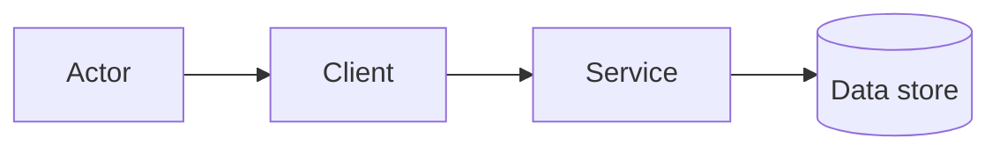

# Đặc tả tính năng — [FEATURE-ID] [Tên tính năng]

> Copy file này thành `product/features/[feature-id]-[ten-ngan].md`; không sửa
> trực tiếp template. Xóa hướng dẫn trong ngoặc vuông sau khi điền. Nếu một mục
> không áp dụng, ghi `N/A` kèm lý do thay vì để trống.

| Thuộc tính | Giá trị |
| --- | --- |
| Status | Draft / In review / Approved / Superseded |
| Feature ID | [FEAT-XXX] |
| Owner | [Người chịu trách nhiệm cập nhật tài liệu] |
| Author | [Người viết] |
| Reviewers | [PM] · [Technical Lead] · [UI/UX Lead] · [PO/QC] · [DRI liên quan] |
| Created | YYYY-MM-DD |
| Last updated | YYYY-MM-DD |
| Source of truth | Có — cho thiết kế và acceptance của feature này; không thay thế PRD hoặc Jira |
| PRD requirements | [Link tới requirement/section trong PRD] |
| Related user stories | [US-XXX] |
| Jira execution | [Epic/Story; Jira giữ assignee, sprint, deadline và trạng thái] |
| Related artifacts | [UI/UX] · [ADR/API/data contract] · [test/evaluation evidence] |

## Tóm tắt quyết định

- **Kết quả cần tạo ra:** [Một câu mô tả outcome, không mô tả task.]
- **Trong phạm vi:** [Các capability thuộc feature.]
- **Ngoài phạm vi:** [Những nội dung dễ bị hiểu nhầm là thuộc feature.]
- **Điều kiện chưa chốt:** [Open question/assumption và DRI cần quyết định.]

## 1. Động lực (Motivation)

### 1.1 Vấn đề cần giải quyết

[Mô tả vấn đề, workflow hiện tại và evidence. Không bắt đầu bằng giải pháp.]

### 1.2 Người dùng mục tiêu

- Persona/actor:
- Bối cảnh sử dụng:
- Nhu cầu hoặc job-to-be-done:
- Hạn chế về thiết bị, quyền, khả năng tiếp cận hoặc kỹ năng:

### 1.3 Mục tiêu kỳ vọng

[Link success metric trong PRD. Chỉ nêu cách feature đóng góp; không định nghĩa
lại metric hoặc priority tại đây.]

### 1.4 Phương án thay thế đã xem xét

| Phương án | Lợi ích | Hạn chế/chi phí | Lý do chọn hoặc loại |
| --- | --- | --- | --- |
| Không làm gì | | | |
| [Phương án A] | | | |
| [Phương án B] | | | |

## 2. Thiết kế (Design)

### 2.1 Luồng người dùng và acceptance criteria

#### Luồng chính

1. [Actor thực hiện hành động.]
2. [Hệ thống phản hồi.]
3. [Kết quả quan sát được.]

#### Traceability

| Requirement/User Story | Scenario | Acceptance criteria có thể kiểm thử | Evidence dự kiến |
| --- | --- | --- | --- |
| [PRD-REQ / US-XXX] | Given / When / Then | | Test / screenshot / log / evaluation |

#### Trạng thái bắt buộc

- [ ] Happy path.
- [ ] Loading/processing.
- [ ] Empty/no result.
- [ ] Invalid input.
- [ ] Source/service unavailable hoặc offline.
- [ ] Permission denied/consent missing.
- [ ] Conflict/duplicate/concurrent update.
- [ ] Partial failure, retry và recovery.
- [ ] Hành động không thể hoàn tác có preview/confirm phù hợp.

### 2.2 Kiến trúc hệ thống

- Thành phần bị ảnh hưởng:
- Luồng dữ liệu/control:
- Boundary và dependency:
- Quyết định kiến trúc liên quan: [Link ADR; không lặp lại rationale của ADR.]

### 2.3 Thiết kế giao diện (UI/UX)

- Design/wireframe:
- Entry point:
- Screen/state/component bị ảnh hưởng:
- Responsive/accessibility requirement:
- Nội dung hiển thị khi lỗi hoặc thiếu dữ liệu:

### 2.4 Thiết kế API

| Method/path/event | Mục đích | Input/contract | Output | Auth/quyền | Lỗi chính |
| --- | --- | --- | --- | --- | --- |
| | | | | | |

[Link OpenAPI/Postman/data contract canonical nếu có; không duy trì hai bản
schema độc lập.]

### 2.5 Mô hình dữ liệu

- Entity/bảng/field bị ảnh hưởng:
- Quan hệ và invariant:
- Migration/backfill:
- Retention/deletion:
- ER diagram/schema canonical:

### 2.6 Thiết kế AI/ML

[Ghi `N/A — không dùng AI/ML` nếu không áp dụng.]

- Task và expected behavior:
- Model/prompt/retrieval/version:
- Input, context và source provenance:
- Output schema/confidence:
- Golden set/evaluation metric và threshold:
- Abstain/fallback/human confirmation:
- Cost, latency và safety constraint:

### 2.7 Trường hợp đặc biệt và xử lý lỗi

| Tình huống | Hành vi mong đợi | Thông báo cho user | Retry/fallback | Telemetry |
| --- | --- | --- | --- | --- |
| | | | | |

### 2.8 Bảo mật và quyền riêng tư

- Dữ liệu nhạy cảm/PII:
- Consent và mục đích sử dụng:
- Authentication/authorization:
- Encryption/redaction/audit:
- Retention/export/delete/revoke:
- Abuse/threat case và mitigation:

### 2.9 Analytics và observability

| Event/signal | Khi nào ghi nhận | Thuộc tính tối thiểu | Mục đích | Không được thu thập |
| --- | --- | --- | --- | --- |
| | | | | |

## 3. Kế hoạch (Plan)

### 3.1 Các lát cắt triển khai

| Slice/outcome có thể demo | Jira Epic/Story | Điều kiện hoàn thành | Evidence |
| --- | --- | --- | --- |
| | | | |

> Không copy assignee, sprint, deadline hoặc trạng thái từ Jira vào bảng này.

### 3.2 Phụ thuộc

| Phụ thuộc | DRI | Cần trước khi | Trạng thái/link canonical |
| --- | --- | --- | --- |
| | | | |

### 3.3 Timeline dự kiến

- Jira plan/backlog: [Link]
- Milestone hoặc constraint cố định: [Chỉ ghi nếu là constraint sản phẩm/Gate,
  không sao chép lịch task.]

### 3.4 Kế hoạch kiểm thử

| Lớp kiểm thử | Phạm vi | Môi trường/fixture | Tiêu chí pass | Evidence |
| --- | --- | --- | --- | --- |
| Unit | | | | |
| Integration/contract | | | | |
| E2E/UX | | | | |
| Security/privacy | | | | |
| AI evaluation | | | | |

### 3.5 Kế hoạch triển khai và rollback

- Environment/release path:
- Feature flag/canary:
- Migration order:
- Monitoring sau release:
- Trigger rollback:
- Cách rollback/recover data:

### 3.6 Tiêu chí thành công và điều kiện đóng

- [ ] Acceptance criteria ở mục 2.1 có evidence đạt.
- [ ] Test/evaluation threshold đạt và được PO/QC xác nhận.
- [ ] Security/privacy review hoàn tất khi áp dụng.
- [ ] Analytics/monitoring cần thiết hoạt động.
- [ ] PRD metric hoặc giả thuyết liên quan có kế hoạch đo.
- [ ] Known limitation và follow-up đã được ghi nhận trong Jira/PRD phù hợp.

### 3.7 Rủi ro và cách giảm thiểu

| Rủi ro | Xác suất | Tác động | Tín hiệu cảnh báo | Cách giảm thiểu/rollback | DRI |
| --- | --- | --- | --- | --- | --- |
| | Low / Medium / High | Low / Medium / High | | | |

## 4. Review và phê duyệt

- [ ] PM xác nhận feature không vượt scope/priority trong PRD.
- [ ] Technical Lead xác nhận kiến trúc, dependency và rollout khả thi.
- [ ] UI/UX Lead xác nhận flow và các trạng thái giao diện.
- [ ] PO/QC xác nhận acceptance criteria có thể kiểm thử.
- [ ] Link PRD, User Story, Jira, design và test evidence hoạt động.
- [ ] Không có secret, PII hoặc raw transcript trong tài liệu.

| Vai trò | Người review | Kết quả | Ngày | Ghi chú/link decision |
| --- | --- | --- | --- | --- |
| PM | | Approve / Changes requested | | |
| Technical Lead | | Approve / Changes requested | | |
| UI/UX Lead | | Approve / Changes requested | | |
| PO/QC | | Approve / Changes requested | | |
