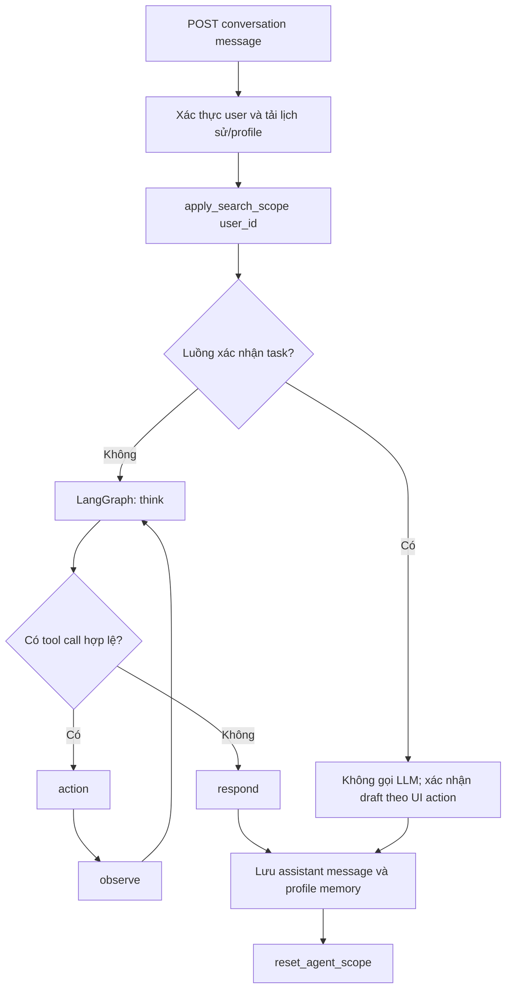
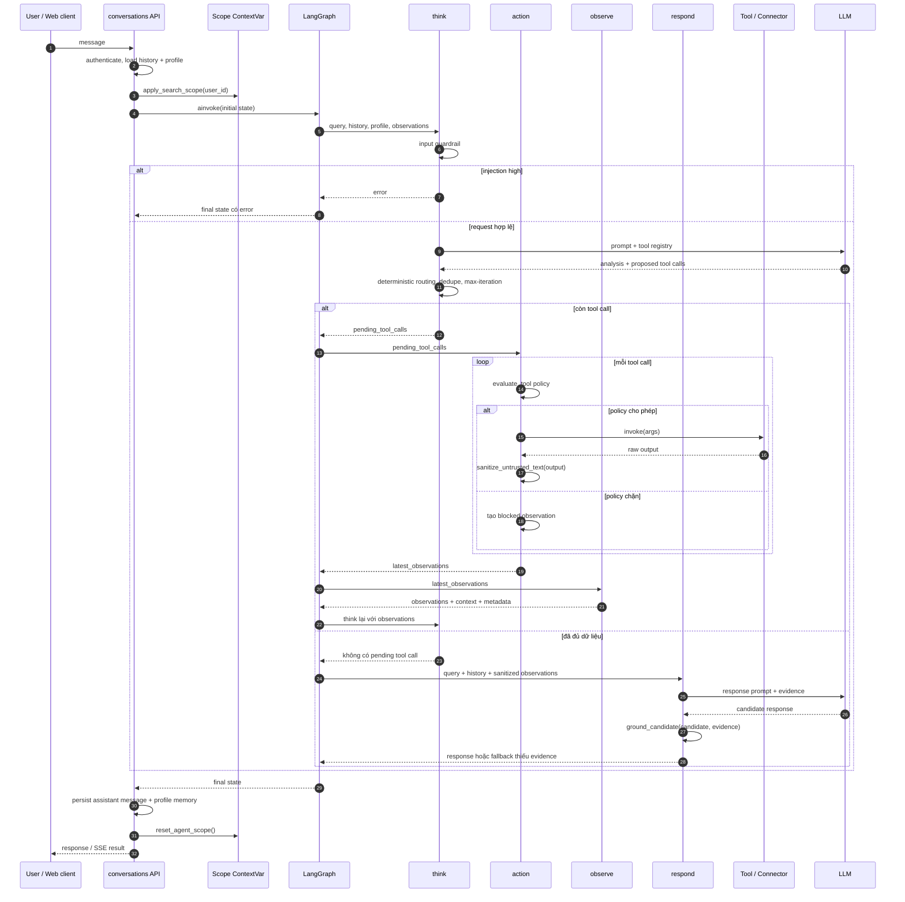
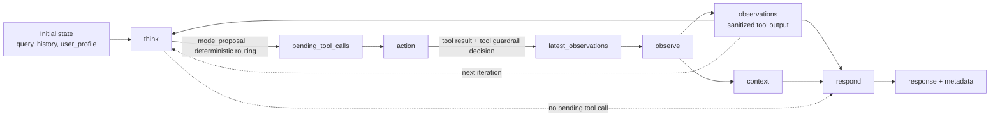
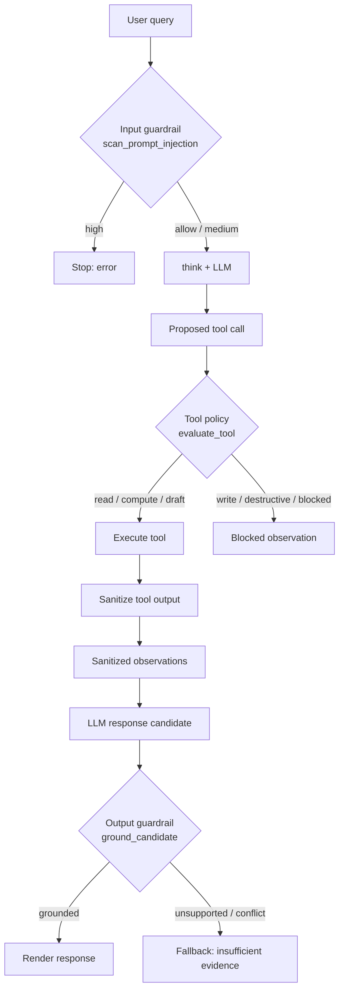
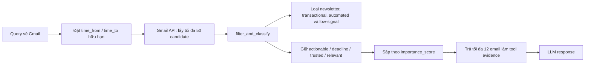

# Luồng agent hội thoại hiện tại

Tài liệu này mô tả agent hội thoại đang chạy trong production, không phải
pipeline ingest Gmail/Calendar ở `src/agents/pipeline/`.

## Thành phần chính

| Thành phần | Vai trò |
| --- | --- |
| `src/api/conversations.py` | Xác thực request, lưu lịch sử, đặt user scope, gọi/stream agent và lưu response. |
| `src/agents/graph.py` | Định nghĩa LangGraph với bốn node `think`, `action`, `observe`, `respond`. |
| `src/agents/nodes/core_nodes.py` | Routing, tool selection, guardrail, thực thi tool và tổng hợp câu trả lời. |
| `src/services/scope.py` | Gắn ContextVar scope cho Tasks, Gmail, Calendar và Discord theo user đã xác thực. |
| `src/services/agent_stream.py` | Chuyển event nội bộ thành SSE `progress`, `token`, `result`. |

## Luồng request



## Sơ đồ chi tiết một lượt hỏi có dùng tool



## Sơ đồ dữ liệu giữa các node



Đường nét đứt từ `observations` về `think` là điểm quan trọng: agent không
chạy một batch tool rồi trả lời ngay. Sau mỗi action, nó quan sát kết quả và
quyết định có cần một tool khác hay không.

## Guardrail nằm ở đâu?



Guardrail không thay thế authorization: ownership và permission vẫn nằm ở API,
database query và ContextVar scope của từng tool. Nó là lớp kiểm soát bổ sung
trước LLM, trước executor và trước khi render câu trả lời.

Endpoint thường gọi `agent.ainvoke(...)`; endpoint stream gọi
`stream_agent_execution(...)`. Cả hai truyền cùng state ban đầu:

```python
{
    "query": cau_hoi,
    "history": [{"role": "user|assistant", "content": "..."}],
    "user_profile": {"display_name": "..."},
}
```

`apply_search_scope` phải chạy trước agent. Model không nhận `user_id` trong
tool schema: tool đọc scope từ `ContextVar`, nên không thể đổi sang dữ liệu của
người dùng khác bằng arguments do model sinh ra.

## State và vòng lặp LangGraph

`AgentState` giữ `query`, `history`, `user_profile`, `pending_tool_calls`,
`observations`, `context`, `analysis`, `response`, `metadata` và `error`.

Đồ thị thực thi là:

```text
think ── pending_tool_calls ──> action -> observe -> think
  └── không có tool call ───────────────────────────> respond -> END
  └── error ────────────────────────────────────────> END
```

Agent giới hạn tối đa bốn vòng tool. Tool call đã có observation cùng chữ ký
`name + args` được loại để tránh lặp vô ích.

### 1. `think`

Node này kiểm tra query rỗng và input guardrail trước. Query có prompt injection
mức `high` bị dừng trước khi LLM được gọi.

Với small talk khi LLM routing được bật, agent dùng lane small-talk và không
bind tool. Các query còn lại dùng work lane, bind registry tool rồi để model đề
xuất tool call. Sau đó các guard deterministic có thể chỉnh lại tool call để
không phụ thuộc hoàn toàn vào model:

- Query Calendar được bổ sung `calendar_search_events` với cửa sổ thời gian
  hữu hạn.
- Query Gmail được bổ sung `gmail_search_emails` với cửa sổ hữu hạn.
- Query Discord ngôi thứ nhất đổi sang tool chỉ đọc dữ liệu tác giả hiện tại.
- Daily overview và next-step tự bổ sung các nguồn cần thiết.
- Query web rõ ràng chỉ gọi web tool khi tính năng được bật.

### 2. `action`

Node chỉ thực thi tool nằm trong registry hiện tại. Trước mỗi lần chạy,
`evaluate_tool` phân loại impact và quyết định policy:

- Read/compute được chạy trực tiếp.
- `draft_task` chỉ được tạo bản nháp `proposed`; không ghi Calendar.
- Tool external-write, destructive hoặc tool không được policy cho phép không
  được thực thi tự động.

Mỗi output tool được chuyển thành chuỗi và `sanitize_untrusted_text` trước khi
đưa vào state. Vì vậy một email, Discord message hoặc Calendar description có
nội dung kiểu prompt injection chỉ là evidence không đáng tin, không thành lệnh
cho model.

### 3. `observe`

Kết quả mới được nối vào `observations`; `context` là phần hiển thị các tool
output đã quan sát. Metadata lưu danh sách tool đã dùng, số vòng tool và quyết
định guardrail của từng tool. Vòng `think` tiếp theo nhận observations này để
quyết định cần tìm thêm hay đã đủ thông tin.

### 4. `respond`

Node response chỉ nhận tool observations làm tư liệu mới; `analysis` của node
think không phải evidence. Nó gọi LLM work-response, sau đó dùng
`ground_candidate` kiểm tra lexical support giữa response và toàn bộ tool
evidence hiện có. Khi không đủ support, agent không render câu trả lời suy diễn
và thay bằng thông báo chưa đủ bằng chứng.

Small talk không có tool observation nên trả về response từ lane small-talk.

## Registry tool hiện tại

| Nhóm | Tool | Giới hạn quan trọng |
| --- | --- | --- |
| Tính toán/thời gian | `calculate`, `current_datetime`, `relative_time` | Không có side effect. |
| Discord | `discord_search_program`, `discord_search_my_messages`, `discord_get_my_activity` | Scope Discord hiện tại; query ngôi thứ nhất bị author-lock. |
| Tasks | `list_tasks`, `draft_task` | Scope theo user; draft luôn là `proposed`. |
| Calendar | `calendar_search_events` | Chỉ đọc; bắt buộc `time_from` và `time_to`; không crawl vô hạn. |
| Gmail | `gmail_search_emails`, `gmail_read_email` | Search chỉ trả email đã qua classifier deterministic; chỉ đọc inbox của user hiện tại. |
| Web | `web_search` | Chỉ xuất hiện khi feature được bật. |

Agent không expose tool tạo, sửa, xoá Google Calendar hay gửi/chỉnh email.
Calendar write chỉ xảy ra trong luồng UI xác nhận task và sync riêng; xem
[`calendar-pipeline.md`](calendar-pipeline.md).

### Luồng Gmail trước khi vào context agent



Classifier chạy ngay trong `src/services/gmail_tools.py`, nên luồng agent không
đưa email bị đánh giá `low_importance` vào LLM. Pipeline sync cũng có filter
riêng cho extraction/task; hai đường dùng cùng `filter_and_classify`, nhưng
agent không phụ thuộc vào việc một run sync đã chạy trước đó.

Để xem output Gmail của ngày hiện tại cho một user cụ thể, chạy:

```powershell
python scripts/fetch_today_gmail.py --user-id <authenticated-user-id>
```

Thêm `--include-text` nếu cần xem preview body; mặc định script chỉ in metadata,
score và lý do classifier giữ email.

## SSE contract

Khi dùng endpoint stream, client chỉ thấy event semantic:

| Event | Ý nghĩa |
| --- | --- |
| `progress` | Một phase `thinking`, `calling`, `observing` hoặc `responding`; tool name chỉ được trả ở phase tool. |
| `token` | Chỉ token của câu trả lời user-visible; planning token không được stream. |
| `result` | State cuối của graph để API lưu response. |

Prompt, arguments, observations và reasoning nội bộ không được đưa vào SSE.

## Các giới hạn hiện tại

- Grounding response hiện dùng lexical overlap, chưa phải claim/NLI verifier.
- `metadata.guardrail` có trong final state để trace, nhưng API conversation
  hiện chưa persist metadata này như một audit record độc lập.
- Khi guardrail block input, graph trả `error`; API conversation đổi lỗi này
  thành HTTP 502. Đây là hành vi hiện tại, không phải status security chuyên
  biệt.

## File và test liên quan

- Graph: `src/agents/graph.py`
- Nodes: `src/agents/nodes/core_nodes.py`
- Scope: `src/services/scope.py`
- Stream adapter: `src/services/agent_stream.py`
- Tests: `tests/test_agents/test_graph.py`, `tests/test_services/test_agent_stream.py`
