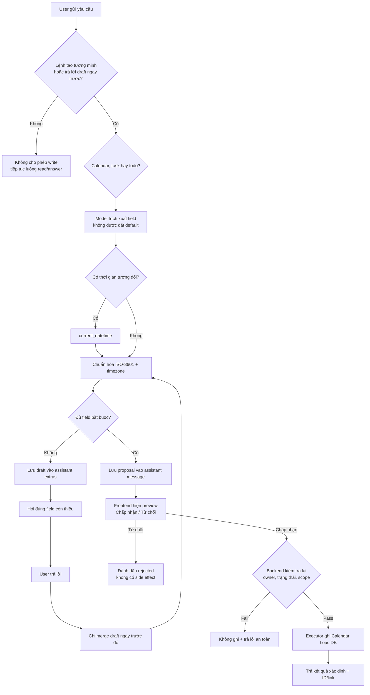

# Agent productivity actions

| Thuộc tính | Giá trị |
| --- | --- |
| Status | Implemented |
| Last updated | 2026-08-11 |
| Tool | `create_productivity_item` |
| Types | `calendar_event`, `task`, `todo` |

## Luồng hội thoại



## Contract trường bắt buộc

| Loại | Bắt buộc | Không được suy đoán |
| --- | --- | --- |
| `calendar_event` | `title`, `starts_at`, một trong `ends_at` / `duration_minutes` | Giờ bắt đầu, giờ kết thúc, thời lượng |
| `task` | `title`, `deadline` | Deadline |
| `todo` | `title`, `deadline` | Deadline |

Nếu model gọi tool nhưng bỏ trống `title`, backend được phép tách title từ
chính từ ngữ user đã nói sau khi bỏ command và mốc thời gian. Fallback này
không được thêm từ mới và vẫn phải qua provenance. Mốc tương đối chưa có giờ
cụ thể (ví dụ `tối nay`, `ngày mai`) không được đổi thành một giờ mặc định;
draft giữ phần đã hiểu và hỏi tự nhiên đúng giờ/thời lượng còn thiếu.

Thời gian đưa vào executor phải là ISO-8601 có timezone. Với “tối nay”, “ngày
mai”… graph bắt buộc quan sát `current_datetime` ở một vòng riêng trước khi cho
phép write tool chạy.

## Ví dụ

```text
User: Tối nay tôi có workshop lúc 8h, hãy thêm vào lịch cho tôi.
Agent: Workshop kéo dài bao lâu hoặc kết thúc lúc mấy giờ?
User: Khoảng 2 tiếng.
Agent: [Hiện preview Workshop 20:00–22:00 với nút Chấp nhận / Từ chối]
User: Chấp nhận.
Agent: Đã thêm “Workshop” vào Google Calendar từ 20:00 đến 22:00.
```

```text
User: Tạo todo nộp báo cáo cho tôi.
Agent: Deadline của Nộp báo cáo là khi nào?
User: Ngày mai lúc 17h.
Agent: [Hiện preview todo với nút Chấp nhận / Từ chối]
User: Chấp nhận.
Agent: Đã tạo todo “Nộp báo cáo” với deadline ngày mai lúc 17h.
```

## Ranh giới an toàn

- `user_id` và request ID do API đặt, model không được truyền.
- Tool từ chối nếu model tự gọi trong một câu chỉ đọc.
- Tool chỉ dựng proposal. Side effect chỉ chạy qua endpoint approve khi user
  bấm **Chấp nhận** trên frontend; payload thực thi được đọc từ message phía
  server, client không được gửi lại field tùy ý.
- Proposal được ký HMAC bằng `APP_SECRET_KEY`; endpoint approve từ chối draft
  bị sửa hoặc action giả được chèn qua client.
- Chỉ draft của assistant message ngay trước đó được tiếp tục; draft cũ không
  tự sống lại trong conversation.
- Draft chỉ lưu field đã chuẩn hóa và cờ provenance từng field, không sao chép
  thêm raw prompt vào metadata.
- Calendar event dùng client-generated ID từ request ID. Retry cùng lượt đọc
  lại event đã có thay vì tạo bản sao.
- Google connection phải có `calendar.events`; token chỉ đọc trả lỗi reconnect.
- Luồng này chỉ tạo mới. Update/delete, recurrence và attendee invitations chưa
  được phép.
- Gửi email chưa thuộc tool này. Email action tiếp tục ở chế độ draft-only cho
  tới khi có executor và approval contract riêng.
