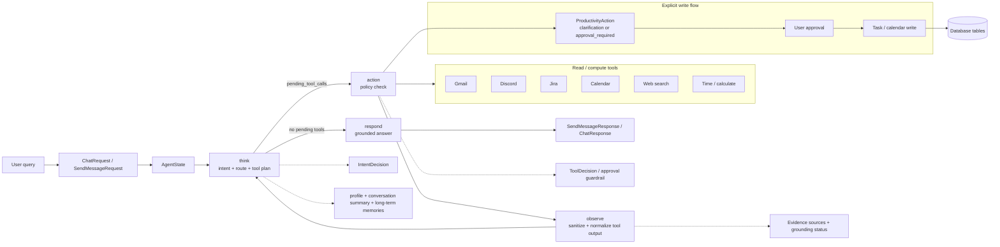
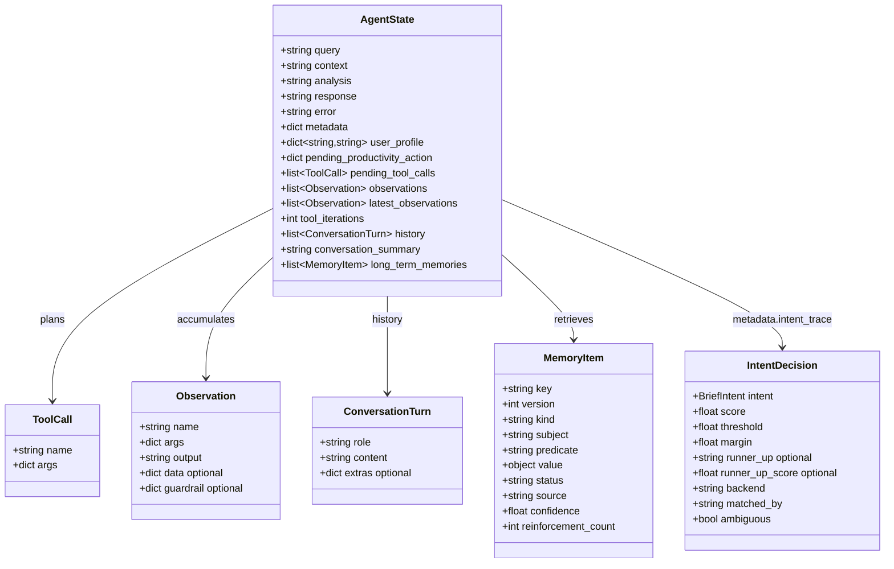
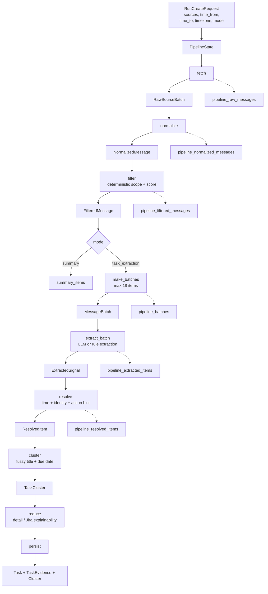
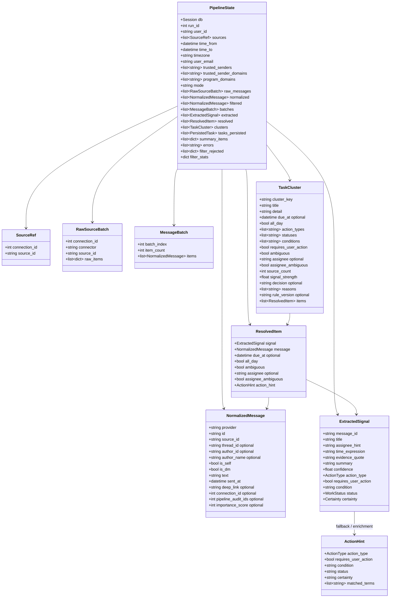
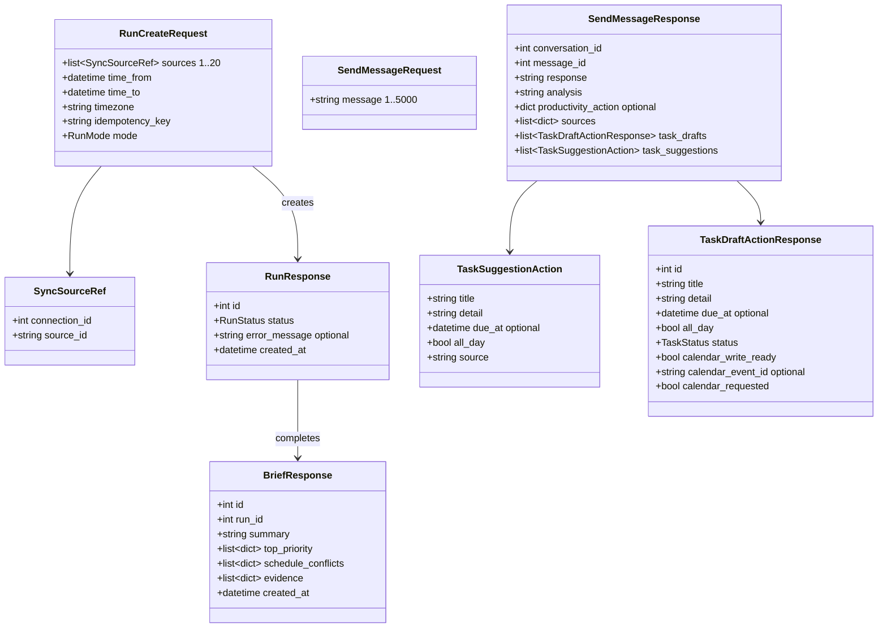
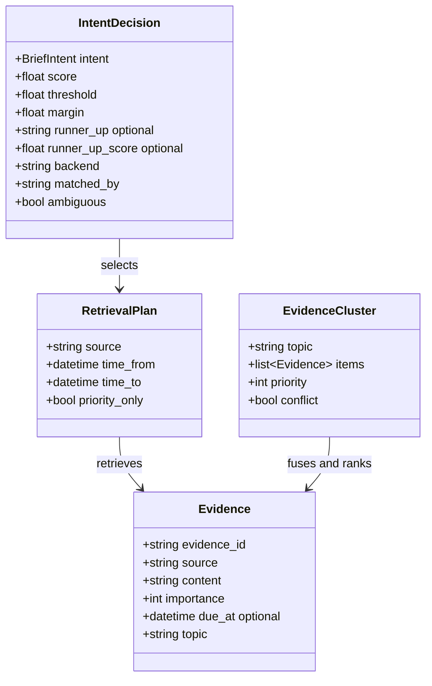

# Database schema architecture

> Snapshot được suy ra từ `src/models/*.py` và các cột bổ sung trong
> `src/db.py::ensure_runtime_schema()`. Schema runtime tạo bảng bằng
> `Base.metadata.create_all()`; `src/database.sql` chỉ là snapshot cũ để tham
> khảo. `PK`, `FK`, `NULL` và kiểu dữ liệu được ghi ngay trên từng field.

## Mermaid ER diagram

```mermaid
erDiagram
    users {
        int id PK
        varchar_255 email UK
        varchar_255 password_hash NULL
        varchar_120 display_name
        varchar_2048 avatar_url NULL
        varchar_16 role
        varchar_1 program_access_level
        boolean is_active
        datetime created_at
        datetime last_synced_at NULL
        boolean auto_sync_enabled
        varchar_10 llm_quota_day NULL
        int llm_questions_used
        int llm_bonus_questions
    }
    connections {
        int id PK
        varchar_128 user_id
        varchar_32 provider
        varchar_255 account_label NULL
        varchar_128 provider_user_id NULL
        varchar_255 external_site_id NULL
        text access_token_encrypted NULL
        text refresh_token_encrypted NULL
        varchar_512 scopes NULL
        datetime expires_at NULL
        datetime connected_at
        varchar_32 status
        boolean initial_sync_completed
        datetime last_synced_at NULL
        int email_count
        varchar_1024 last_error NULL
    }
    sync_cursors {
        int id PK
        varchar_128 user_id
        varchar_128 key
        varchar_255 value
        datetime updated_at
    }
    conversations {
        int id PK
        varchar_128 user_id
        varchar_255 title
        text summary
        int summary_through_message_id NULL
        datetime created_at
        datetime updated_at
    }
    conversation_messages {
        int id PK
        int conversation_id FK
        varchar_16 role
        text content
        text analysis NULL
        json extras NULL
        varchar_16 feedback NULL
        datetime created_at
    }
    push_subscriptions {
        int id PK
        varchar_128 user_id
        varchar_512 endpoint UK
        varchar_255 p256dh
        varchar_255 auth
        varchar_255 user_agent NULL
        datetime created_at
        datetime last_used_at NULL
        varchar_64 last_error_class NULL
    }
    app_ratings {
        int id PK
        varchar_128 user_id
        int rating
        text feedback NULL
        varchar_32 trigger
        varchar_128 session_id NULL
        int meaningful_action_count
        int session_duration_seconds
        datetime created_at
    }

    source_scopes {
        int id PK
        varchar_32 provider
        varchar_64 external_id
        varchar_255 name NULL
        varchar_64 parent_external_id NULL
        varchar_64 guild_external_id NULL
        int kind NULL
        boolean is_thread
        varchar_1 tier
    }
    source_scope_access {
        int id PK
        varchar_128 user_id
        int scope_id FK
        varchar_16 status
        varchar_128 granted_by NULL
        datetime granted_at
        datetime valid_to NULL
    }
    source_items {
        int id PK
        varchar_32 provider
        varchar_64 external_id
        int scope_id FK
        varchar_64 author_external_id NULL
        varchar_255 author_name NULL
        json author_roles NULL
        text content
        int item_type NULL
        varchar_64 reply_to_external_id NULL
        int attachment_count
        varchar_512 deep_link NULL
        varchar_64 content_hash
        datetime source_updated_at
        datetime observed_at
        varchar_32 run_id
        datetime created_at
    }
    source_item_versions {
        int id PK
        int item_id FK
        varchar_64 content_hash
        text content
        datetime source_updated_at
        datetime first_observed_at
        datetime last_observed_at
    }
    chunks {
        int id PK
        varchar_32 run_id
        varchar_64 chunk_key
        int scope_id FK
        varchar_16 mode
        varchar_64 group_key
        text text
        int message_count
        int char_count
        json author_ids NULL
        json author_roles NULL
        datetime first_timestamp
        datetime last_timestamp
        varchar_512 deep_link NULL
        vector_2048 embedding NULL
        datetime created_at
    }
    chunk_items {
        bigint id PK
        int chunk_id FK
        int item_id FK
        int position
    }

    messages {
        int id PK
        varchar_128 user_id
        int connection_id FK NULL
        varchar_32 provider
        varchar_128 source_id
        varchar_255 external_id
        varchar_255 thread_id NULL
        varchar_128 author_id NULL
        varchar_255 author_name NULL
        boolean is_self
        boolean is_dm
        text text
        datetime sent_at
        varchar_1024 deep_link NULL
        datetime ingested_at
    }
    tasks {
        int id PK
        varchar_128 user_id
        varchar_64 cluster_key
        varchar_500 title
        text detail
        datetime due_at NULL
        boolean all_day
        boolean ambiguous
        varchar_255 assignee NULL
        boolean assignee_ambiguous
        varchar_32 status
        int source_count
        float signal_strength
        varchar_255 calendar_event_id NULL
        varchar_16 decision NULL
        json reasons
        varchar_32 rule_version NULL
        int reminder_dismiss_count
        datetime created_at
        datetime updated_at
    }
    clusters {
        int id PK
        varchar_128 user_id
        varchar_64 cluster_key
        float signal_strength
        datetime due_at NULL
        boolean ambiguous
        int task_id FK NULL
        datetime created_at
    }
    cluster_messages {
        int cluster_id PK, FK
        int message_id PK, FK
    }
    task_evidence {
        int id PK
        int task_id FK
        int message_id FK NULL
        varchar_32 provider
        text evidence_quote
        varchar_1024 deep_link
    }
    calendar_handoffs {
        int id PK
        int task_id FK
        boolean opened
        datetime opened_at NULL
        datetime created_at
    }
    reminders {
        int id PK
        int task_id FK NULL
        int related_task_id FK NULL
        varchar_128 user_id
        varchar_32 kind
        varchar_32 milestone
        json payload
        datetime scheduled_at
        varchar_16 status
        int snooze_count
        varchar_32 dismiss_reason NULL
        datetime created_at
        datetime updated_at
    }
    notification_deliveries {
        int id PK
        int reminder_id FK
        varchar_128 user_id
        datetime delivered_at
    }
    channel_notification_deliveries {
        int id PK
        varchar_32 channel
        int reminder_id FK
        varchar_128 user_id
        varchar_128 provider_message_id NULL
        datetime delivered_at
    }
    notification_preferences {
        int id PK
        varchar_128 user_id
        varchar_64 timezone
        int quiet_hours_start
        int quiet_hours_end
        int hourly_cap
        int batch_window_minutes
        int daily_brief_hour NULL
        varchar_10 daily_brief_last_date NULL
        datetime created_at
        datetime updated_at
    }

    users ||--o{ runs : owns
    users ||--o{ user_memories : owns
    users ||--o{ user_profile_memories : owns
    conversations ||--o{ conversation_messages : contains
    conversations ||--o{ user_memories : source
    conversations ||--o{ user_profile_memories : source
    connections ||--o{ messages : ingests
    source_scopes ||--o{ source_scope_access : grants
    source_scopes ||--o{ source_items : contains
    source_scopes ||--o{ chunks : groups
    source_items ||--o{ source_item_versions : versions
    source_items ||--o{ chunk_items : indexed_in
    chunks ||--o{ chunk_items : contains
    tasks ||--o{ clusters : resolves
    tasks ||--o{ task_evidence : supported_by
    messages ||--o{ task_evidence : evidence
    clusters ||--o{ cluster_messages : contains
    messages ||--o{ cluster_messages : grouped
    tasks ||--o{ calendar_handoffs : handoff
    tasks ||--o{ reminders : schedules
    reminders ||--o{ notification_deliveries : delivered
    reminders ||--o{ channel_notification_deliveries : delivered_on

    runs ||--o{ briefs : produces
    runs ||--o{ run_node_events : emits
    runs ||--o{ pipeline_raw_messages : audits
    runs ||--o{ pipeline_normalized_messages : audits
    runs ||--o{ pipeline_filtered_messages : audits
    runs ||--o{ pipeline_batches : batches
    runs ||--o{ pipeline_extracted_items : extracts
    runs ||--o{ pipeline_resolved_items : resolves
    pipeline_raw_messages ||--o{ pipeline_normalized_messages : normalizes
    pipeline_normalized_messages ||--o{ pipeline_filtered_messages : filters
    pipeline_batches ||--o{ pipeline_filtered_messages : groups
    pipeline_batches ||--o{ pipeline_extracted_items : groups
    pipeline_extracted_items ||--o{ pipeline_resolved_items : resolves

    program_events ||--o{ program_calendar_syncs : synced_to
    tasks ||--o{ schedule_conflicts : conflicts
    user_memories ||--o{ user_memory_evidence : supported_by
    user_memories ||--o{ user_memories : supersedes
    meeting_notes ||--o{ meeting_action_items : contains
    program_events ||--o{ program_calendar_syncs : calendar_sync
```

## Pipeline, calendar, memory và operational tables

Các entity dưới đây cũng nằm trong sơ đồ trên; phần này bổ sung đầy đủ các
field của những entity ít liên quan đến luồng core.

```mermaid
erDiagram
    runs {
        int id PK
        int user_id FK
        json sources
        datetime range_from
        datetime range_to
        varchar_128 idempotency_key
        varchar_64 timezone
        varchar_32 mode
        varchar_16 status
        int attempts
        datetime claimed_at NULL
        varchar_1024 error_message NULL
        datetime created_at
    }
    briefs {
        int id PK
        int run_id FK
        int user_id FK
        text summary
        json top_priority
        json schedule_conflicts
        json evidence
        datetime created_at
    }
    run_node_events {
        int id PK
        int run_id FK
        varchar_32 node
        varchar_16 status
        int count NULL
        text message NULL
        datetime at
    }
    pipeline_raw_messages {
        int id PK
        int run_id FK
        int connection_id FK NULL
        varchar_32 provider
        varchar_128 source_id
        varchar_255 external_id
        text raw_json
        datetime fetched_at
    }
    pipeline_normalized_messages {
        int id PK
        int run_id FK
        int raw_message_id FK NULL
        varchar_32 provider
        varchar_128 source_id
        varchar_255 external_id
        varchar_255 thread_id NULL
        varchar_128 author_id NULL
        varchar_255 author_name NULL
        boolean is_self
        boolean is_dm
        text text
        datetime sent_at
        varchar_1024 deep_link NULL
        datetime normalized_at
    }
    pipeline_filtered_messages {
        int id PK
        int run_id FK
        int normalized_message_id FK NULL
        int batch_id FK NULL
        int score
        datetime filtered_at
    }
    pipeline_batches {
        int id PK
        int run_id FK
        int batch_index
        int item_count
        datetime created_at
    }
    pipeline_extracted_items {
        int id PK
        int run_id FK
        int batch_id FK NULL
        int filtered_message_id FK NULL
        varchar_500 title
        varchar_255 assignee_hint NULL
        varchar_500 time_expression NULL
        text evidence_quote
        float confidence
        datetime extracted_at
    }
    pipeline_resolved_items {
        int id PK
        int run_id FK
        int extracted_item_id FK NULL
        datetime due_at NULL
        boolean all_day
        boolean ambiguous
        varchar_255 assignee NULL
        boolean assignee_ambiguous
        datetime resolved_at
    }
    calendar_events {
        int id PK
        varchar_128 user_id
        varchar_512 calendar_id
        varchar_255 event_id
        varchar_500 title
        text description
        datetime starts_at
        datetime ends_at NULL
        boolean all_day
        varchar_16 status
        varchar_1024 deep_link NULL
        datetime source_updated_at NULL
        json payload
        datetime synced_at
        datetime created_at
        datetime updated_at
    }
    calendar_operations {
        int id PK
        varchar_128 user_id
        varchar_512 calendar_id
        varchar_255 event_id
        varchar_16 op
        json before
        json after
        datetime undone_at NULL
        datetime expires_at
        datetime created_at
    }
    schedule_conflicts {
        int id PK
        varchar_128 user_id
        varchar_64 conflict_key
        varchar_16 conflict_type
        int task_id FK
        varchar_512 calendar_id
        varchar_255 event_id
        datetime task_starts_at
        datetime event_starts_at
        int overlap_minutes
        json event_snapshot
        varchar_24 suggestion
        json suggestion_reasons
        varchar_16 status
        varchar_24 resolution NULL
        text resolution_note
        datetime resolved_at NULL
        datetime detected_at
        datetime updated_at
    }
    program_events {
        int id PK
        varchar_64 cohort_slug
        varchar_191 external_id
        varchar_32 event_type
        varchar_16 visibility
        text title
        text description
        varchar_255 host NULL
        varchar_512 location_url NULL
        datetime starts_at
        datetime ends_at NULL
        varchar_64 content_hash
        datetime source_updated_at NULL
        datetime observed_at
        datetime created_at
        varchar_16 origin
        varchar_16 status
        json locked_fields NULL
        json feed_payload NULL
        boolean source_conflict
        varchar_64 updated_by NULL
        datetime updated_at NULL
        datetime published_at NULL
    }
    program_calendar_syncs {
        int id PK
        varchar_64 user_id
        int program_event_id FK
        varchar_512 calendar_id
        varchar_512 event_id
        varchar_64 approved_content_hash
        varchar_24 status
        datetime approved_at
        datetime updated_at
        int reapproved_count
    }
```

```mermaid
erDiagram
    meeting_notes {
        int id PK
        varchar_128 user_id
        varchar_255 title
        text notes
        text transcript
        varchar_32 status
        text summary
        text decisions
        datetime started_at
        datetime ended_at NULL
        datetime created_at
        datetime updated_at
    }
    meeting_action_items {
        int id PK
        int meeting_note_id FK
        varchar_500 title
        text detail
        varchar_255 assignee NULL
        boolean assignee_ambiguous
        varchar_255 time_expression
        datetime due_at NULL
        boolean all_day
        boolean ambiguous
        text evidence_quote
        varchar_32 status
        int task_id NULL
        datetime created_at
    }
    user_memories {
        int id PK
        varchar_64 memory_key
        int version
        int user_id FK
        varchar_32 kind
        varchar_255 subject
        varchar_64 predicate
        json object_json
        text search_text
        vector_2048 embedding NULL
        varchar_128 embedding_model NULL
        varchar_16 status
        float confidence
        float importance
        varchar_16 source_authority
        varchar_16 created_by
        datetime valid_from
        datetime valid_to NULL
        datetime first_observed_at
        datetime last_reinforced_at
        int reinforcement_count
        int negative_feedback_count
        int supersedes_id FK NULL
        varchar_32 extractor_version
        int source_conversation_id FK NULL
        datetime created_at
        datetime updated_at
    }
    user_memory_evidence {
        int id PK
        int memory_id FK
        varchar_32 evidence_type
        varchar_128 evidence_ref
        datetime created_at
    }
    user_profile_memories {
        int id PK
        int user_id FK
        varchar_32 key
        text value
        int source_conversation_id FK NULL
        datetime created_at
        datetime updated_at
    }
    recording_quota_slots {
        int id PK
        varchar_128 user_id
        date usage_date
        int note_id
        int offset_ms
        int duration_ms
        datetime created_at
    }
    reminders {
        int id PK
        int task_id FK NULL
        int related_task_id FK NULL
        varchar_128 user_id
        varchar_32 kind
        varchar_32 milestone
        json payload
        datetime scheduled_at
        varchar_16 status
        int snooze_count
        varchar_32 dismiss_reason NULL
        datetime created_at
        datetime updated_at
    }
    notification_preferences {
        int id PK
        varchar_128 user_id
        varchar_64 timezone
        int quiet_hours_start
        int quiet_hours_end
        int hourly_cap
        int batch_window_minutes
        int daily_brief_hour NULL
        varchar_10 daily_brief_last_date NULL
        datetime created_at
        datetime updated_at
    }
    notification_deliveries {
        int id PK
        int reminder_id FK
        varchar_128 user_id
        datetime delivered_at
    }
    channel_notification_deliveries {
        int id PK
        varchar_32 channel
        int reminder_id FK
        varchar_128 user_id
        varchar_128 provider_message_id NULL
        datetime delivered_at
    }
    channel_update_receipts {
        int id PK
        varchar_32 channel
        varchar_128 external_update_id
        datetime received_at
    }
    telegram_link_intents {
        int id PK
        varchar_64 token_hash UK
        varchar_128 user_id
        datetime expires_at
        datetime used_at NULL
        datetime created_at
    }
    worker_heartbeats {
        int id PK
        varchar_64 loop UK
        datetime last_tick_at
        datetime last_success_at NULL
        bigint tick_count
        bigint error_count
        bigint processed_count
        varchar_128 last_error_class NULL
        datetime updated_at
    }
    telemetry_events {
        int id PK
        varchar_48 name
        varchar_36 trace_id
        varchar_16 surface
        varchar_128 user_id NULL
        json attributes NULL
        int duration_ms NULL
        datetime created_at
    }
    audit_events {
        int id PK
        varchar_48 action
        varchar_48 object_type
        varchar_64 object_id
        varchar_16 actor_type
        varchar_128 actor_id NULL
        varchar_36 trace_id
        varchar_64 version_label NULL
        json details NULL
        datetime created_at
    }
```

## Ghi chú về cardinality và schema hiện hành

- Các FK thực tế được lấy từ `ForeignKey(...)`; quan hệ qua `user_id` dạng
  `VARCHAR` (ví dụ `connections`, `tasks`, `messages`, `conversations`) là
  liên kết logic với identity bên ngoài hoặc legacy identity, không phải FK
  tới `users.id`.
- `runs.user_id`, `briefs.user_id`, `user_memories.user_id` và
  `user_profile_memories.user_id` là `INTEGER` và có FK tới `users.id`.
- PostgreSQL cần các extension `vector`, `unaccent`, `pg_trgm`; `chunks.embedding`
  và `user_memories.embedding` dùng `VECTOR(2048)`. Full-text search runtime
  thêm generated column `chunks.fts` kiểu `tsvector` và các GIN index; cột này
  không nằm trong SQLAlchemy model nên không biểu diễn như entity field ở trên.
- Một số cột được thêm/migrate lúc startup: connection sync state, task
  explainability, conversation summary, program-event admin fields và FTS.
- Unique constraints/indexes quan trọng gồm: provider/external identity của
  source tables, `(user_id, cluster_key)` của tasks, `(user_id, key)` của sync
  cursors, `(user_id, idempotency_key)` của runs, và các unique key cho
  reminders/calendar/program sync.

---

## AI system data schemas

Phần này mô tả các object chạy trong memory/state của agent, không phải bảng
database. Nguồn chính là `src/agents/state.py`,
`src/agents/pipeline/state.py`, `src/agents/pipeline/schemas.py`, các node
pipeline và `src/models/schemas.py`.

### 1. AI orchestration architecture



### 2. Interactive agent state and contracts



`AgentState` là state nội bộ của LangGraph và có `total=False`, vì vậy các
field xuất hiện dần qua từng node. `pending_tool_calls` chỉ được tạo ở
`think`; `action` chỉ chạy tool có trong registry và vượt qua policy; `observe`
đưa output đã sanitize trở lại state; `respond` là điểm kết thúc.

### 3. Task-extraction pipeline schemas





### 4. AI-facing request/response schemas



### 5. Semantic briefing và evidence schemas



Intent hiện có: `small_talk`, `daily_brief`, `next_steps`, `schedule`,
`gmail_focus`, `task_status`, `explicit_action`, `general_work`. Action
understanding hiện có: `direct_action`, `commitment`, `conditional_action`,
`waiting`, `prohibition`; work status: `open`, `waiting`, `blocked`,
`cancelled`, `completed`.

### 6. Boundary và safety invariants

- Tool output là untrusted data: được serialize, sanitize rồi mới đưa lại vào
  `Observation`, prompt vòng kế tiếp hoặc `respond`.
- `analysis` là quyết định điều phối nội bộ, không phải evidence; evidence
  hợp lệ đến từ `Observation.data`, `sources`, memory đã được API scope theo
  user và dữ liệu connector.
- Agent có thể tạo `TaskSuggestionAction` hoặc `TaskDraftActionResponse`, nhưng
  side effect ghi task/calendar phải đi qua approval/policy flow.
- Pipeline task extraction có hai nhánh: `summary` dừng sau filter; chỉ
  `task_extraction` chạy extract → resolve → cluster → reduce → persist.
- `ExtractedSignal.evidence_quote` phải là trích dẫn nguyên văn; `summary` là
  phần diễn giải. `confidence` nằm trong `[0, 1]`.
- Time resolution không được tự biến một `time_expression` mơ hồ thành ngày
  chắc chắn: khi không resolve được thì `ambiguous=true`.
- Identity resolution giữ `assignee_ambiguous=true` nếu không đủ căn cứ; không
  tự đoán người nhận việc từ tên gần giống.
