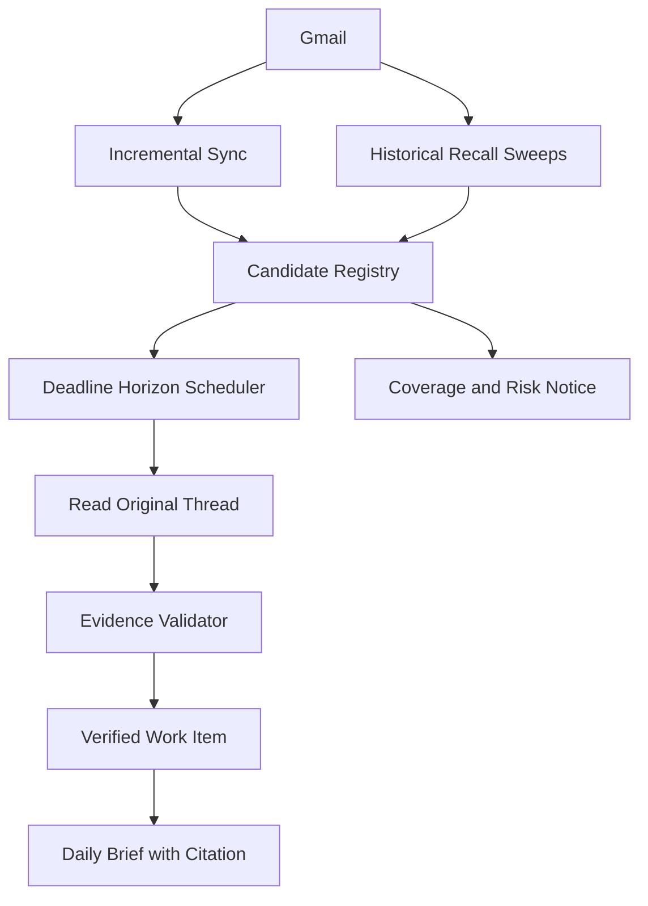

# Gmail Deadline-Safe Architecture v2 — mondAIy

| Thuộc tính | Giá trị |
|---|---|
| Trạng thái | Đề xuất cải tiến sau review kiến trúc clue-driven |
| Phạm vi | Gmail connector chỉ đọc; phát hiện việc, cam kết và hạn chót |
| Mục tiêu | Giảm tối đa deadline lịch sử bị bỏ sót mà không xây bản sao Gmail |
| Nguyên tắc nguồn | Gmail là bằng chứng gốc; PostgreSQL là canonical evidence/memory store |
| Múi giờ mặc định | `Asia/Ho_Chi_Minh` |

> Tài liệu này không hứa “không bao giờ miss” ngoài phạm vi dữ liệu mà hệ thống
> đã truy cập được. Nó định nghĩa cách đạt mức an toàn có thể kiểm chứng: không
> mất dữ liệu sau khi đồng bộ, phát hiện lịch sử theo nhiều đường độc lập, và
> không nói “không có việc” khi coverage chưa đủ.

## 1. Vấn đề cần giải quyết

Một email gửi ngày 05/05 có thể yêu cầu nộp vào cuối tháng 08. Nếu chỉ đọc email
mới, hệ thống bỏ sót. Nếu lưu toàn bộ Gmail hoặc embedding mọi email, hệ thống
trở thành bản sao mailbox và phình không giới hạn.

Vì vậy cần tách ba thứ:

```text
Gmail message/thread     = bằng chứng gốc
Retrieval clue           = dấu vết nhỏ để biết cần đọc thread nào
Verified work item       = việc/deadline đã được xác minh bằng bằng chứng
```

Clue chỉ dùng để định tuyến. Không được trình bày clue như sự thật.

## 2. Quyết định kiến trúc

### 2.1. Không dùng một lần quét duy nhất

Historical discovery gồm nhiều lớp bổ sung nhau:

1. **Incremental sync:** xử lý email mới hoặc thay đổi từ checkpoint.
2. **High-recall candidate sweep:** quét lịch sử theo các nhóm tín hiệu rộng.
3. **Temporal sweep:** tìm các email có biểu thức thời gian, không phụ thuộc từ `deadline`.
4. **Relationship sweep:** kiểm tra thread có yêu cầu hành động, phản hồi hai chiều hoặc người gửi quan trọng.
5. **Reconciliation sweep:** đối chiếu vùng Gmail đã quét với checkpoint, query receipt và số lượng kết quả.

Một deadline chỉ được coi là an toàn khi đã qua các lớp kiểm tra phù hợp, không
phụ thuộc vào một classifier hoặc một query.

### 2.2. Không lưu toàn bộ email trong index

Lưu bền vững chỉ gồm:

- `message_id`, `thread_id`, `history_id` và link mở lại;
- metadata tối thiểu: thời điểm, người gửi, người nhận, subject, label;
- tín hiệu phát hiện: `action_signal`, `temporal_signal`, `importance_signal`;
- khoảng thời gian có thể liên quan: `earliest_possible_at`, `latest_possible_at`;
- `next_check_at`, trạng thái, lý do và phiên bản detector;
- hash metadata/nội dung đã xử lý để chống trùng.

Không lưu dài hạn toàn bộ body, embedding hoặc email FYI. Nội dung gốc chỉ được
đọc qua Gmail tool khi cần xác minh và được lưu theo chính sách retention đã công bố.

## 3. Luồng tổng thể



## 4. Các trạng thái dữ liệu

### 4.1. `candidate_clue`

Một dấu vết có khả năng liên quan, chưa phải task.

```json
{
  "id": "clue_123",
  "source": "gmail",
  "message_id": "msg_123",
  "thread_id": "thread_456",
  "received_at": "2026-05-05T09:00:00+07:00",
  "signals": ["action", "future_time", "important_sender"],
  "earliest_possible_at": "2026-05-05",
  "latest_possible_at": "2026-08-31",
  "next_check_at": "2026-08-20",
  "state": "unverified",
  "detector_version": "gmail-recall-v2",
  "expires_at": "2026-09-15"
}
```

### 4.2. `verified_work_item`

Chỉ tạo sau khi đọc bằng chứng gốc và trích dẫn được đoạn liên quan.

```json
{
  "title": "Chỉnh sửa và gửi lại báo cáo",
  "owner": "me",
  "due_at": "2026-08-31T23:59:00+07:00",
  "due_precision": "date_only",
  "status": "open",
  "evidence_id": "ev_789",
  "citation": {"thread_id": "thread_456", "message_id": "msg_123"},
  "verified_at": "2026-08-20T10:00:00+07:00"
}
```

Nếu chưa có đủ ngày, giờ hoặc múi giờ, giữ nguyên câu chữ và để trường chuẩn
hóa là `unknown`; không tự điền.

## 5. Historical Recall Sweeps

### 5.1. Candidate sweep ưu tiên recall

Các nhóm truy vấn được chạy độc lập và hợp nhất bằng `message_id/thread_id`:

| Nhóm | Mục tiêu | Ví dụ tín hiệu |
|---|---|---|
| Direct-to-user | Email có khả năng giao việc cho user | `to:me`, `cc:me`, thread có reply của user |
| Action language | Câu yêu cầu dù không nói deadline | gửi, sửa, nộp, hoàn thành, xem lại, xác nhận |
| Temporal language | Deadline diễn đạt tự nhiên | cuối tháng, tuần sau, tháng tới, trước kỳ nghỉ |
| Important relationship | Nguồn có trọng số cao | mentor, manager, giảng viên, khách hàng |
| Active thread | Việc chưa có dấu hiệu hoàn tất | thread mới cập nhật, có trao đổi hai chiều |
| Subject/domain | Phạm vi khóa học hoặc dự án | report, assignment, project, review |

Không dùng `deadline` làm điều kiện bắt buộc. Query không có kết quả không được
coi là bằng chứng “không có task”.

### 5.2. Temporal backstop

Định kỳ, hệ thống chạy sweep theo các biểu thức thời gian và khoảng ngày, kể cả
khi candidate classifier không gắn clue trước đó. Với mỗi vùng thời gian:

```text
today - historical_window → today + future_horizon
```

`future_horizon` phải đủ dài cho use case khóa học, ví dụ 180 ngày trong pilot.
Các email có tháng/ngày tương lai được giữ clue tới sau `latest_possible_at` cộng
grace period.

### 5.3. Recall ledger

Mỗi sweep ghi một `scan_receipt` bất biến:

```json
{
  "query_family": "temporal_language",
  "time_range": {"from": "2026-05-01", "to": "2026-08-31"},
  "started_at": "...",
  "completed_at": "...",
  "pages_read": 12,
  "message_count": 842,
  "deduplicated_threads": 516,
  "checkpoint": "...",
  "status": "complete"
}
```

Nếu một page lỗi, quota hết hoặc history token hết hạn, receipt là `partial`,
không được ghi `complete`.

## 6. Deadline Horizon Scheduler

Đây là lớp chống miss quan trọng nhất sau candidate discovery.

Mỗi ngày scheduler chọn:

- clue có `next_check_at <= now`;
- clue có `latest_possible_at` trong 30 ngày tới;
- clue có temporal signal nhưng chưa xác minh;
- clue từ nguồn quan trọng chưa có trạng thái hoàn tất;
- verified item đã quá lâu chưa được kiểm tra hoặc có thread mới.

Lịch kiểm tra tăng dần theo rủi ro:

```text
unverified + far away       → kiểm tra định kỳ 7 ngày
unverified + within 30 days → kiểm tra mỗi ngày
within 72 hours             → đọc thread và xác minh ngay
overdue/ambiguous           → đưa vào review queue, không tự kết luận
```

Scheduler không xóa clue chỉ vì chưa tìm thấy deadline. Chỉ đóng clue khi:

- thread có bằng chứng hoàn tất/hủy;
- đã qua `latest_possible_at + grace_period`;
- hoặc người dùng xác nhận không liên quan.

## 7. Incremental sync và reconciliation

### 7.1. Checkpoint an toàn

Worker chỉ cập nhật checkpoint sau khi toàn bộ page đã được ghi idempotent vào
evidence/clue store. Nếu worker chết giữa chừng, chạy lại từ checkpoint cũ.

Khóa chống trùng tối thiểu:

```text
source + account_id + message_id + content_hash
```

### 7.2. Khi Gmail history không còn hợp lệ

Nếu Gmail trả lỗi history token đã hết hạn:

1. Đánh dấu coverage là `unknown/partial`.
2. Không tiếp tục từ checkpoint không đáng tin.
3. Chạy lại incremental recovery theo cửa sổ thời gian an toàn.
4. Chạy reconciliation sweep để bù khoảng trống.
5. Chỉ nâng coverage sau khi receipt xác nhận thành công.

### 7.3. Định kỳ đối chiếu

Reconciliation kiểm tra:

- có gap giữa các checkpoint không;
- query family nào chưa chạy trong horizon yêu cầu;
- số page đã đọc có khớp receipt không;
- clue quan trọng có bị hết hạn trước deadline tiềm năng không;
- thread đã thay đổi nhưng verified item chưa được re-verify không.

## 8. Query người dùng không truy vấn Gmail trực tiếp

Với câu hỏi “Hôm nay tôi cần làm gì?”:

```text
User query
  → Intent resolver
  → Verified work items + due horizon
  → Candidate clues cần kiểm tra gấp
  → Gmail read tool có giới hạn
  → Evidence validation
  → Brief 4 phần + citations + coverage
```

Không biến câu hỏi thành một Gmail keyword query duy nhất. Nếu Active Work State
chưa đủ, hệ thống gọi các clue rủi ro cao và hiển thị giới hạn coverage.

## 9. Evidence Gateway và quy tắc LLM

LLM không được tự gọi Gmail tùy ý. Mọi đọc sâu đi qua Evidence Gateway:

```text
Allowed: get_thread(message_id/thread_id), get_message(message_id)
Denied: search toàn mailbox không có time range, write/delete/send, đọc cookie
```

Gateway bắt buộc:

- kiểm tra user/account/permission;
- giới hạn số thread và dung lượng nội dung mỗi lượt;
- ghi audit log query, tool result, model và phiên bản parser;
- trả về `source_not_available` khi không đọc được;
- không cho LLM biến suy luận thành evidence.

LLM chỉ được tạo `verified_work_item` nếu có:

1. đoạn bằng chứng nguyên văn;
2. `message_id/thread_id` mở lại được;
3. owner/status/deadline được đánh dấu `explicit`, `inferred` hoặc `unknown`;
4. confidence vượt ngưỡng nội bộ hoặc được đưa vào review queue.

## 10. Coverage contract

Coverage phải được tính theo vùng và query family, không chỉ một cờ boolean.

```json
{
  "overall": "partial",
  "gmail": {
    "incremental_since": "2026-08-01T00:00:00+07:00",
    "historical_window": {"from": "2026-05-01", "to": "2026-08-12"},
    "sweeps": {
      "direct_to_user": "complete",
      "action_language": "complete",
      "temporal_language": "partial",
      "reconciliation": "not_started"
    },
    "risk_notice": "Có thể còn deadline lịch sử chưa được xác minh."
  }
}
```

Daily Brief không được hiển thị “Không có việc” nếu:

- có sweep bắt buộc đang `partial` hoặc `failed`;
- có clue rủi ro cao quá hạn kiểm tra;
- incremental sync có gap;
- nguồn Gmail bị mất quyền hoặc lỗi.

Thay vào đó hiển thị: “Chưa phát hiện thêm trong phạm vi đã kiểm tra” và nêu rõ
phần chưa kiểm tra.

## 11. Bốn phần Daily Brief và citation

Bản tóm lược phải trả về đúng bốn phần nghiệp vụ:

1. Việc đã hoàn thành.
2. Việc chưa hoàn thành.
3. Deadline có nguy cơ.
4. Thứ tự ưu tiên nên làm.

Mỗi item trỏ theo chuỗi:

```text
work_item → evidence_id → message_id/thread_id → Gmail URL
```

Phần “Deadline có nguy cơ” bao gồm cả deadline đã xác minh và clue chưa xác minh
nhưng có rủi ro cao; hai loại phải được gắn nhãn khác nhau.

## 12. Bảo toàn dữ liệu và vòng đời

| Dữ liệu | Lưu | Vòng đời |
|---|---|---|
| Evidence gốc | Nội dung cần citation, theo retention đã công bố | Có thể xóa theo consent/retention |
| Candidate clue | ID, metadata, tín hiệu, lịch kiểm tra | Tới `latest_possible_at + grace_period` |
| Verified work item | Trạng thái hiện tại và citation | Tới khi đóng + thời gian lưu lịch sử |
| Scan receipt/audit | Checkpoint, lỗi, query family, actor | Theo audit policy |

Không xóa clue còn liên quan chỉ để giảm kích thước index. Dùng TTL có điều kiện,
archive và compact phiên bản cũ; không compact bằng cách mất provenance.

## 13. Tiêu chí nghiệm thu

### Bắt buộc bằng test

| Tiêu chí | Mục tiêu |
|---|---:|
| Email đã đồng bộ thành công bị mất sau restart | 0 |
| Bản ghi trùng sau retry | 0 |
| Work item chính thức không có evidence mở lại được | 0 |
| Deadline trong bộ test thuộc vùng sweep hoàn tất bị bỏ sót | 0 |
| Clue bị xóa trước `latest_possible_at + grace_period` | 0 |
| Coverage `complete` khi receipt còn lỗi/gap | 0 |
| Daily Brief nói “không có việc” khi coverage chưa đủ | 0 |
| Hành động ghi ra ngoài trước confirm | 0 |

### Bộ test tối thiểu

- Email tháng 5, deadline cuối tháng 8, không dùng từ “deadline”.
- Email chỉ nói “gửi lại sau khi sửa”, deadline nằm trong thread reply.
- Deadline thay đổi từ 31/08 thành 25/08.
- Thread có người khác được giao, không phải user.
- Email đã hoàn thành nhưng reply mới mở lại công việc.
- Gmail history token hết hạn giữa batch.
- Query temporal có một page lỗi.
- Hai sweep phát hiện cùng một thread.
- Deadline mơ hồ “cuối tháng”, “sau kỳ nghỉ”.
- Không có deadline nhưng có yêu cầu hành động.

## 14. Giới hạn và cách nói chính xác

Kiến trúc này không thể chứng minh mọi nội dung trong mailbox đã được hiểu đúng
nếu Gmail không cho truy cập hoặc historical scan chưa hoàn tất. Cam kết phù hợp
cho sản phẩm là:

> mondAIy không làm mất deadline trong dữ liệu đã đồng bộ thành công; đối với
> Gmail lịch sử, hệ thống dùng nhiều lớp phát hiện, lịch kiểm tra theo horizon,
> reconciliation và cảnh báo coverage để giảm miss và không che giấu phần chưa
> được xác minh.

Đây là cam kết có thể kiểm thử và phù hợp với nguyên tắc của PRD: không có nguồn
thì không khẳng định, bằng chứng gốc không bị ghi đè, đồng bộ tăng dần,
idempotent và mọi câu trả lời đều có citation.

## 15. Lộ trình triển khai P0

1. **P0-A:** Gmail incremental sync, checkpoint, idempotency, evidence receipt.
2. **P0-B:** Candidate Registry và temporal/action recall sweeps.
3. **P0-C:** Deadline Horizon Scheduler và clue lifecycle.
4. **P0-D:** Evidence Gateway, citation và coverage contract.
5. **P0-E:** Reconciliation worker, test suite và Daily Brief 4 phần.

Chỉ bật trạng thái “coverage complete” sau khi P0-A đến P0-D có test pass; P0-E
là điều kiện để tuyên bố hệ thống có khả năng vận hành an toàn trong pilot.
